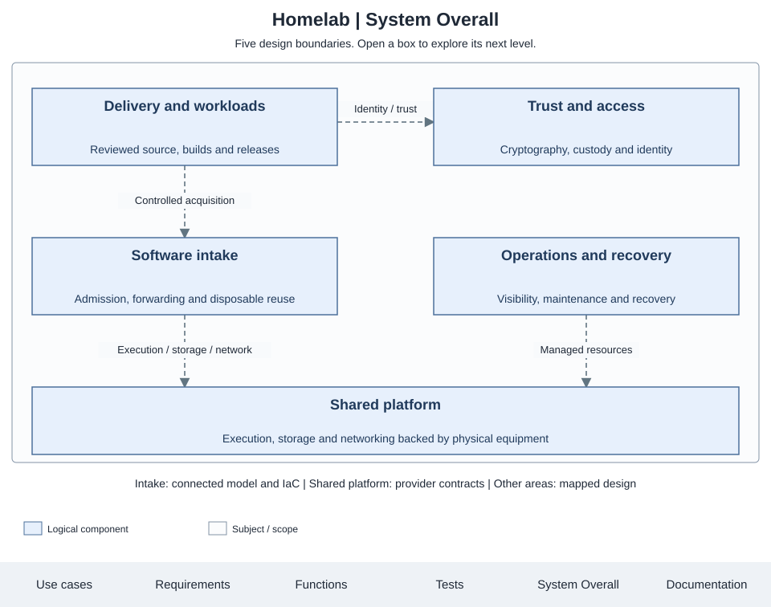

# Connected architecture

Start with [System Overall](design/README.md), then open a subsystem and descend to its more focused
designs. Use cases explain intended use; functions, realization and tests stay connected to that design.
Software intake is the first capability traced end to end. Other areas remain mapped to existing owners.

For a focused actor goal, open [Clone a Git repository on boot-1](views/platform/hosting/clone-repository.svg).
Select Software intake to follow the supporting service to its own design.

For the software-intake example, [follow one request in familiar terms](../docs/01-architecture/07-software-intake/03-http-walkthrough.md),
then [compare the model with real software](../docs/01-architecture/07-software-intake/06-implementation-comparison.md).

[](views/system-overall.svg)

Open [system use cases](views/use-cases.svg), [requirements](views/requirements.svg) or
[functions](views/functions.svg) directly. The [software intake design](views/software-intake/logical.svg)
has its own focused concern views and [verification cases](views/software-intake/tests.svg).

Open the SVG directly in a browser to move between views. Use its **Documentation** link for
supporting text. Use [Change impact](views/software-intake/asset-impact.svg) to start from a file or test.
[Inspect engineering relationships](views/software-intake/engineering.svg) or
[review the MBSE working method](../docs/01-architecture/07-software-intake/04-mbse-review.md).
[Run and inspect HTTP retrieval](views/software-intake/execution.svg).
[Follow one HTTP scenario](../docs/01-architecture/07-software-intake/03-http-walkthrough.md).

*Logical responsibility view: open [Design](design/README.md) for linked subsystem boxes and folder
navigation. Dashed arrows are selected design dependencies, not traffic or installation order.*

| Concern | Software intake entry |
| --- | --- |
| Use Cases | [System goals](use-cases/README.md); [actors and retrieval scenarios](use-cases/software-intake/README.md) |
| Requirements | [Few functional and quality guardrails](requirements/README.md) |
| Functions | [Responsibilities, inputs, outputs and behavior](functions/software-intake/README.md) |
| Design | [System Overall](design/README.md) → [Software intake](design/software-intake/README.md): logical contracts, realization and resource dependencies; [shared platform boundary](design/platform/README.md) |
| Test | [Scenario acceptance, executable checks and evidence](test/software-intake/README.md) |

The [connected resource view](views/software-intake/resource-dependencies.svg) follows the intake
design through shared virtualization, storage and network providers to physical backing. Design is
organized by subsystem ownership; logical, deployment and resource diagrams are views of that design.

The engineering concerns own the authored sources. Shared notation, layout, implementation traces and
generated views support them. Existing IaC, application code and executable tests keep their owners.

```text
architecture/
  use-cases/software-intake/       Goal, scenarios and compilation manifest
  requirements/functional/        Essential observable capability obligations
  requirements/non-functional/    Integrity, custody and egress constraints
  functions/software-intake/       Function contracts and HTTP/HTTPS behavior
  design/                         Level 0: System Overall and native system boundary
    software-intake/               Level 1: connected intake design
      policy-proxy/                Level 2: reusable proxy definition and contracts
      object-cache/                Level 2: reusable cache definition and contracts
    platform/                      Level 1: shared provider boundary
      hosting/                     Level 2: mapped execution and equipment owner
      networking/                  Level 2: mapped network and attachment owner
      data/                        Level 2: mapped storage owner
    trust-and-access/              Level 1: mapped cryptography and identity
    delivery/                      Level 1: mapped delivery and workloads
    operations/                    Level 1: mapped operations and recovery
  test/software-intake/            Acceptance criteria and evidence entry
  views/                          Shared catalogue, notation and generated SVGs
    software-intake/               Same owner depth as Design
      policy-proxy/                Context, contract and change impact
      object-cache/                Cache context and concern views
    platform/                      Platform overview and owner views
      hosting/                     Hosting views
      networking/                  Networking views
      data/                        Data views
  trace/                          Checked model-to-code/IaC/test ownership
  generated/software-intake/       Reproducible model projections; do not edit
```

Design folder depth follows composition: each README opens the design at its level, and child folders
focus further. Shared providers remain beside their consumers under the common owner, with dependency
links across folders. The [coverage map](../docs/01-architecture/model-map.md) records modeled versus mapped
areas. This is a repository convention, not a SysML-mandated tree. Intake has detailed native coverage;
System Overall adds connected boundary references. Sources compile as one `SoftwareIntake` package using
stable identities, with `SystemDesign::homelab` as the root design part.
Browse all [styled SVG views](views/README.md), including pages within the linked SVG books.
The matching SysON `Views` hierarchy consumes the same catalogue. Git holds the accepted semantic baseline;
[native rendering coverage](test/syson-view-coverage.md) records matches and explicit gaps.
Follow the [model development workflow](../docs/04-development/model-change-workflow.md) to reconcile
proposed SysON edits, implementation changes and requirement evidence. Requirement/use-case return import
is available with explicit scope and conflict checks; combined execution verdicts remain planned.
See [build and change instructions](../docs/01-architecture/07-software-intake/02-connected-model.md)
and [publish review snapshots to SysON](../docs/04-development/syson.md).
Copied `docs/auto-docs/architecture/` bundles are read-only upstream references; selected site models
and operating records belong outside auto-docs and survive refresh.
