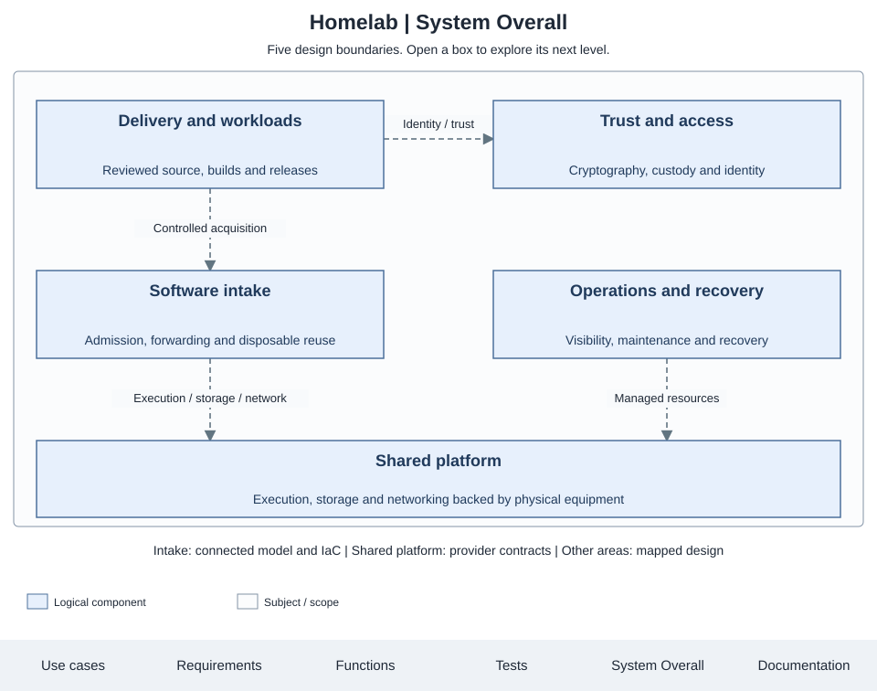

# Homelab architecture

Open the SVG to follow software intake from Logical design to Solution design, use cases, functions
and tests. Each view uses the same native identities. The other areas remain mapped to their existing
owners; their folders do not claim detailed modeled implementation.

## Read and edit the model

`models/` owns the SysML sources; `generated/` contains the portable diagrams and matrices.
Both follow the same subject hierarchy. View remains a modeling concept, not a file ownership category.

`models/` contains authored native `.sysml`, normally 1–5 files per owner. Their `doc` annotations
explain intent and assumptions. Descending folders focuses the design; shared providers retain their
own home. Generated SVG diagrams and Markdown matrices live under `generated/`, following the same owner hierarchy.
Aim for 1–5 view files per owner too. Software intake has Logical design, Use cases (including their
scenarios), Functions (including focused detail), Requirements, and Verification. Solution and analysis
detail stays in its owning child folder. Source, comparison and reverse-trace reports are supporting
assets, not another diagram inventory.

| Start | Native source | Portable view |
| --- | --- | --- |
| System Overall | [HomelabSystemDesign.sysml](models/HomelabSystemDesign.sysml) | [Overall](generated/HomelabSystemOverview.svg) |
| Software intake | [SoftwareIntakeLogicalDesign.sysml](models/software-intake/SoftwareIntakeLogicalDesign.sysml) | [Logical design](generated/software-intake/SoftwareIntakeLogicalDesign.svg) |
| Selected solution | [SoftwareIntakeSolutionDesign.sysml](models/software-intake/solution/SoftwareIntakeSolutionDesign.sysml) | [Solution design](generated/software-intake/solution/SoftwareIntakeSolutionDesign.svg) |
| Human-led use | [Hosting.sysml](models/platform/hosting/Hosting.sysml) | [Clone a repository on boot-1](generated/platform/hosting/Boot1CloneRepository.svg) |
| Retrieval behavior | [SoftwareIntakeBehavior.sysml](models/software-intake/SoftwareIntakeBehavior.sysml) | [Scenarios](generated/software-intake/SoftwareIntakeUseCases.svg) |
| Verification intent | [SoftwareIntakeVerification.sysml](models/software-intake/SoftwareIntakeVerification.sysml) | [Tests](generated/software-intake/SoftwareIntakeVerification.md) |

Use PascalCase names with the subject and concern where needed, and the `.sysml`, `.svg` or generated `.md` extension.
Keep stable model/view identities when renaming a file. Folder names remain descriptive kebab-case.

## Guardrails

<!-- BEGIN MODEL GUARDRAILS -->
| Guardrail | Subject | Native acceptance constraint | Verification intent |
| --- | --- | --- | --- |
| `REQ-custody` | DisposableCache | The disposable cache shall keep the effects of losing its rebuildable data isolated from the independently retained recovery supply. | [VC-custody](views/software-intake/SoftwareIntakeVerification.md#REQ-custody) |
| `REQ-egress` | UpdateClient | The update client shall be unable to retrieve external software through a path that bypasses the independently enforced egress policy. | [VC-egress](views/software-intake/SoftwareIntakeVerification.md#REQ-egress) |
| `REQ-integrity` | UpdateClient | The update client shall accept retrieved software for use only after the applicable source and publisher authenticity checks succeed, retaining end-to-end source TLS through CONNECT for HTTPS. | [VC-http-cache-untrusted, VC-http-untrusted, VC-integrity](views/software-intake/SoftwareIntakeVerification.md#REQ-integrity) |
| `REQ-policy` | PolicyProxy | The policy proxy shall deny external retrieval requests that fail the accepted client, destination or port policy. | [VC-http-denied, VC-http-hit, VC-http-miss, VC-http-source-failure, VC-https, VC-https-denied](views/software-intake/SoftwareIntakeVerification.md#REQ-policy) |
<!-- END MODEL GUARDRAILS -->

The [requirements matrix](generated/software-intake/SoftwareIntakeRequirements.md) connects obligations,
recorded design satisfaction assertions and checks. The [verification matrix](generated/software-intake/SoftwareIntakeVerification.md)
lists method, setup/action, pass criteria and evidence status. Both are generated from native SysML.
An assertion of satisfaction is not a passed verification result.

The table above is generated from native constraints and verification intent. It does not declare passed
tests; client integrity, independent custody and network enforcement retain their actual owners.
Use cases and activities explain goals and behavior without requiring an extra requirement for every step.

## Build and verify

Follow the [build/change guide](../docs/01-architecture/07-software-intake/02-connected-model.md).
Native SysML v2 validation, implementation checks and current evidence are separate completion gates.
[Verification records](../docs/01-architecture/07-software-intake/verification.md) retain gaps and scope.
Git owns the native sources; SysON is optional. Ordinary operating guides remain under `docs/`.

Tool settings/layouts are under `scripts/architecture/config`; generated indexes/reports and retained
evidence are under `artifacts/architecture`. These support validation and browsing, not a second
authored model. Update native sources and relevant implementation, rebuild, and inspect the actual
clicked route. Model parsing or simulation alone does not establish live operation.
