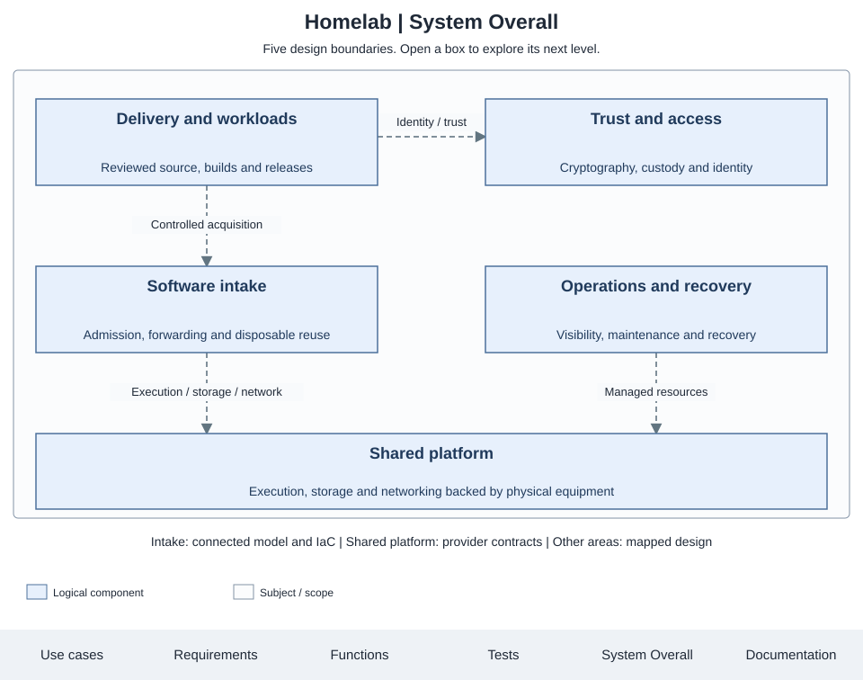

# System Overall

The homelab supplies controlled software acquisition, shared execution resources, trust and access,
delivery, and operations. Start with these five design boundaries, then open a subsystem's overview.

[](../views/system-overall.svg)

*Figure: Model-derived logical responsibility view. Dashed arrows are selected design dependencies,
not request traffic or deployment order. Click a box in the standalone SVG, or use the matching links
below. Software intake is connected to its implementation; the other areas retain mapped coverage.*

| Main design / level 1 | Responsibility and next detail | Coverage |
| --- | --- | --- |
| [Software intake](software-intake/README.md) | Admission, forwarding and rebuildable reuse; descend into policy proxy and object cache | Native roles, behavior, IaC and checks |
| [Shared platform](platform/README.md) | Execution, network and storage services backed by equipment | Native provider boundary; hosting/network/data detail mapped |
| [Trust and access](trust-and-access/README.md) | Cryptographic trust, custody and identity/access | Mapped to existing design owners |
| [Delivery and workloads](delivery/README.md) | Reviewed source, builds, approved artifacts and scoped releases | Mapped to existing design owner |
| [Operations and recovery](operations/README.md) | Observation, protected evidence, maintenance and independent recovery | Mapped to existing design owner |

## Navigate by design depth

This folder is level 0. Its child folders are level 1 designs; their child folders hold the next
focused design. The SVG is the visual overview at its level; README.md is its supporting entry document. Up returns to the containing design; sideways
links follow shared dependencies. A provider stays under its own owner even when several designs use it.

```text
design/
  README.md                       System Overall — level 0
  system.sysml                    Native system boundary and selected relationships
  software-intake/                Level 1 — connected design
    policy-proxy/                 Level 2 — admission, forwarding and reuse policy
    object-cache/                 Level 2 — disposable object storage
  platform/                       Level 1 — shared resource provider boundary
    hosting/                      Level 2 — mapped execution and hardware owner
    networking/                   Level 2 — mapped attachments, transports and equipment
    data/                         Level 2 — mapped storage and persistence owner
  trust-and-access/                Level 1 — mapped cryptography and identity
  delivery/                       Level 1 — mapped delivery and workloads
  operations/                     Level 1 — mapped operations and recovery
```

Logical, deployment and resource views stay with the design they explain. Use Cases, Requirements,
Functions and Test remain sibling engineering concerns reached through the [architecture entry](../README.md).
The [coverage map](../../docs/01-architecture/model-map.md) locates the existing chapters.

## Model and implementation connection

[system.sysml](system.sysml) owns the root `SYS-homelab`. Native reference bindings connect its intake
roles to `L-Proxy` and `L-Cache`, and its platform reference to `P-context`; they reuse the existing parts.
The [view selection](../views/system-overall.json) supplies layout and overview links. The build checks
root coverage, native dependencies, reference bindings and navigation targets before generating the SVG.
The other three subsystem boundaries map documented responsibilities; they have no detailed native
behavior or implementation-conformance claim yet. These are design scopes, not live resource inventory.

The [intake build](../../docs/01-architecture/07-software-intake/02-connected-model.md) compiles the root,
shared contracts and intake together. `SoftwareIntake` remains the compilation package name; the system
root is `SystemDesign::homelab`. Selected dependencies reach the existing IaC through intake's allocations.
Keep exact hardware identities and placement in the selected site's design and evidence.

<!-- BEGIN DESIGN CONTEXT -->
## Connected views

[Use cases](../views/use-cases.svg) · [Requirements](../views/requirements.svg) · [Functions](../views/functions.svg) · [Tests](../views/software-intake/tests.svg).

Native concerns below cover the modeled intake slice within the overall system. Other subsystem intent, constraints and evidence remain mapped to their existing owners.
<!-- END DESIGN CONTEXT -->
