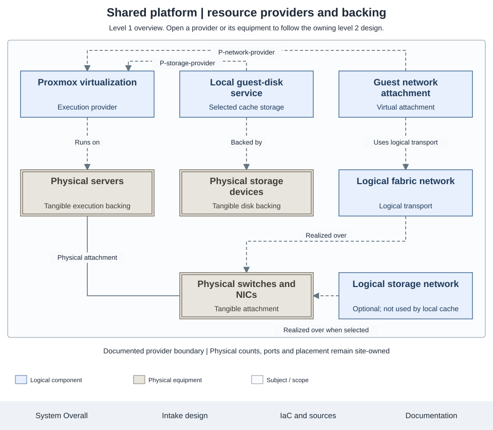

# Shared platform overview

[Up: System Overall](../README.md) · Level 1 · `SYS-platform` references `P-context`

*Native provider boundary: execution, guest storage and networking map to tangible equipment.
Dashed arrows describe dependencies/backing; the solid line is physical attachment. The optional
storage network remains surrounding context. Counts, ports and site placement are not modeled here.*

Descend into [hosting](hosting/README.md), [networking](networking/README.md) or [data](data/README.md),
the level 2 owner maps. These retain the existing detailed chapters and their implementation owners.

This package owns the small set of provider contracts referenced by software intake. It is a mapped
boundary into existing platform designs, not a second platform inventory or full subsystem adoption.
[contracts.sysml](contracts.sysml) names the resource providers, their dependencies and a coarse physical
attachment. Names identify roles, not a server count, switch port or discovered installation.

| Provider or backing | Authoritative design and implementation |
| --- | --- |
| Virtual execution and guest disks | [Hosting](../../../docs/01-architecture/04-hosting/01-runtime.md), [VM resource module](../../../tier-2/terraform/modules/vm/main.tf) |
| Guest attachments and logical fabric | [Networking](../../../docs/01-architecture/05-networking/README.md), [tier network example](../../../tier-2/terraform/common.tfvars.example) |
| Logical fabric/storage networks and physical attachment | [Host-network design](../../../docs/03-deployment/foundation/proxmox/network.md) |
| Storage services and physical backing | [Data interfaces](../../../docs/01-architecture/06-data/README.md), [selected cache disks](../../../tier-2/terraform/deployments/cache/terraform.tfvars.example) |

The selected cache disks use the local class. The optional storage fabric is modeled as surrounding
platform context, with no cache-storage dependency on it. Choosing network-backed storage requires
an explicit provider/allocation change. Existing host/guest fabric and optional storage fabric are
logical networks realized over physical equipment; neither is itself a switch or cable.

Use this boundary from [software intake](../software-intake/README.md). Other platform areas remain
mapped in their existing homes until they are deliberately modeled. Shared hardware may support many
services; neither composition in a view nor VM count establishes physical separation or availability.

<!-- BEGIN DESIGN CONTEXT -->
## Connected views

[Owning documentation](../../../docs/01-architecture/04-hosting/README.md) · [Owning documentation](../../../docs/01-architecture/05-networking/README.md) · [Owning documentation](../../../docs/01-architecture/06-data/README.md).

Direct platform use cases, requirements and functions are not modeled yet. The related native concerns below come from supported intake consumers; they are not automatically allocated to the platform.
<!-- END DESIGN CONTEXT -->
