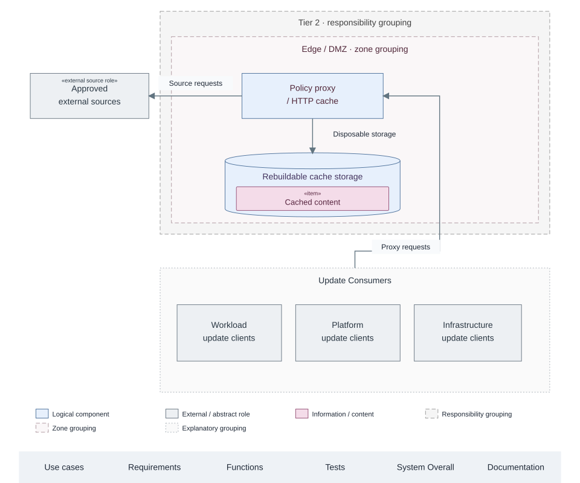

# Software intake design

[Up: System Overall](../README.md) · Level 1 · `SYS-intake`

One capability design connects its logical responsibilities, selected realization and required
platform resources. The diagrams are views into that design; they are not separate subsystem owners.

For the software-intake example, [follow one request in familiar terms](../../../docs/01-architecture/07-software-intake/03-http-walkthrough.md),
then [compare the model with real software](../../../docs/01-architecture/07-software-intake/06-implementation-comparison.md).

Follow the [connected resource view](resources.md) to trace the selected VM realization through
shared providers to physical backing. The optional storage network remains outside the selected
local-cache disk dependency path.

| Question | View or source |
| --- | --- |
| Which smaller designs make up intake? | [Policy proxy](policy-proxy/README.md) and [object cache](object-cache/README.md), level 2 |
| What does intake do, and which roles interact? | [Logical contracts](logical.md), [types](structure.sysml) and [context](context.sysml) |
| Which implementation fulfills those roles? | [Selected deployment](deployment.md) |
| What resources does it need and what backs them? | [Resource relationships](resources.md) and [native relationship report](../../generated/software-intake/resource-trace.md) |
| Who owns the shared providers? | [Shared platform boundary](../platform/README.md); hosting/network/data details keep their current owners |
| How is it used and verified? | [Use cases](../../use-cases/software-intake/README.md), [functions](../../functions/software-intake/README.md), [tests](../../test/software-intake/README.md) |

Change a provider and inspect its consumers; change a consumer and follow its resource obligations.
The [build/change guide](../../../docs/01-architecture/07-software-intake/02-connected-model.md) provides
both queries. Requirements remain guardrails, and the product/provider selections remain revisable.

<!-- BEGIN DESIGN CONTEXT -->
## Connected views

[Use cases](../../views/software-intake/use-cases.svg) · [Requirements](../../views/software-intake/requirements.svg) · [Functions](../../views/software-intake/functions.svg) · [Tests](../../views/software-intake/tests.svg).

Connected intake concerns derive from native use-case/scenario, functional allocation and requirement relationships. External actor obligations retain their own owner.
<!-- END DESIGN CONTEXT -->
