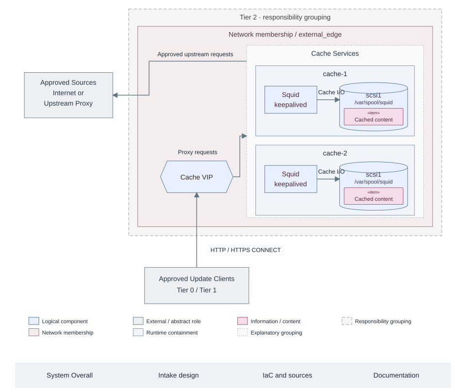

# Software intake software and deployment design

*IaC-derived example: selected Tier 2 VMs, individual virtual cache disks and an active-owner listener.
These are software and virtual resources. The [physical context](resources.md)
maps the surrounding hardware. This depicts tracked examples, not Terraform state or live availability.*

[Editable layout](../../views/software-intake/placement.layout.svg).

| Logical role / functions | Current choice | Owning implementation |
| --- | --- | --- |
| `L-Proxy`: admission, HTTP, reuse, relay | Squid | [policy and role](../../../tier-2/ansible/roles/cache_proxy/tasks/main.yml) |
| Stable listener for `L-Proxy` | keepalived VIP | [listener binding](../../../tier-2/ansible/roles/cache_proxy/tasks/keepalived.yml) |
| `L-Cache`: disposable reuse storage | Per-VM virtual disk and guarded mount | [Terraform inputs](../../../tier-2/terraform/deployments/cache/terraform.tfvars.example), [storage safety](../../../tier-2/ansible/roles/cache_proxy/tasks/storage.yml) |
| `L-Consumers`: verification before use | APT/DNF consumer policy | [verification settings](../../../shared/ansible/roles/baseline/tasks/package_policy.yml), [proxy route](../../../shared/ansible/roles/baseline/tasks/repository_proxy.yml) |
| Selected compute and network attachment | Proxmox VMs through Terraform | [deployment root](../../../tier-2/terraform/deployments/cache/main.tf), [configuration entry](../../../tier-2/ansible/playbooks/deployment/outbound-cache.yml) |

The builder reads the actual examples and generates native
[realization allocations](../../generated/software-intake/realization.sysml); it checks module/role
wiring, matching member inventories and disk attachment. Exact addresses, sizes and policy values stay
in their inputs. [Trace](../../generated/software-intake/trace.md) maps reusable definitions to code/IaC
and checks; [scenarios](../../generated/software-intake/scenarios.md) map behavior to the same sources.

These are revisable product choices. The [logical contracts](logical.md)
remain stable when a replacement fulfills the same obligations. The design trades operational simplicity
for an active-owner listener and independently rebuildable caches; it does not provide authoritative
retention or release approval. Revisit it for stronger consumer policy separation, throughput or custody needs.
Follow the [Stage 1 guide](../../../docs/03-deployment/stage-01-software-intake/README.md) for deployment
and [Test](../../test/software-intake/README.md) for confidence and outstanding live acceptance.

See the [connected resource view](../../views/software-intake/resource-dependencies.svg)
for the relationships between responsibilities, selected resources, shared providers and physical backing.
