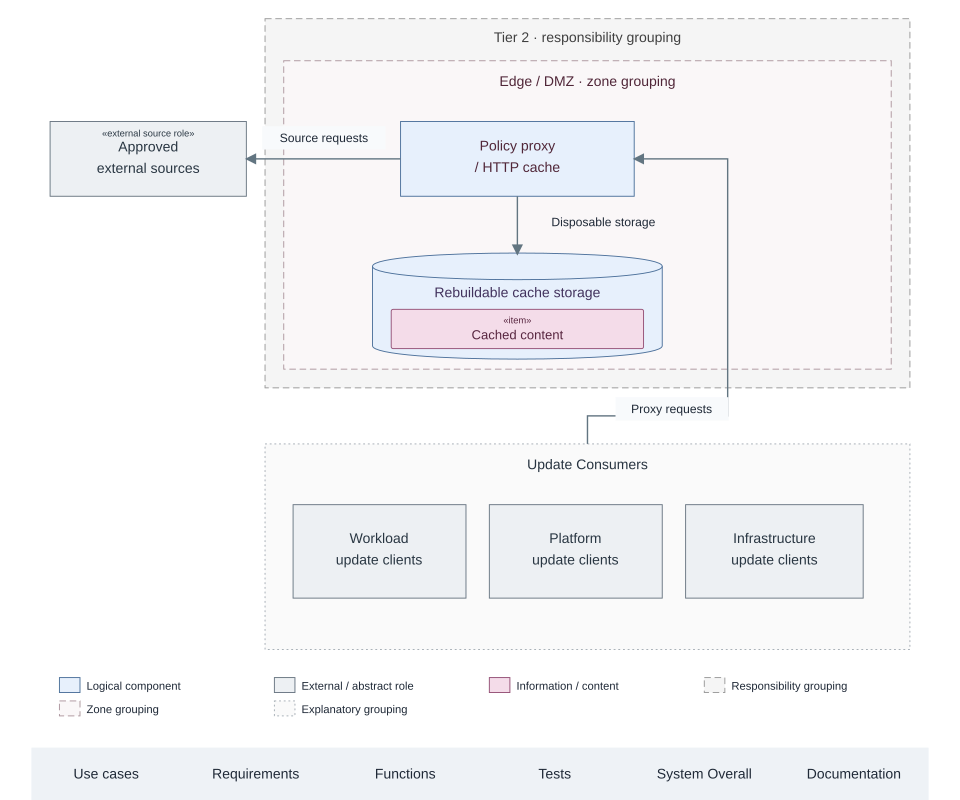

# Software intake logical design

*Model-derived responsibility and request view. External source and client roles keep their own authority.*

[Editable layout](../../views/software-intake/logical.layout.svg) |
[Implementation source map](../../views/software-intake/sources.svg).

[structure.sysml](structure.sysml) owns shared interfaces and member composition. The
[policy-proxy definition](policy-proxy/definition.sysml) and [object-cache definition](object-cache/definition.sysml)
are owned by their child designs; [context.sysml](context.sysml) composes their logical uses. Function allocations remain with [functions.sysml](../../functions/software-intake/functions.sysml).
`ProxyMember` is reusable; two uses do not imply shared storage or simultaneous active service.

The [use case](../../use-cases/software-intake/README.md) binds its subject to `L-Proxy` and its external
actors to `L-Consumers` and `L-Sources`. Sequences use those same parts. Requirements and native flows
preserve policy, consumer verification, disposable storage and separate recovery custody.

The parent [platform context](../../../docs/01-architecture/README.md) supplies hosting, networking and
ownership boundaries. The [shared provider boundary](../platform/README.md) makes resource relationships
explicit; neighboring capability details remain with their documented owners in the
[coverage map](../../../docs/01-architecture/model-map.md).
Continue to [software and deployment design](deployment.md),
[physical hardware context](resources.md) and
[test intent](../../test/software-intake/README.md).

See the [connected resource view](../../views/software-intake/resource-dependencies.svg)
for the relationships between responsibilities, selected resources, shared providers and physical backing.
