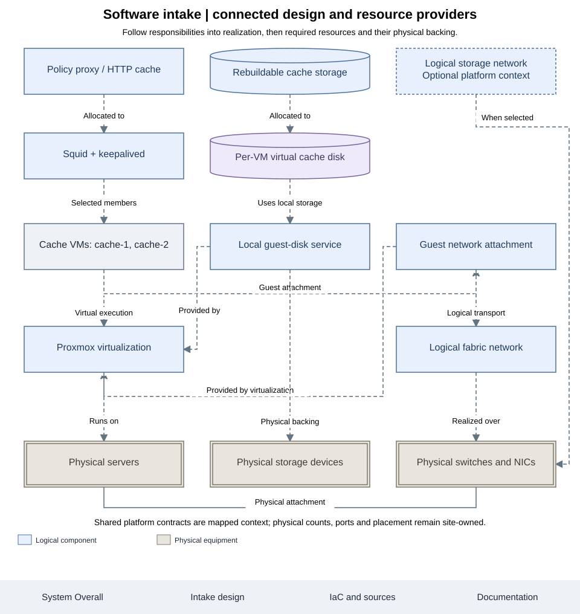

# Software intake resource dependencies

Software intake consumes shared platform services. Hosting, networking and storage remain owned by
their platform designs, even when their elements appear in an intake view.

*Figure: A selected view of native mappings, dependencies and physical attachment. Provider relationships
can be traversed in either direction for design review; arrows do not describe request traffic.*

| Intake need | Selected resource/provider | Physical realization or owning context |
| --- | --- | --- |
| Execute the proxy and listener software | Cache VMs use Proxmox virtual execution | Hypervisor runs on physical servers; identities and placement remain site-owned |
| Store rebuildable cache objects | Per-VM virtual disk uses the local guest-disk service | Storage service maps guest disks onto physical storage devices |
| Reach permitted clients and upstreams | Each VM consumes the guest network attachment | Prepared logical fabric over NICs, switches and physical links |
| Network-backed storage, if selected later | Separate storage provider/fabric choice | Logical storage transport mapped onto physical equipment; absent from the current cache path |

The [native platform boundary](../platform/contracts.sysml) owns provider-to-backing relationships.
The generated [realization](../../generated/software-intake/realization.sysml) owns each selected VM's
provider dependencies. The [relationship report](../../generated/software-intake/resource-trace.md)
shows those links and reverse impact on the logical functions and scenarios.

The source checks verify the cache root's node, bridge, VLAN, storage-class and disk inputs reach the
VM module. The example uses `external_edge` through `vmbr0` and local cache storage. A different bridge,
VNet or storage provider requires reviewing this selected contract, not silently reusing its diagram.
These checks inspect tracked examples, not all Terraform evaluation or a live platform.

**Coverage:** platform roles and relationships are modeled as documented boundary contracts. This is
not a complete hosting/network subsystem model or an as-built hardware inventory. Physical server,
device and switch-port identities, actual placement and failure domains remain site-owned evidence.
The [platform owner map](../platform/README.md) links the authoritative detail. Two cache VMs do not
establish separate physical servers. Return to the [intake design](README.md).
