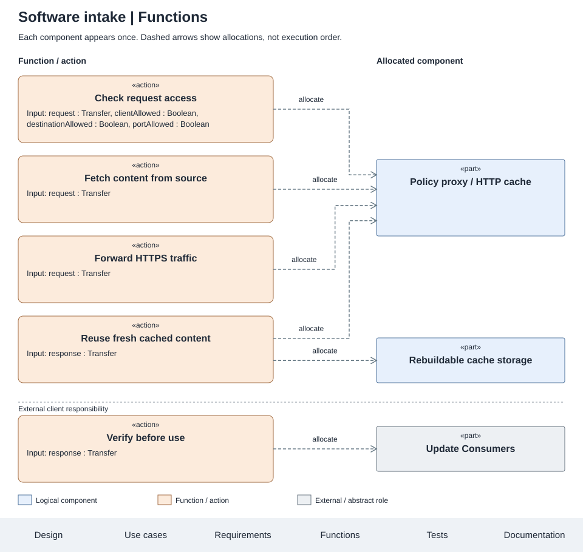

# Software intake functions

Functions describe behavior. Non-functional concerns are quality requirements and constraints,
not a second kind of function.

Five responsibilities explain the controlled-supply interaction: admission, HTTP retrieval, eligible
reuse, encrypted relay and verification before use. A function does not imply a separately deployed service.

The [generated function table](../../generated/software-intake/functions.md) shows native inputs,
outputs, logical allocation and guardrails from [functions.sysml](functions.sysml). Consumer verification
is allocated outside the supply boundary. Reuse spans the proxy and disposable storage.
Each function and component appears once in the view. Separate labelled allocation arrows use horizontal/vertical segments and meet distinct
points on the component boundary; their layout order does not prescribe execution order. If further
detail makes routing unclear, refine the abstraction or add a focused view instead of repeating parts.

[behavior.sysml](behavior.sysml) owns HTTP/HTTPS messages, decisions and succession.
The [sequence views](../../../docs/01-architecture/07-software-intake/README.md#cache-request-and-response)
and [selected scenario paths](../../generated/software-intake/scenarios.md) derive from that same model.
Each message has a native dependency to its functional owner and a checked implementation/test trace.

Open [focused function details](../../views/software-intake/function-views.svg).
Editable sequence projections: [HTTP](../../generated/software-intake/http.mmd) and
[HTTPS](../../generated/software-intake/https.mmd).

Follow [logical design](../../design/software-intake/logical.md),
[software deployment](../../design/software-intake/deployment.md) or [Test](../../test/software-intake/README.md).
Return to [use cases](../../use-cases/software-intake/README.md).

[Execute retrieval scenarios](../../views/software-intake/execution.svg) and
[inspect native execution setup and evidence](../../../docs/01-architecture/07-software-intake/05-retrieval-execution.md).

[Compare with real Squid and APT](../../views/software-intake/implementation.svg): [setup, measured outcomes and limits](../../../docs/01-architecture/07-software-intake/06-implementation-comparison.md).
