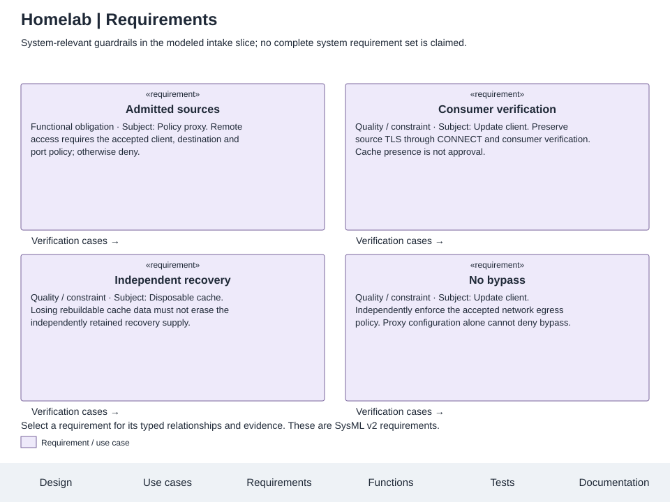

# Software intake guardrails

[Software intake requirement view](../views/software-intake/requirements.svg).

Use cases carry the behavior; these four requirements protect essential outcomes across scenarios.
The classification is a navigation aid: security constraints can require observable behavior too.

| Owner | Identity | Obligation and acceptance route |
| --- | --- | --- |
| [Functional](functional/software-intake.sysml) | `REQ-policy` | Reject unaccepted client/destination/port combinations before source access; native proxy tests |
| [Non-functional](non-functional/software-intake.sysml) | `REQ-integrity` | Preserve source TLS and client verification; package tests plus deployed HTTPS acceptance |
| [Non-functional](non-functional/software-intake.sysml) | `REQ-custody` | Cache loss cannot erase independent recovery supply; custody/recovery acceptance |
| [Non-functional](non-functional/software-intake.sysml) | `REQ-egress` | Independently enforce egress and prevent bypass; network acceptance outside proxy settings |

Functions link to the obligations they refine. The [implementation trace](../generated/software-intake/trace.md)
locates source and evidence owners, while [Test](../test/software-intake/README.md) distinguishes executed
checks from remaining acceptance. These requirements are descriptive constraints, not executable proofs.
Return to the [architecture map](../README.md).
