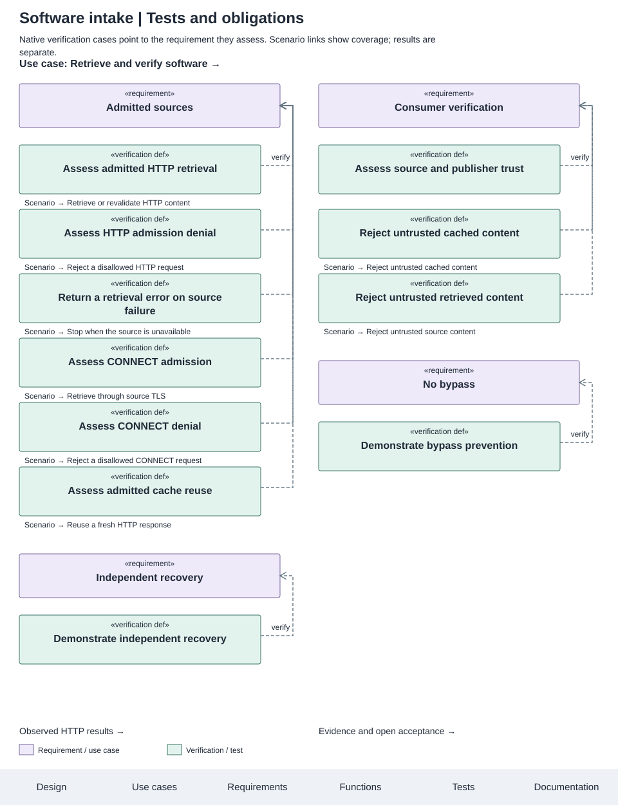

# Software intake test and evidence

Acceptance follows the [use-case scenarios](../../generated/software-intake/scenarios.md), their functions,
logical allocations and implementation sources. [verification.sysml](verification.sysml) owns native verification cases and scenario acceptance criteria
with explicit manual gaps. It must cover exactly the scenarios present in the native model.
The [generated acceptance criteria](../../generated/software-intake/verification-cases.md)
connect each verification case to its requirement and evidence owner.

| Verification layer | Owner | What it establishes |
| --- | --- | --- |
| Native model and scenario paths | [model builder](../../../scripts/architecture/software_intake.py) | Resolved model references, branch selection, function allocations and full modeled-message coverage |
| Drift and broken-connection checks | [model tests](../../../tests/test_tier_intake_model.py), [behavior tests](../../../tests/test_tier_intake_behavior.py), [use-case tests](../../../tests/test_tier_intake_use_cases.py) | Changed sources require regeneration; missing conditions, allocations, tests or stale outputs fail |
| Proxy configuration in isolation | [native Squid tests](../../../tests/test_tier_cache_policy.py) | Denial, HTTP origin access, cache freshness, privacy and source/generated configuration |
| Consumer integrity in isolation | [package-policy tests](../../../tests/test_tier_package_policy.py) | APT rejects unsigned/expired metadata; selected verification configuration remains enforced |
| Selected site and external obligations | [Stage 1 acceptance](../../../docs/03-deployment/stage-01-software-intake/README.md) | Successful CONNECT/TLS, network bypass prevention, failover and independent custody/recovery |

The generated walkthrough lists exact test selectors from the existing message trace, rather than a
second scenario-to-test inventory. A selector that exists is not proof it ran. The native HTTP test
fixture does not forward CONNECT; successful HTTPS remains an explicit manual acceptance gap.

The [verification record](../../../docs/01-architecture/07-software-intake/verification.md) owns dates,
commands and actual results. Follow the [build/check guide](../../../docs/01-architecture/07-software-intake/02-connected-model.md#build-and-check)
to repeat them. The [admission evaluation](admission-analysis-2026-11-18.json) records native Boolean
analysis for the stated design choice; it is not a full behavior simulation or live deployment check.
In generated manuals, linked upstream test/tool source snapshots are for inspection; run checks in the upstream checkout.
Return to the [architecture map](../../README.md).

`cases.json` is a generated compatibility projection; edit `verification.sysml` and rebuild.
[Inspect typed verification relationships](../../views/software-intake/engineering.svg#REQ-policy).

[Execute retrieval scenarios](../../views/software-intake/execution.svg) and
[inspect native execution setup and evidence](../../../docs/01-architecture/07-software-intake/05-retrieval-execution.md).

[Compare with real Squid and APT](../../views/software-intake/implementation.svg): [setup, measured outcomes and limits](../../../docs/01-architecture/07-software-intake/06-implementation-comparison.md).
