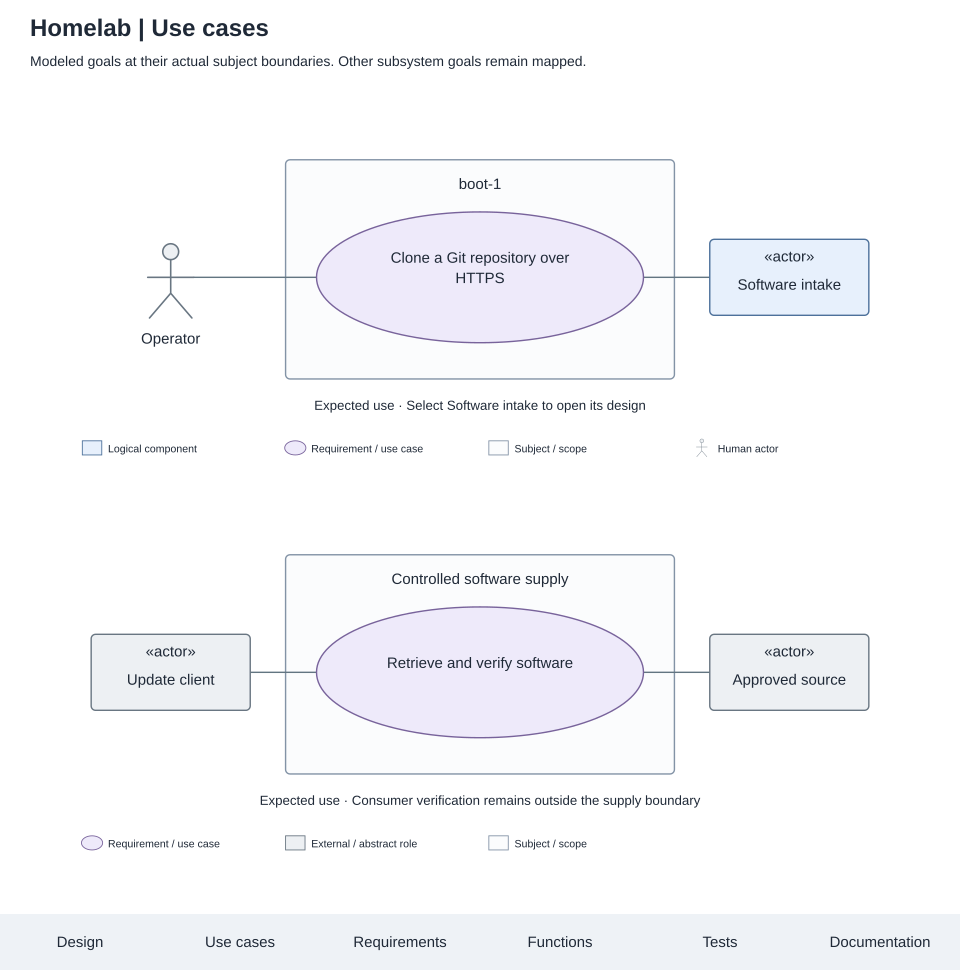

# System use cases

The system view collects the existing goals while preserving each subject boundary:

- [Clone a Git repository on boot-1](bootstrap/README.md): operator and supporting intake service.
- [Retrieve and verify software](software-intake/README.md): client and approved source.

Open the subject or goal to follow its design or scenarios. The other subsystem goals remain mapped
to their existing documentation. This view does not redefine the host's goal as an intake goal.

[System Overall](../views/system-overall.svg) · [Requirements](../views/requirements.svg) ·
[Functions](../views/functions.svg) · [Intake tests](../views/software-intake/tests.svg)
