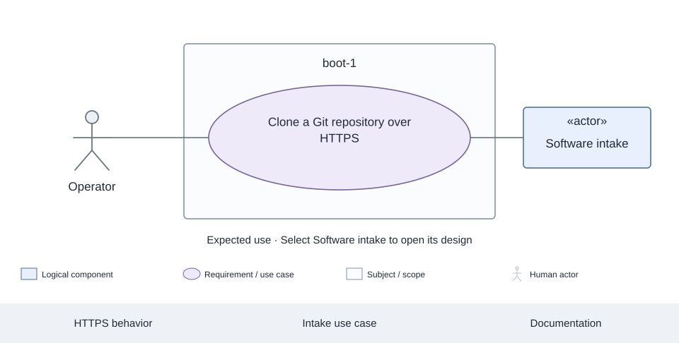

# Clone a Git repository on boot-1

The operator wants a local checkout on **boot-1**. Software intake participates as a supporting
service. Select **boot-1** to open its [foundation diagram](../../views/platform/hosting/bootstrap-reference.svg),
or select **Software intake** to open its [logical design](../../views/software-intake/logical.svg);
its proxy, cache, products and hardware do not belong inside this use-case view.

The [native use case](clone-repository.sysml) owns the goal and scenario. Its subject is the
[existing bootstrap host](../../design/platform/hosting/bootstrap.sysml), not software intake.
Roles are relative to the subject: boot-1 is the subject here, and a client of software intake.
The human operator uses a stick figure; software intake uses an actor-labelled rectangle. It is an
external supporting actor relative to boot-1 because it participates in obtaining the checkout.
Within a whole-homelab subject it would instead be an internal component. A dependency alone does
not establish actor participation. This symbol distinction is a readability convention. [1]
The native dependency links this goal to the existing HTTPS access scenario; it is not an
`include use case` relationship, because the two use cases have different subjects. [1]

## Expected scenario

1. The operator starts an approved HTTPS Git clone on boot-1.
2. Git uses the accepted proxy from the current shell.
3. Software intake admits the CONNECT request, or denies it.
4. Git verifies the source TLS certificate and transfers repository data through the tunnel.
5. Git reports a checkout or failure to the operator.

Follow the [HTTPS access behavior](../../views/software-intake/scenario-views.svg#SC-https)
for the supporting exchange and its functions. It is an access-level correspondence, not a claim
that the generic package-verification scenario executes Git or approves commits. Git's TLS
verification and subsequent signed revision approval are distinct checks. [2]

CONNECT keeps the source TLS session between Git and the Git server; its encrypted payload is
not an HTTP object-cache hit. Denial, source failure and TLS failure stop the clone. Detailed Git
protocol messages, authentication, retries and signed revision approval remain outside this view.

The foundation SVG exports the existing guide-owned Mermaid figure. Its boot-1 boundary retains
the `BOOT-host` identity; the other internal details remain a mapped reference, not a complete native
SysML design. The figure links back to this use case and attaches its owning documentation separately.
See [rendering and navigation checks](../../../docs/08-reference/diagrams/bootstrap-use-case.md).

## Implementation and evidence

| Connection | Owning asset |
| --- | --- |
| Existing clone procedure | [Bootstrap: obtain the kit](../../../docs/03-deployment/foundation/bootstrap/README.md#step-8-obtain-the-kit) |
| Local proxy configuration | [Bootstrap intake playbook](../../../tier-0/ansible/playbooks/deployment/bootstrap-software-intake.yml) |
| Proxy environment supplied to Git | [Shared shell template](../../../shared/ansible/roles/baseline/templates/shell-proxy.sh.j2) |
| Configure and verify the consumer | [Bootstrap consumer guide](../../../docs/03-deployment/stage-01-software-intake/procedures/bootstrap-consumer.md) |
| Existing measured evidence | [Squid/APT comparison and limits](../../../docs/01-architecture/07-software-intake/06-implementation-comparison.md) |

The scenario assumes proxy mode is already available and loaded in this shell. Initial offline
bootstrap and mirror intake remain separate supported paths. Boot-1 is not newly enrolled in
Terraform or inventory by this model. No hardware placement is inferred.

The [validation record](../../../docs/01-architecture/07-software-intake/verification.md#focused-bootstrap-use-case)
records the model, view, navigation and reverse-trace checks. This view is validated expected use. No real Git clone was executed for this example;
existing HTTP cache/APT results do not verify Git over HTTPS. A runtime check would need to show
an admitted clone, denied destination, unavailable source and TLS rejection on the chosen route.

Return to [software intake use cases](../software-intake/README.md) or [System Overall](../../design/README.md).

## References

1. [OMG SysML v2 language, section 7.25: use cases](https://www.omg.org/spec/SysML/2.0/Language/PDF).
2. [Git configuration: proxy and TLS verification](https://git-scm.com/docs/git-config).
