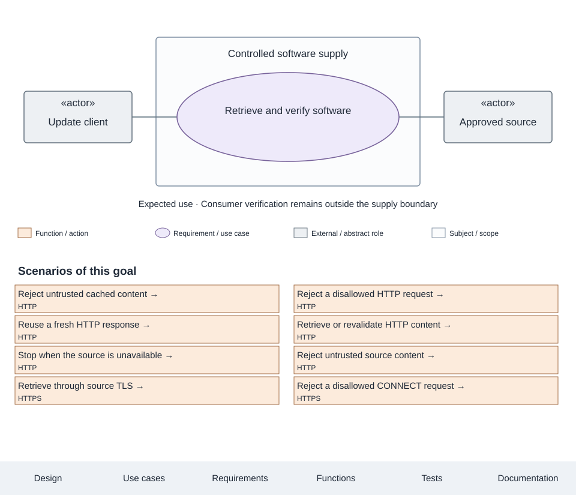

# Software intake use case

For the consumer perspective, open [Clone a Git repository on boot-1](../bootstrap/README.md).
That view references this service as a black box and links directly to its separate design.

An update client needs content through accepted supply, with an explicit denial when policy rejects
the request. The client remains responsible for verifying publisher metadata/signatures before use.

*Tailored model-derived use-case view. Lines mean participation, not traffic direction. Both actors
are external to the policy-supply subject; the proxy, cache and selected products are internal design.*

The [native use case](use-cases.sysml) owns the actor/subject bindings, trigger, preconditions and outcome
of each scenario. It selects the existing behavior with explicit Boolean conditions. The generated
[scenario walkthroughs](../../generated/software-intake/scenarios.md) show the resulting ordered steps,
function owners, implementation and named checks:

- [Retrieve or revalidate HTTP content](../../generated/software-intake/scenarios.md#sc-http-miss).
- [Reuse a fresh HTTP response](../../generated/software-intake/scenarios.md#sc-http-hit).
- [Reject a disallowed HTTP request](../../generated/software-intake/scenarios.md#sc-http-denied).
- [Stop when the source is unavailable](../../generated/software-intake/scenarios.md#sc-http-source-failure).
- [Reject untrusted source content](../../generated/software-intake/scenarios.md#sc-http-untrusted).
- [Reject untrusted cached content](../../generated/software-intake/scenarios.md#sc-http-cache-untrusted).
- [Retrieve through source TLS](../../generated/software-intake/scenarios.md#sc-https).
- [Reject a disallowed CONNECT request](../../generated/software-intake/scenarios.md#sc-https-denied).

These paths refine one goal; denial and cache alternatives are not separate actor goals. A returned
response is still subject to consumer verification. The HTTP source-failure path stops without usable content; detailed retries and HTTPS
transport-error exchanges remain outside the current sequence model. Independent recovery is a
linked guardrail and operating procedure, not a modeled cache-recovery scenario.

Continue to [functions](../../functions/software-intake/README.md),
[guardrails](../../requirements/README.md), [test intent](../../test/software-intake/README.md), or the
[whole-system map](../../README.md). [model.json](model.json) lists all source packages relative to the
upstream repository root. Scenario selection is a view projection, not behavioral simulation.

[Execute retrieval scenarios](../../views/software-intake/execution.svg) and
[inspect native execution setup and evidence](../../../docs/01-architecture/07-software-intake/05-retrieval-execution.md).
