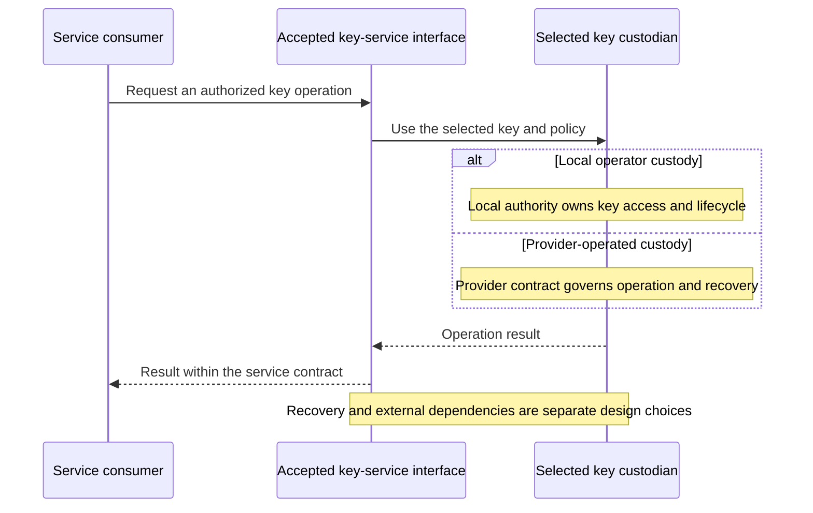

# Local and provider key custody

Read this comparison when deciding who controls trust material and which external
dependencies are acceptable. For the repository's signing implementations and failure
domains, use [key-protection choices](../08-cryptography/03-hsm-selection.md).

*Figure: Consumers retain a service contract while local or provider-operated key custody
changes operation and recovery obligations. The branches compare custody choices;
they do not imply a supplied adapter or a network route to an offline root.*

## Local and cloud boundaries

Public cloud key management is useful, but it is not the same as keeping a
private trust root under local operational control.

Cloud customer-managed keys improve control because the customer manages the key
that protects a provider service. Azure Storage, for example, can use a
customer-managed key stored in Azure Key Vault or Managed HSM.[5] Azure Monitor
describes a model where the service uses managed identity to perform wrap and
unwrap operations against the customer's Key Vault key.[6]

Microsoft's ITAR guidance adds an important distinction: Azure Commercial can
provide controls such as region choice, encryption, customer-managed keys, and
Customer Lockbox, but the compliance boundary is customer-built. Azure
Government adds stronger environment-level commitments around US data storage
and limiting potential access to screened US persons.[13][14] That makes the
cloud choice a compliance architecture decision, not only a key-storage
feature.

AWS has similar patterns. AWS KMS customer managed keys are keys created,
owned, and managed in the customer's AWS account.[7] AWS KMS also supports custom key stores
backed by AWS CloudHSM clusters owned and managed by the customer, and external key
stores for regulated workloads where cryptographic operations use keys in an
external key manager outside AWS.[8][9] AWS CloudHSM is the dedicated
single-tenant HSM option for AWS workloads that need customer-managed HSM
capacity inside a VPC.[10]

That model can be the right answer for cloud workloads. For a private-cloud
trust root, this repository prefers local custody:

- root CA material can stay offline in a ceremony path
- issuing CA keys can be moved toward HSM-backed protection
- secret-platform seal or recovery paths can be hardened later
- private traffic and internal service identity do not depend on an external
  provider key service

The boundary is practical rather than absolute. Major cloud providers publish
controls around lawful access and government requests. Microsoft states that it
does not give governments direct or unfettered access to customer data and does
not provide governments with encryption keys or the ability to break
encryption.[11] AWS states that the CLOUD Act does not give any government
unfettered or automatic access to data, and that AWS challenges overbroad or
inappropriate requests where it can.[12] At the same time, both providers
publish reports or statements showing that providers can be legally compelled
to disclose some customer content in specific cases.[11][12]

The practical design point is simple: for workloads where key custody and
private trust anchors matter, keeping the root of trust local reduces external
dependency and gives the operator a clearer boundary.

## References

5. [Azure Storage customer-managed keys](https://learn.microsoft.com/en-us/azure/storage/common/customer-managed-keys-overview)
6. [Azure Monitor customer-managed keys](https://learn.microsoft.com/en-us/azure/azure-monitor/logs/customer-managed-keys)
7. [AWS KMS keys](https://docs.aws.amazon.com/kms/latest/developerguide/concepts.html)
8. [AWS KMS key stores](https://docs.aws.amazon.com/kms/latest/developerguide/key-store-overview.html)
9. [AWS KMS external key stores](https://docs.aws.amazon.com/kms/latest/developerguide/keystore-external.html)
10. [AWS CloudHSM](https://aws.amazon.com/cloudhsm/)
11. [Microsoft Government Requests for Customer Data Report](https://www.microsoft.com/en-us/corporate-responsibility/law-enforcement-requests-report)
12. [AWS CLOUD Act overview](https://aws.amazon.com/compliance/cloud-act/)
13. [Azure ITAR compliance guidance](https://learn.microsoft.com/en-us/azure/compliance/offerings/offering-itar)
14. [Azure and Azure Government feature availability](https://learn.microsoft.com/en-us/azure/security/fundamentals/feature-availability)
