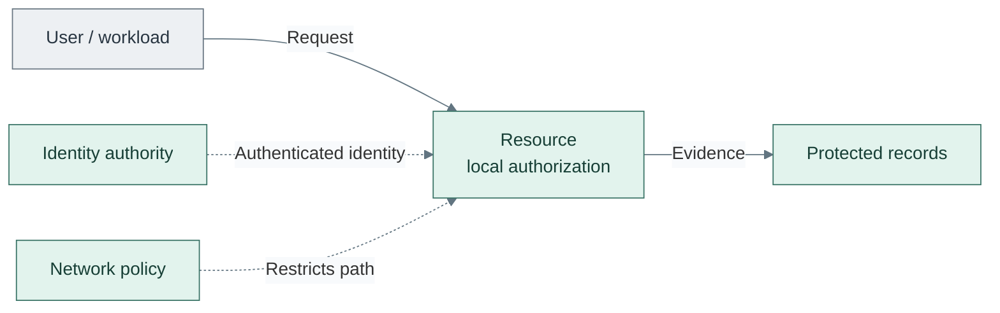

# Design principles

## Table of contents

- [Purpose](#purpose)
- [Baseline posture](#baseline-posture)
- [Zero-trust boundaries](#zero-trust-boundaries)
- [Identity and access](#identity-and-access)
- [Scale and failure domains](#scale-and-failure-domains)
- [Secrets handling](#secrets-handling)
- [Platform hardening](#platform-hardening)
- [Automation guardrails](#automation-guardrails)

## Purpose

The platform follows one rule: **it should be easy to do right**. Purpose-based
names, explicit ownership and small reusable components keep the design readable.
Security, scalability and independent recovery constrain every
[foundational capability](README.md#foundational-capabilities).

## Baseline posture

This repository assumes:

- explicit authentication and resource-local authorization
- least privilege for users, tokens, and services
- secure-by-default configuration
- rebuild-first or immutable patterns where practical
- public code with private runtime data

Map networks into the [layered architecture](README.md#tier-and-zone-view)
and use the [firewall policy](11-networking/01-firewall-policy.md) for scoped access between
them. Tiers classify potential damage and repo ownership; zones classify
network policy. Neither label grants trust. Tier 0 can be connected; offline
custody remains separately isolated.

## Zero-trust boundaries

Network location and device ownership do not establish trust. Access decisions
concern a specific subject, resource and operation; a permitted route does not
authorize the application request. This follows NIST's resource-focused
zero-trust model. [1]

*Figure: A request reaches a resource through a constrained path; the resource authorizes it and records
evidence.*

This logical view does not prescribe an authentication exchange or policy engine.

| Responsibility | Design rule | Capability owner |
| --- | --- | --- |
| Establish identity | Distinguish humans, devices and workloads; authenticate supported clients before protected access | [Identity and access](18-identity/README.md) |
| Authorize an operation | Enforce scoped roles at the service, cluster, API or dataset; SSO does not replace that policy | Resource-owning capability |
| Constrain a path | Permit only required destinations and listeners; separate administrative and consumer paths | [Networking](11-networking/README.md) |
| Protect credentials and exchanges | Verify peer identity, protect keys and scope secret delivery | [Cryptography and secrets](16-cryptography/README.md) |
| Observe and review | Retain access evidence; revoke or revise privileges when scope or risk changes | [Operations](24-operations/README.md) and resource owners |

These are design constraints, not a claim that the kit implements a complete
zero-trust policy engine. Automated device-posture assessment and continuous
risk-based access decisions require separately qualified integrations. Product
support and session/token lifetimes determine when a changed policy takes effect.
Recovery credentials have explicit custody and audited use rather than an
unrestricted exception to normal access controls.

## Identity and access

Preferred access methods, in order:

1. short-lived credentials from a trusted secret system
2. scoped API tokens
3. SSH keys with controlled distribution
4. passwords only where bootstrapping requires them

Guidance:

- separate human and machine identities
- avoid shared administrator credentials
- restrict management interfaces to dedicated paths
- rotate trust material after scope or ownership changes

## Scale and failure domains

Keep the capability's interface stable while changing its implementation or
capacity. A homelab can combine roles; a larger installation can separate them
when resource needs, administration or failure isolation justify the change.
Managed services transfer operating responsibilities through an explicit
contract; they do not remove them.

| Concern | Required decision |
| --- | --- |
| Capacity | Identify CPU, memory, I/O, storage and throughput limits before scaling; unrelated bottlenecks need independently scalable components |
| Control and consumption | Separate infrastructure administration from service use; tenant growth must not expand host or trust authority |
| Stateless execution | Define replicas, routing, placement and surviving capacity together |
| Stateful services | Define consistency, replication/quorum, storage behavior and restore limits before adding replicas |
| Shared dependencies | Record common hosts, fabrics, storage, identity and power; multiple instances may still fail together |
| Recovery | Preserve lower-tier recovery without higher-tier tooling; test the declared recovery point and time |

Node counts, elasticity and automatic rescheduling do not establish availability
or durability by themselves. The [hosting design](10-hosting/01-runtime.md#failure-domains),
[data contract](12-data/README.md) and
[recovery design](24-operations/04-backup-recovery.md) define the relevant boundaries.

## Secrets handling

Keep secrets out of Git and move shared or long-lived secret material to a
secret system early.

Read more in [Secret strategy](../05-operations/secret-handling/strategy.md).

## Platform hardening

Security expectations for the baseline:

- harden the platform foundation before broad automation use
- isolate management, edge, workload, and sensitive services
- patch and minimize templates before cloning
- prefer SSH keys over password login
- keep administrative actions auditable

## Automation guardrails

- separate image build, provisioning, and configuration concerns
- review plans before applying in shared or sensitive environments
- keep defaults extensive and environment overrides focused
- store significant architectural choices in the decision log
- prefer small, composable changes over broad mixed updates

## References

1. [NIST SP 800-207: Zero Trust Architecture](https://csrc.nist.gov/pubs/sp/800/207/final).
