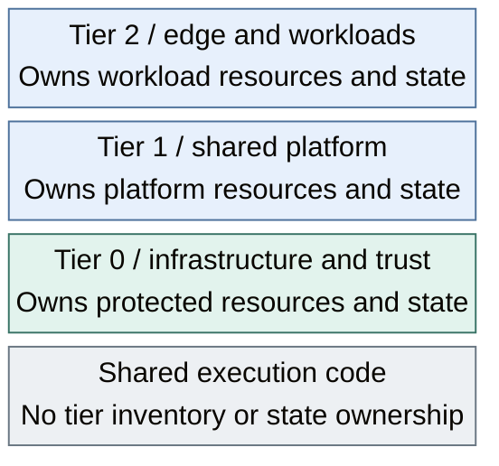

# Tier ownership

Tiers divide repositories by **potential impact**, not network location.
Lower-numbered tiers can affect more of the environment. Network names and
VLANs remain purpose-based; they do not need tier prefixes.

## Table of contents

- [Tier meanings](#tier-meanings)
- [Repository role](#repository-role)
- [Dependency rule](#dependency-rule)
- [Placement and execution](#placement-and-execution)

## Tier meanings

*Figure: Tiers own their resources and state; shared automation supports each tier without taking ownership.*

Placement shows ownership and impact; it does not grant network access.

| Tier | Responsibility | Examples |
| --- | --- | --- |
| Tier 0 | Infrastructure and trust | Proxmox, physical networks/storage, all template publication, identity authority, PKI, privileged automation |
| Tier 1 | Shared platform services | Source control, registries, authoritative mirrors, general runners, platform telemetry |
| Tier 2 | Edge, clients and workloads | Public edge load balancers, ordinary outbound caches, clients, applications, development environments, labs |

Classify the instance by its authority, not its product. A runner with
hypervisor credentials belongs to Tier 0. A workload-local secret service is
not automatically Tier 0. Reassess ownership when privileges change.

## Repository role

| Repository | Owns |
| --- | --- |
| Each tier | Its Terraform resources, deployment inputs, Ansible inventory, service configuration, and separate state roots |
| Shared | Reusable scripts, baseline roles, sizes, approved image and platform references; never inventory, Terraform resources, or state |
| Architecture | Project conventions, design, service records, recovery procedures, and upstream auto-docs |

Terraform and Ansible use the same host inputs within each tier. Tier 0 alone
maintains template recipes and approves the shared consumer catalog.
The [code map](../../04-development/code-layout.md) explains file
placement; the [generator contract](../../04-development/generated-repositories.md)
explains repository creation and refresh.

## Dependency rule

- Tier 0 must recover without Tier 1 or Tier 2 services.
- Tier 1 must recover without Tier 2 services, including public ingress and caches.
- A service must not be the only source of its own recovery inputs.

Retain protected code, artifacts, inventory, state, credentials, and backups
outside the recovery target. Source control, registries, identity, and inventory
applications can support normal operation without becoming the only recovery
path. Consuming a service does not grant authority to administer it.

## Placement and execution

Public edge load balancers belong to Tier 2 / Edge. Ordinary outbound caches
and clients also belong to Tier 2, without infrastructure credentials. Tier 1
Internet-facing build runners and authoritative mirrors use separate DMZ subnets;
sharing a zone never transfers ownership or grants peer access.

Privileged jump hosts, bootstrap VMs and infrastructure runners belong to Tier 0
on protected Control networks, not the public DMZ. A remote access boundary
requires a separately isolated entry service and an explicit target-tier access
contract; it must not place Tier 0 credentials on an ordinary edge host.
Internal control/API load balancers follow their target authority and remain
independent of the Tier 2 public edge.

Connected Tier 0 systems use protected Control networks. Offline root keys and
custody remain physically separate; a VLAN or firewall deny is not an air gap.
See the [network map](../05-networking/README.md) and [control platform design](../03-reference-platform.md).

Workload definitions remain tier-local even when Tier 0 executes provisioning.
The protected execution path must control credentials, accepted code, approval,
and state access. Ordinary Tier 1/2 jobs cannot gain Tier 0 authority by reaching
a runner or API. The [request contract](../04-hosting/02-provisioning.md#delegated-provisioning)
defines the intended self-service boundary; no such controller is shipped yet.

Follow the [deployment stages](../../03-deployment/README.md) for bootstrap,
service integration, and handover. Stages describe readiness, not another tier.
