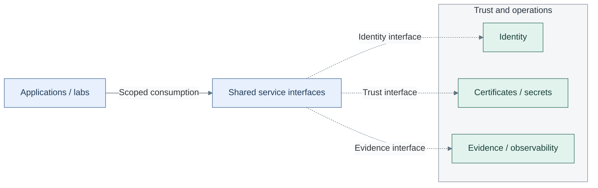

# Organization and service boundaries

Read this before assigning administration, sharing a service, or deciding that a
project needs its own instance. Responsibility follows authority and potential impact;
network placement and a successful login do not grant it.

## Shared interfaces, separate authority

*Figure 1 - Applications consume scoped shared interfaces. Dashed links identify supporting identity,
trust and evidence contracts; the group is functional, not a common runtime or ownership boundary.*

## Contents

- [Responsibilities](#responsibilities)
- [Shared service boundaries](#shared-service-boundaries)
- [Shared or multiplied](#shared-or-multiplied)
- [Environment model](#environment-model)
- [Selected design](#selected-design)

## Responsibilities

These are responsibility boundaries, not a prescribed organizational hierarchy.
One homelab operator may hold several roles; the credentials and permissions still differ.

| Responsibility | Authority retained |
| --- | --- |
| Platform operator | Hosts, approved networks/images and protected execution |
| Trust and identity administrator | Certificate policy, directory/federation and scoped credentials |
| Service or project owner | Application configuration, authorization, data and release decisions |
| User or tenant | Only the granted service or isolated runtime scope |
| Recovery custodian | Independent copies, keys and authorized restoration |

[Tier ownership](01-tier-ownership.md) explains the impact of those grants.
[Infrastructure control](../04-hosting/02-provisioning.md) describes protected execution;
[tenant isolation](../04-hosting/04-lab-environments.md) and
[recovery boundaries](../11-operations/04-backup-recovery.md) define their separate scopes.

Trusted infrastructure CI extends the authority boundary to its dedicated project,
GitLab control plane and administrators; [the selected CI design](../10-delivery/03-development-platform.md#privileged-ci)
explains the consequence before that option is chosen.

## Shared service boundaries

A private cloud becomes easier to secure and operate when common trust services
are shared instead of rebuilt in every project.

See [Figure 1](#figure-shared-boundaries) for the participants and boundaries.

Lines group interface roles; they do not imply unrestricted access between them.

These services give later projects a common base:

| Shared service | What it gives other paths |
| --- | --- |
| DNS and private domain | Stable service names such as `ldap.corp.example.com` and `git.corp.example.com`; individual servers retain separate names |
| identity | one user and group authority for operators, services, and automation |
| PKI | trusted certificates for internal TLS, mTLS, service identity, and device identity |
| secret platform | controlled storage for long-lived secrets, tokens and service credentials; later dynamic credential paths |
| Security Logging and Audit | Tier 0 protected evidence and traceability; submission does not grant read or deletion rights |
| Observability | Tier 1 operational logs, metrics and distributed traces; approved evidence copies and scoped diagnostics |

Use [familiar service DNS names](../../02-conventions/service-dns.md) for client-facing
interfaces. The service name stays stable as hosting changes; `idm-1` identifies
one directory server rather than the directory service as a whole.

This is not only convenience. It also removes many weak defaults:

- fewer local passwords across unrelated systems
- fewer one-off certificates and self-signed exceptions
- fewer copied API tokens in project repositories
- fewer isolated logs that disappear when a host fails
- fewer teams reinventing the same trust bootstrap

Existing approved directory, DNS, trust, secret and telemetry services can satisfy
these interfaces; a new deployment need not recreate them. Identity protocol and
credential choices belong to [Identity](../09-identity/README.md#administrative-authentication).
Provider versus local key custody is a [background comparison](../01-background/02-key-custody.md).

## Shared or multiplied

Not every service should be deployed once, and not every service should be
deployed per project.

Use this split:

| Service type | Default pattern | When to multiply it |
| --- | --- | --- |
| identity and DNS | shared | isolated lab, air-gapped project, or separate administrative domain |
| root CA | shared and offline | separate legal or operational trust boundary |
| issuing CA | shared per trust boundary | project requires separate certificate policy or key custody |
| secret platform | shared early | project requires separate secret administration or blast-radius boundary |
| observability | shared early | project has strict isolation, high-risk data, or separate retention policy |
| syslog/security archive | Tier 0-owned; all tiers submit through scoped intake; raw reads restricted | additional custody separation or stricter retention is required |
| application platform | shared first, then multiplied where needed | teams or projects need source control, CI/CD, GitOps, Kubernetes, or isolated runtime boundaries |

The default private-cloud path is a shared service backbone with isolated
project resources on top. High-risk or air-gapped projects can still bring
their own identity, secret platform, observability, or network boundaries.

## Environment model

The same service design can serve test, lab, development and production
instances. Each instance has explicit ownership, state, access and recovery.
Environment labels do not create isolation by themselves.

| Need | Architectural property |
| --- | --- |
| Parallel validation | Separate state and host/IP identity; selected shared dependencies remain explicit |
| Project isolation | Separate network, data or operator boundary where justified |
| Different capacity | Same functional design with different resource sizing |
| Shared foundation | Approved identity, trust or software supply reused without duplicate owners |

The [development workflow](../../04-development/repository-workflow.md) and
[input reference](../../08-reference/repository-scripts.md) own environment flags,
overlay files and execution commands.

## Selected design

Choose alternatives in the capability that owns the decision: runtime placement in
[Hosting](../04-hosting/README.md#design-choices), key custody in
[Cryptography](../08-cryptography/03-hsm-selection.md), and release control in
[Delivery](../10-delivery/02-controllers.md). These are architectural functions;
changing an implementation does not create a new organizational role.

For each consequential choice, record the selected option, why it meets the required
isolation/availability/recovery properties, and which deployment path realizes it.
Keep addresses and VMIDs in their owning inputs. Progress and acceptance evidence
belong in deployment records, not the static architecture.

Revisit the parent design and [decision log](../../07-decisions/README.md) when a
choice changes an external dependency, service interface, trust boundary, owner or
failure/recovery contract. Internal tuning can remain in the component's own design.
