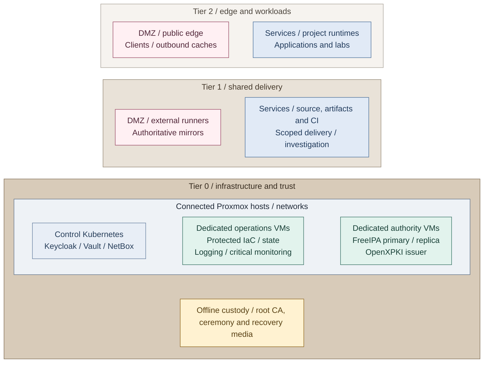

# Integrated reference platform

This is the selected Proxmox and Kubernetes realization of the platform's capabilities.
The map shows the intended placement, not a claim that every service is automated.
Read it from the hosted applications toward their shared services and infrastructure.

## Service placement

Proxmox hosts the connected VMs and clusters across all tiers. Tiers identify
authority and resource ownership; VM and cluster boundaries identify runtime
placement. Physical host, storage and network failure domains are selected
separately. Offline custody remains Tier 0-owned but outside the connected platform.

*Figure 1 - Edge and application runtimes sit above shared platform services.
The connected infrastructure and trust foundation remains separate from offline custody;
vertical placement identifies ownership, while foundational authorities sit to the right.*

## Table of contents

- [Service placement](#service-placement)
- [Connected functions](#connected-functions)
- [Access and automation](#access-and-automation)
- [Certificate trust](#certificate-trust)
- [Data and recovery](#data-and-recovery)
- [Implementation choices](#implementation-choices)
- [Design to deployment](#design-to-deployment)

**Reference inputs:** the [network deployment mapping](../02-conventions/network-plan.md#deployment-mapping)
links tier-owned guest and cluster inputs to their actual attachments. The
[Tier 0 service installer](../../tier-0/ansible/roles/control_applications/tasks/main.yml),
[Tier 1 delivery installer](../../tier-1/ansible/roles/delivery_platform/tasks/main.yml),
[Tier 1 development installer](../../tier-1/ansible/roles/development_platform/tasks/main.yml)
and [Observability installer](../../tier-1/ansible/roles/observability_platform/tasks/main.yml)
realize the supported cluster services. The
[support map](../08-reference/implementation-support.md) distinguishes those installers
from separately commissioned distribution acceleration, mirrors, HSM integrations
and other variants.

Ordinary client workstations also belong to Tier 2 / DMZ, on a separate subnet
outside the server runtime boundary. Privileged operator devices and bootstrap
or jump VMs remain Tier 0 / Control.

This is a placement view, not a traffic diagram. A disconnected ceremony VM
on a connected hypervisor is not isolated from that hypervisor's administrators.
Keep root keys on offline media/devices and conduct ceremonies in a separately
controlled environment; a VM or VLAN label alone does not establish an air gap.

- **Tier 2** runs public edge load balancers, ordinary outbound caches and isolated
  application/lab runtimes. Ordinary clients use a separate DMZ subnet outside server hosting.
- **Tier 1** supplies source control, registries, general CI, delivery and observability.
  Internet-facing runners and authoritative mirrors have their own DMZ attachments.
  Rancher/Fleet workload management remains an optional project integration.
- **Tier 0** operates Proxmox, templates and protected infrastructure execution. Its control
  cluster hosts Keycloak, Vault and inventory services; the FreeIPA pair and OpenXPKI Community
  issuer retain dedicated VMs. Protected logging and critical monitoring remain independent
  of the observed cluster. Offline root/recovery custody remains outside connected runtimes.

Storage uses direct NAS file interfaces where supported, or a qualified existing object
endpoint for applications requiring that API. No additional storage gateway is implied;
the [storage contracts](06-data/README.md#storage-interfaces) define the required interface.

The [cluster topology](04-hosting/03-kubernetes.md) defines three independent tier APIs,
compact control planes and optional worker pools. [Controller patterns](10-delivery/02-controllers.md)
keep Tier 0 Flux separate from Tier 1 delivery and scoped Tier 2 application access.

Keycloak and NetBox use the database service. Vault has its own storage design and independent recovery/unseal material; the database service is not its storage backend by implication.
Database, cache, storage, and backup requirements remain service-specific.

Network purposes remain `management`, `identity`, `control_cluster`,
`cryptography`, `application`, `external_edge`, `delivery_edge` and the separate
`client` subnet as applicable. The [network plan](../02-conventions/network-plan.md) owns reference VLANs;
full site allocations remain in inventory. A hosting boundary does not create
a new subnet or permitted connection.

## Connected functions

A client reaches a named application listener. The service authenticates supported
callers through the identity provider and applies its own authorization. Certificate
and credential requests use the online issuer or scoped secret API; consumers receive
no root-key access.

A release follows a different chain: reviewed source and candidate artifacts reach
approved publication, then the selected delivery controller changes only its granted
destinations. Infrastructure changes cross the separate Tier 0 acceptance/execution
boundary. Stateful services name their actual data provider and recovery contract;
telemetry and backup submissions do not grant administration of their receivers.

The [communication examples](README.md#how-the-platform-works-together) follow these
requests, releases and recovery transfers through their participating capabilities.

## Access and automation

- **Service use:** HTTPS and service RBAC, with OIDC where supported. Directory
  federation supports the IdP without granting directory administration to its clients.
- **Administration:** protected workstations, cluster interfaces and infrastructure
  execution retain scoped privileges and independent bootstrap/recovery credentials.
- **Delivery:** Tier 0 reads accepted source/artifacts through its own GitOps credentials;
  Tier 1 may manage explicitly granted Tier 2 application/cluster scope, never Tier 0.

The protected infrastructure runner is a Tier 0 management VM, separate from
general Tier 1 runners. Ordinary source-control and build access does not grant
infrastructure authority. The [direct trusted-CI option](10-delivery/03-development-platform.md#privileged-ci)
explicitly accepts the dedicated project's GitLab control plane and administrators
as Tier 0 trusted principals; it cannot independently exclude their compromise.
See [infrastructure control](04-hosting/02-provisioning.md) for the acceptance policy and state handover.

## Certificate trust

The offline root signs intermediate CA certificates during an authorized
ceremony. Routine issuance and renewal use an online issuer, not the root.
Signed certificates move through controlled handoffs; there is no network route to root custody.

The [cross-tier trust map](08-cryptography/README.md#completed-design) places offline
custody and infrastructure authority in Tier 0. The [CA hierarchy](08-cryptography/01-certificate-authority.md#trust-hierarchy)
expands its sibling infrastructure and identity issuers; [enrollment and publication](08-cryptography/01-certificate-authority.md#enrollment-and-publication)
shows tier-local clients using the authorized online interfaces.

The [CA design](08-cryptography/01-certificate-authority.md) owns the OpenXPKI portal,
Community ACME adapter and separate FreeIPA certificate inventory. OpenXPKI is the
long-term issuer; Vault remains the secret service. A Vault PKI issuer remains an
explicit alternative using its own API [1], not the default migration destination.
Seal/unseal support and certificate signing remain different integrations [2].

Hardware is optional. The [key-protection variants](08-cryptography/03-hsm-selection.md)
include software custody, single USB, replicated gateways and network HSMs.
The [USB design](08-cryptography/04-usb-hsm.md) is one variant, not the entire
cryptography design. An offline backup of an online key is not an offline
root CA. Normal CI must never initialize keys or perform custody ceremonies.

## Data and recovery

Persistence is part of the result, not an installation detail. Each selected
service needs a data owner, storage/backup boundary and recoverable configuration.
The reference does not treat every stateful component as a consumer of one database.

| State | Reference ownership and dependency | Required recovery independence |
| --- | --- | --- |
| Infrastructure inventory and Terraform state | Owning tier, accessed only by its authorized executor | Tools, state and credentials remain available without hosted source control |
| Directory and DNS data | Dedicated Tier 0 directory pair | Restoration does not require the unavailable IdP or control cluster |
| Kubernetes control state and configuration | Owning cluster; approved desired state and bootstrap material | Control-plane recovery inputs survive the cluster |
| Keycloak and NetBox data | Selected database service and application-specific dependencies | Database state, app configuration and credentials are covered together |
| Vault data and seal/recovery material | Vault's explicitly selected storage and seal contract | Required unseal/recovery material remains independent of Vault |
| Source, artifacts and workloads | Tier 1 or Tier 2 service owner, according to actual resources | Required code, images and workload data survive the service hosting them |
| CA state and identities | Root/issuer/provider custodians; local OpenXPKI database, configuration and DataVault material | Signing, issuance history and revocation survive replacement without the cluster or secret service |
| Logs, audit records and backups | Owner-specific receivers, retention and protected copies | Loss of an observed service does not remove all detection and restoration paths |

Availability, replication and backup solve different failure cases. The
[data, visibility and recovery view](11-operations/04-backup-recovery.md#recovery-boundaries)
shows their relationships; [administration](../05-operations/06-resilience/README.md) owns
operating procedures and restore evidence.

## Implementation choices

Proxmox is the chosen hypervisor. Kubernetes is the cluster goal; Talos is
the current implementation, not a requirement of the model. Service products
above are reference choices. Existing VM-based service deployments remain
valid alternatives; moving them into Kubernetes requires deliberate data and
lifecycle migration, not a documentation refresh.

Review this design when a service gains cross-tier privileges, recovery starts
depending on a higher tier, or CA/key custody changes. Record site choices in
the project-owned design and recovery documents.

## Design to deployment

Figure 1 is the intended integrated result. Deployment builds it in prerequisite order;
capability designs explain the available variants.

Use the [capability index](../06-paths/capabilities.md) to open the matching deployment
and operating guide. The [foundation](../03-deployment/foundation/README.md) establishes hosts,
bootstrap and approved templates; the numbered stages add the selected service capabilities.

The [support map](../08-reference/implementation-support.md) distinguishes supplied
automation from project integration. [Readiness](../03-deployment/readiness.md)
records demonstrated capability; selecting this reference does not establish it.

## References

Sources checked 2026-11-09.

1. [cert-manager: Vault issuer](https://cert-manager.io/docs/configuration/vault/)
2. [HashiCorp: Vault HSM support](https://developer.hashicorp.com/vault/docs/enterprise/hsm)
