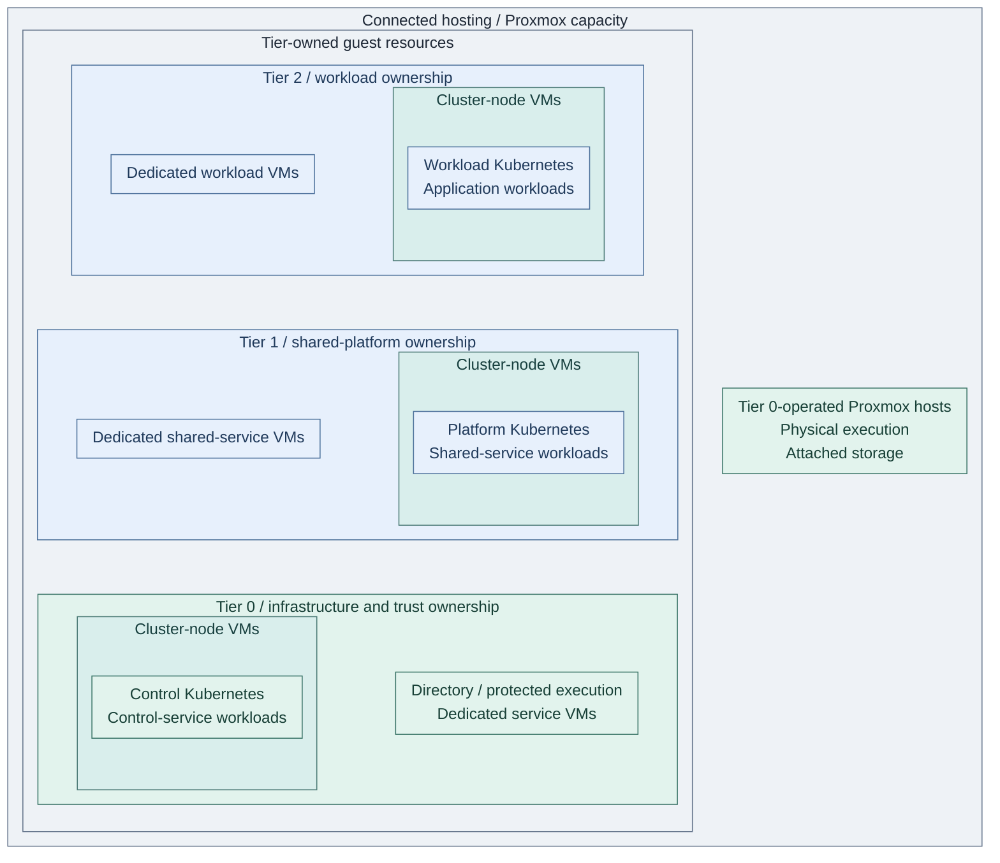
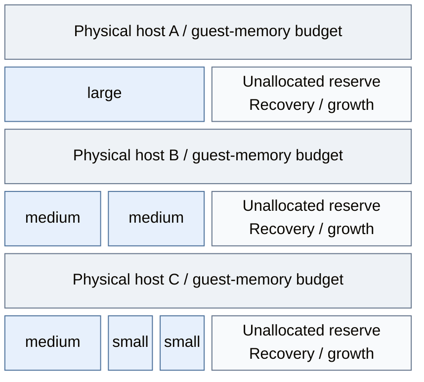

# Service runtimes and infrastructure

Services run either in dedicated guest operating systems or as workloads in a
Kubernetes cluster. In the supplied Proxmox realization, the cluster nodes are also
VMs: Kubernetes adds a service lifecycle inside the hosting foundation rather than
replacing it. Tier ownership remains separate from physical placement.

## Completed hosting model

**Reference realization:** Proxmox supplies connected VM execution across the tiers. A service can run in a
dedicated VM or in a Kubernetes cluster whose nodes are VMs. The hosting layer
does not change the service's authority classification or transfer its resource
definitions and state to another tier.

*Figure: Dedicated VMs and cluster-node VMs occupy the same hosting foundation. Kubernetes workloads
remain inside their node-VM runtime. Tier rows identify workload ownership; the hosts
to their right supply shared physical capacity under Tier 0 operation, not one pool per row.*

The VM boundary is the first hosting layer; the cluster inside node VMs is the
second. The [cluster roots](../../../tier-0/terraform/deployments/kubernetes/main.tf)
and [VM resources](../../../tier-0/terraform/deployments/kubernetes/machines.tf)
implement this nesting for the control-cluster reference. The other tier roots use
the same model; no shared Kubernetes control plane spans the rows.

The rows describe placement and ownership, not network connectivity or a shared
control plane. The [Kubernetes topology](03-kubernetes.md) selects three independent
tier clusters, each with its own API, inventory, state and credentials. Dedicated
VMs remain available alongside them. Host placement and failure-domain separation
remain explicit project decisions.

In the reference allocation, the directory pair and protected execution VM are
dedicated Tier 0 guests, while selected control services use the Tier 0 cluster.
Tier 1 cluster management is scoped to Tier 2 workload clusters and has no
authority over Tier 0. Offline root keys and their ceremony environment remain
outside this connected hosting model.

## Table of contents

- [Completed hosting model](#completed-hosting-model)
- [Runtime realizations](#runtime-realizations)
- [Scaling and host capacity](#scaling-and-host-capacity)
- [Storage interfaces](#storage-interfaces)
- [Persistence and recovery](#persistence-and-recovery)
- [Failure domains](#failure-domains)
- [Related designs and procedures](#related-designs-and-procedures)
- [References](#references)

## Runtime realizations

Both realizations expose the service's agreed client interface. Their deployment,
storage and recovery mechanisms differ and require a recorded service design.

| Concern | Dedicated VM realization | Kubernetes realization |
| --- | --- | --- |
| Execution | Service processes in an owned guest OS | Workloads on the selected cluster's node VMs |
| Client interface | Published service endpoint with service authentication and authorization | Published service endpoint with service authentication and authorization |
| Administration | Guest and service access, separate from hypervisor authority | Cluster and workload access, separate from hypervisor authority |
| Persistent data | Explicit guest disks, external services or storage attachments | Explicit persistent volumes or external data services; node replacement must preserve required data |
| Lifecycle | Approved images plus the selected configuration/update model | Cluster lifecycle plus service reconciliation and data lifecycle |
| Recovery inputs | Guest definitions, configuration, service data and scoped credentials | Cluster definitions and state, service manifests, service data and scoped credentials |

The directory pair's dedicated-VM placement is part of the reference design.
A runtime alternative for another service does not imply migration of that pair
or of any existing service. Moving a service requires an explicit data and
lifecycle design, even when its client interface remains unchanged.

## Scaling and host capacity

**Vertical scaling** gives an existing instance more CPU or RAM. **Horizontal scaling** adds instances
or hosts. Choose the layer that is constrained: larger node VMs, more workers and more application
replicas solve different capacity problems.

### How VM sizes fill a host

This illustrative allocation uses the repository's shared VM profiles. Each host has the **same
16 GiB guest-memory budget**, after separately budgeting host OS, hypervisor and storage overhead.
Read each row from allocated VMs on the left to unallocated capacity on the right.

*Figure: VM rectangle widths represent configured RAM: one large, two medium, or one medium plus
two small VMs occupy the same memory. Each host retains half its guest budget. These are illustrative packing
patterns in an example pool, not deployed inventory or measured utilization; the picture shows no
network routes, application replication or automatic capacity reservation.*

| VM profile in the figure | vCPUs | Configured RAM |
| --- | --- | --- |
| `small` | 2 | 2 GiB |
| `medium` | 2 | 4 GiB |
| `large` | 4 | 8 GiB |

The [Shared size catalog](../../../shared/config/guest-sizes.json) owns the actual values, including
`tiny`, `xl` and memory-heavy `-mem` variants. Size names describe allocations, not service importance.
The selected service's minimums still apply; the cluster root rejects undersized node profiles.
CPU demand, disk capacity/IOPS and network throughput need their own budgets; equal RAM does not mean
equal processing capacity. The VM module uses fixed RAM with ballooning disabled.

### What changes at each layer

| Layer | Vertical: larger instance | Horizontal: more instances | Control in this project |
| --- | --- | --- | --- |
| VM or Kubernetes node VM | Change its `size`, or explicit `cores` / `memory` overrides | Add guest or worker definitions, matching inventory and address entries | Owning tier's Terraform inputs and original state |
| Kubernetes application | Adjust the supported CPU/memory requests and limits | Change supported replica counts and qualify routing/data behavior | Selected service's Helm values or manifests |
| Physical hosting | Expand an existing host's hardware | Commission additional eligible hosts and their network/storage access | Foundation host lifecycle; physical expansion is external work |

The [VM module](../../../tier-0/terraform/modules/vm/main.tf) resolves profile values and per-field
overrides. The [cluster root](../../../tier-0/terraform/deployments/kubernetes/main.tf) sizes its declared
node map separately. Kubernetes then schedules application requests within node allocatable capacity;
changing a VM size does not change pod requests or replica counts. [1]

Scaling is an explicit reviewed IaC change here. Retain existing resource keys, identities and state;
review restart/replacement requirements before resizing. Application replication must use its native
data/quorum lifecycle. No cluster autoscaler is supplied. Proxmox HA/rebalancing relocates or restarts
existing VMs; it adds neither instances nor physical capacity.

### Keep room for failure as well as growth

Budget against the selected failure scenario, such as **N+1**: required workloads must still fit after
losing one host. In the picture, one host's RAM allocation fits into a survivor's reserve; actual
recovery also needs eligible placement, CPU, reachable storage, networking and application recovery.
Free RAM spread across several hosts cannot run a VM that fits on none of them. Growth consumes the
same reserve, so recheck the failure budget before allocating it. Terraform does not enforce this
physical-host capacity budget automatically.

Use [platform inputs](../../08-reference/platform-inputs.md#find-supported-settings) to find sizing fields,
[worker operations](../../05-operations/01-hosting/kubernetes-and-labs.md#add-capacity) to add cluster capacity,
and the [HA guide](../../03-deployment/foundation/proxmox/step-1b-cluster-ha.md) to qualify surviving placement.

## Storage interfaces

Dedicated VMs use declared guest disks or external data services. Kubernetes
workloads use persistent volumes or external services, with attachment and reclaim
behavior chosen separately from pod scheduling. In both cases, replacing execution
must preserve the selected dataset's identity, access scope and consistency.

[Data and storage](../06-data/README.md#storage-interfaces) defines block, file and object
contracts. Its [reference realization](../06-data/README.md#reference-realization) distinguishes
live block volumes, NAS backup files and native object endpoints.

## Persistence and recovery

Persistent data can survive guest or pod replacement without being independently
recoverable after storage loss. Restoring a service requires its compatible data,
configuration, secrets and lifecycle records; infrastructure and cluster state
have their own recovery inputs alongside application data.

The [persistence contract](../06-data/README.md#persistence-and-recovery) owns dataset
responsibilities and the transferred data view. [Operations](../11-operations/04-backup-recovery.md)
owns independent copies, retention and recovery objectives; hosting consumes those contracts.

## Failure domains

An availability claim includes the resources and dependencies that can fail
together. Tier separation, multiple VM names and a cluster label do not establish
independent failure domains by themselves.

| Domain | Required design property |
| --- | --- |
| Physical hosts | Placement identifies which guests fail together and which surviving capacity can run the required services |
| Cluster control | The selected node and quorum design identifies the failures it can tolerate and its independent recovery inputs |
| Service replicas | Replicas have a deliberate placement and data design rather than an assumed benefit from their count |
| Storage | Data placement, access paths and restore material support the declared host and service failure scenarios |
| Networking | Uplinks, switches, routing and host fabrics have recorded shared dependencies and reachable recovery paths |
| Hosted management | Loss of source control, registry, identity or inventory tooling leaves the required lower-tier recovery inputs available |

Tier 0 recovery does not require Tier 1 or Tier 2 services; Tier 1 recovery does
not require Tier 2 workloads. Normal consumption of higher-tier source or
artifact services is compatible with this rule only when protected recovery
copies and local administrative execution remain available.

## Related designs and procedures

- Parent: [Hosting and orchestration](README.md).
- Whole system: [reference platform](../03-reference-platform.md), [interaction index](../README.md#how-the-platform-works-together) and [selection guidance](../02-organization/README.md#selected-design).
- Interfaces: [networking](../05-networking/README.md), [infrastructure control](02-provisioning.md) and [tier ownership](../02-organization/01-tier-ownership.md).
- Realization: [host/image foundation](../../03-deployment/foundation/README.md#step-1-prepare-compute-and-templates) and [Kubernetes capability](../../03-deployment/stage-4-kubernetes/README.md).
- Persistence: [Data and storage](../06-data/README.md), including its selected storage qualification links.
- Acceptance and implementation coverage: [deployment readiness](../../03-deployment/readiness.md).

## References

Storage-interface sources are maintained in [Data and storage](../06-data/README.md#references).
The hosting figure is the repository's selected reference, not a cloud-provider deployment claim.

1. [Kubernetes: resource requests, limits and scheduling](https://kubernetes.io/docs/concepts/configuration/manage-resources-containers/).
