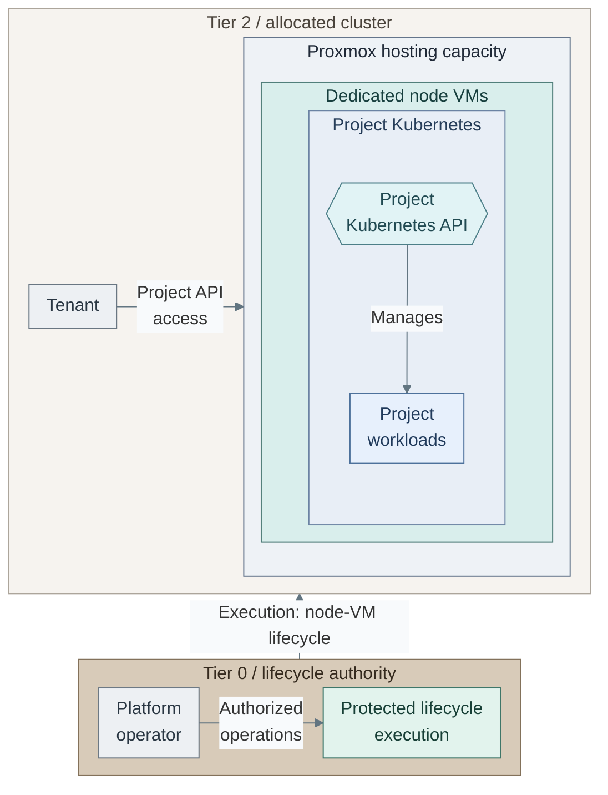

# Workload lab isolation

Provide a project-owned Kubernetes API and disposable capacity without exposing
hypervisors, host OS, control-cluster credentials or other tenants.
This differs from ephemeral CI build pods and ordinary application delivery.

*Figure: Tenant access ends at the allocated Kubernetes API. Tier 0 execution provisions and maintains
the node VMs while the tenant manages workloads inside them. Boundary arrows identify these scoped
API and lifecycle interfaces; they grant no tenant access to Proxmox.*

The figure separates using a cluster from creating or replacing it. The lifecycle
arrow names privileged operations; it does not grant tenants a return administrative path.
VM hosting does not establish a dedicated physical failure domain.

## Contents

- [Choices](#choices)
- [Authority](#authority)
- [Lifecycle and scale](#lifecycle-and-scale)
- [Realization](#realization)
- [References](#references)

## Choices

| Pattern | Appropriate scope | Constraint |
| --- | --- | --- |
| Dedicated VM-backed cluster | Reference for unsafe workloads and OS/add-on experiments | Separate control/data planes; more capacity and slower creation |
| Virtual control plane | Optional faster Kubernetes-API experiments | Shared data-plane/kernel isolation still needs qualification |
| Shared namespace | Trusted application teams | Not a separate cluster; namespace policy does not isolate cluster-scoped administration |
| Dedicated physical pool | Workloads beyond the accepted VM boundary | Separate hardware/fabric and stronger operating controls |

Kubernetes distinguishes control-plane and data-plane isolation. Virtual control
planes alone do not isolate worker kernels; namespace policy does not cover every
cluster-scoped resource. [1] The reference favors dedicated VM-backed clusters for
unsafe experiments, without claiming they are sufficient for every hostile workload.

## Authority

The platform operates lifecycle; tenants receive only their allocated Kubernetes
API and owner-scoped authorization. Hidden control-plane hosting means withholding
Talos/SSH/hypervisor credentials, not removing the tenant API.
Tenant cluster-admin is an explicit experiment option inside that cluster, never
access to the infrastructure executor or other clusters.

Tier 2 owns per-cluster definitions, inventory, allocation records and state.
Tier 0 holds provisioning authority. A dispatcher verifies identity/ownership,
accepts bounded profiles/operations and returns sanitized status/access.
A request is data, not permission to execute user CI definitions or arbitrary IaC.

## Lifecycle and scale

Profiles separate control-plane count, worker count and worker resources.
Multiple clusters need distinct VMIDs/MACs, addresses/endpoints, enforced networks,
state and credentials; an environment suffix is not an allocator.
Latency includes cloning, bootstrap, networking, identity and health. No seconds-level
target is assumed. Warm capacity or virtual clusters are separately qualified options.
Expiry is an explicit authorized event with data-retention checks. Missing requests
or an unavailable portal never authorize destruction.

## Realization

[Stage 10](../../03-deployment/stage-10-lab-environments/README.md) owns the operator path and
future request contract. The current Tier 2 root creates one configured cluster,
not a multi-tenant allocator, automatic DNS service or portal backend.
[Cluster and lab operations](../../05-operations/01-hosting/kubernetes-and-labs.md)
covers the corresponding maintenance tasks.

## References

1. [Kubernetes multi-tenancy and isolation](https://kubernetes.io/docs/concepts/security/multi-tenancy/).
