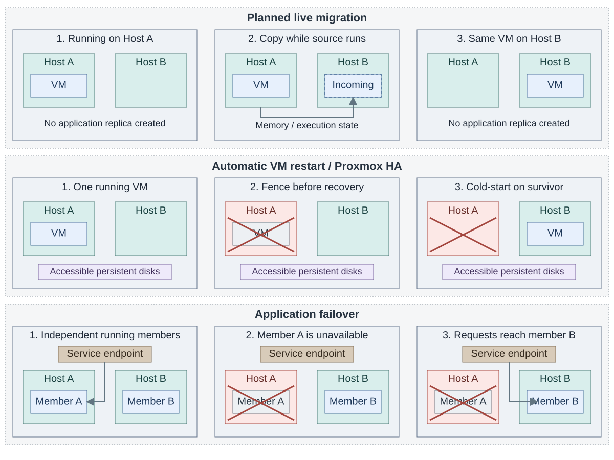
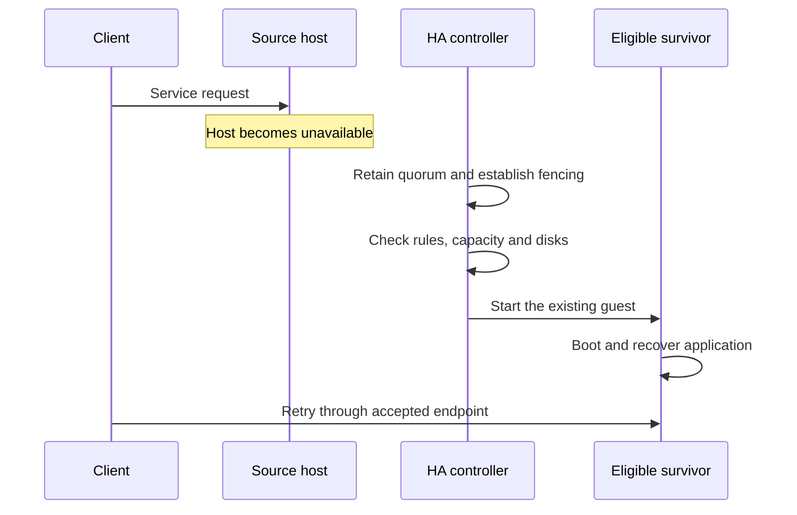

# Availability, failover and scaling

Availability is a property of the complete service path: clients, routing, running members,
data and their dependencies. More capacity and more copies help in different ways; neither
alone establishes high availability (HA).

*Figure 1: Read each independent example left to right. Live migration transfers execution from a
healthy source. VM HA waits for safe fencing, then boots the same guest from accessible disks.
Application failover directs requests to a member that was already running. Only the source and
destination hosts are shown, not a complete cluster or quorum topology. The application remains
degraded until its failed member is repaired and any required data synchronization completes.* [1][2]

## Contents

- [What each mechanism provides](#what-each-mechanism-provides)
- [What happens during a failure](#what-happens-during-a-failure)
- [How scaling changes the failure budget](#how-scaling-changes-the-failure-budget)
- [Two scheduling layers](#two-scheduling-layers)
- [Choose protection for the service](#choose-protection-for-the-service)
- [Deployment and operation](#deployment-and-operation)
- [References](#references)

## What each mechanism provides

Name the protected layer and behavior. **Automatic VM restart (Proxmox HA)** recovers the guest
with a boot interruption. **Application-level HA** uses independently running members and
service-aware routing or failover. Accept either against the service's measured outage/data target;
the Proxmox feature name alone makes no claim of continuous application service. [2]

| Term | What changes | What still needs a design |
| --- | --- | --- |
| Redundancy | An additional component, path or copy exists | Independence, selection, current data and enough surviving capacity |
| High availability | A service can continue or recover automatically within its accepted outage target | Detection, routing, safe ownership, data consistency and tested failure handling |
| Failover | Responsibility or requests move to a surviving component | Which failures trigger it, how quickly it happens and whether clients retry |
| Live migration | One running guest changes physical host during planned work | Compatible hosts/devices, usable disks, network and migration bandwidth |
| Automatic VM restart (Proxmox HA) | The same guest boots on an eligible survivor after safe host-loss handling | Cluster quorum/fencing, accessible disks and placement/capacity |
| Replication | Selected state is copied to another member or storage location | Synchronous/asynchronous guarantees, lag, corruption/deletion propagation and promotion |
| Backup and restore | Retained independent data is restored to a recovery target | Restore time, recovery point, compatible configuration and keys |

HA does not mean zero downtime. A restarted VM has lost its in-memory execution; the operating
system and application must recover. A healthy replica may shorten interruption, but client
timeouts and routing still matter. A backup solves a different failure class, including loss or
corruption replicated to the live copies. [1][2]

| Serving model | Before failure | During recovery |
| --- | --- | --- |
| Active-active | Multiple members serve requests | Surviving members carry the accepted load; routing, clients and consistent state still matter |
| Active-passive | One member serves; another is ready to take over | Detection and promotion/switchover can interrupt service |
| Restart-based recovery | One instance runs; capacity exists elsewhere | Detection, fencing, boot and application recovery interrupt service |

Active-active and active-passive are both established HA models. Choose by the required service
behavior and measured interruption, rather than treating either label as an availability guarantee. [5]

## What happens during a failure

### Planned host maintenance

In the first row of [Figure 1](#figure-availability-cases), both hosts remain available while
execution state is transferred. The guest briefly switches to the destination. There is one
logical VM, not a second application member. Host maintenance also needs a plan for guests
that cannot migrate because of local devices, storage or placement constraints. [1]

### Unexpected host loss

The second row requires a decision about safe ownership before a restart. Starting the same
disk on two uncontrolled writers risks corruption; an unreachable host is not proof it stopped. [2]

*Figure 2: Recovery has a detection/fencing interval and a boot/application interval.
The controller waits when safe ownership or placement cannot be established. The timeline
illustrates responsibilities, not fixed timings or an application-health check by the hypervisor.* [2]

### Application member loss

The third row uses independently running members and an application-aware selection mechanism.
A failed process inside a running VM may need this layer even when host HA sees a healthy guest.
Examples here include directory client endpoint failover, a single-owner cache VIP and a
database leader election. Their data and failover contracts differ; a VIP does not replicate data.

For a majority-based service, three voting members need two to agree and tolerate one member loss.
Placing all three on one physical host loses that protection in one failure. Five voters require
three votes and can tolerate two member failures; adding a fourth to three does not increase
that failure tolerance. [3]

## How scaling changes the failure budget

Read the [VM sizes and host-capacity view](01-runtime.md#scaling-and-host-capacity) first when sizing.
Availability adds a second question: **does the required service still fit after the selected loss?**

| Change | Capacity effect | Availability effect to check |
| --- | --- | --- |
| Larger VM: vertical scaling | More CPU/RAM in one instance | It must fit on an individual eligible survivor; it remains one instance |
| More application members: horizontal scaling | More serving or voting members | Members need independent placement, routing and the native data/quorum protocol |
| More worker VMs | More Kubernetes scheduling capacity | They must not all fail with one physical host; pods still need placement constraints |
| More physical hosts | More capacity and possible failure domains | Network, storage, power and eligibility must make that capacity usable |
| Automatic rebalancing | Moves existing guests to redistribute load | It creates no capacity or replicas and must respect the failure-domain design |

For N+1 host tolerance, reserve enough usable capacity after one host is unavailable. Budget
host/storage overhead and growth as well as guests. Free RAM distributed across several hosts
cannot accommodate a VM too large for each host. Growth consumes the same reserve used for
recovery; revisit the failure test after resizing or adding members.

## Two scheduling layers

| Layer | Placement unit | Constraint belongs here |
| --- | --- | --- |
| Hypervisor | VM on physical host | Host eligibility and separation of guest replicas or Kubernetes control-plane VMs |
| Kubernetes | Pod on Kubernetes node | Pod anti-affinity/topology spread, requests, storage attachment and disruption policy |

Different Kubernetes node names do not prove different physical hosts. Pod spread by
`kubernetes.io/hostname` separates pods across node VMs; it does not tell Kubernetes whether those
VMs share a Proxmox host. Preserve physical separation at the hypervisor layer too. [4]

A hard rule separating three VMs across three hosts prevents co-location after host loss.
The two survivors may retain application quorum while the third VM waits for an eligible host.
To recover all three while preserving that rule, the design needs another eligible host and
capacity. Relaxing the rule changes the failure model; it must be a deliberate decision. [2][3]

## Choose protection for the service

| Need | Selected mechanisms | Remaining failure to test |
| --- | --- | --- |
| Planned hardware work | Qualified migration and one-host maintenance | Local disks/devices, transfer load and capacity |
| Automatic return after a host dies | VM HA plus safe disk access and N+1 capacity | Fencing, no-quorum and blocked-placement cases |
| Shorter interruption for client requests | Independent application members and routing/client failover | Process/member loss and client retries |
| Continued writes after member loss | Native database/consensus replication | Majority, lag, data integrity and shared storage loss |
| Recovery after deletion or storage/site loss | Independent retained backups and recovery access | Restore into a clean target with original keys/configuration |

The [identity view](../09-identity/README.md), [cache contract](../07-software-intake/README.md) and
[observability design](../11-operations/03-observability.md) select different combinations.
Measure outage and data loss against the service's recovery time and recovery point objectives
(RTO/RPO); do not infer them from a host count or a green HA status.

## Deployment and operation

- **Install:** [Foundation cluster/HA option](../../03-deployment/foundation/proxmox/step-1b-cluster-ha.md).
- **Configure and maintain:** [Proxmox HA operations](../../05-operations/01-hosting/proxmox-ha.md).
- **Look up a UI field:** [HA controls reference](../../08-reference/proxmox-ha.md).
- **Size or expand:** [host budgets](01-runtime.md#scaling-and-host-capacity) and
  [Kubernetes capacity tasks](../../05-operations/01-hosting/kubernetes-and-labs.md#add-capacity).
- **Recover data:** [backup/recovery design](../11-operations/04-backup-recovery.md).

## References

1. [Proxmox: VM migration](https://github.com/proxmox/pve-docs/blob/master/qm.adoc#qm_migration).
2. [Proxmox: HA, fencing and affinity rules](https://github.com/proxmox/pve-docs/blob/master/ha-manager.adoc).
3. [etcd: quorum and failure tolerance](https://etcd.io/docs/v3.6/faq/#what-is-failure-tolerance).
4. [Kubernetes: pod topology spread](https://kubernetes.io/docs/concepts/scheduling-eviction/topology-spread-constraints/).
5. [Microsoft: active-active and active-passive failover cluster models](https://learn.microsoft.com/en-us/windows-server/failover-clustering/failover-clustering-overview).
