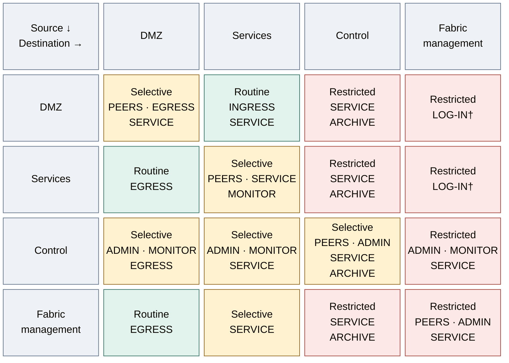

# Firewall policy

Firewall policy turns a service dependency into permission for a specific new
connection. The initiating source, receiving listener and enforcement point all
matter; sharing a zone or successfully receiving a reply grants no broader access.

## Table of contents

- [Prerequisites](#prerequisites)
- [Connected-zone matrix](#connected-zone-matrix)
- [Rule contracts](#rule-contracts)
- [Boundary peers](#boundary-peers)
- [Enforcement boundaries](#enforcement-boundaries)
- [Policy assurance](#policy-assurance)
- [References](#references)

## Prerequisites

Use the [network plan](README.md). Zone names describe network
protection; tier numbers identify repository ownership and potential impact.
Each flow has a defined gateway, switch, host or workload enforcement point.

This is the intended policy, not vendor defaults or an applied ruleset.
Deny new traffic unless an explicit rule permits its source, destination,
protocol, and listener, following default-deny guidance. [1]

## Connected-zone matrix

Rows initiate traffic; columns receive it. Zones follow protection purpose and
compatible policy, independently of repository ownership. Fabric adds the
hardware/host boundary to DMZ, Services and Control. Its matrix entries apply
only to routed management interfaces; Corosync/Ceph transport stays host-only
and non-routed where the selected topology permits it.
**Read the source row toward the destination column. Every cell is default-deny;
the labels identify the exceptions that may be configured.** Colour expresses
restriction, not a zone's architectural colour or permission for its whole subnet.

| Colour / label | Meaning |
| --- | --- |
| Green — Routine | Normal published-service or approved proxy paths; allow only their named endpoints/listeners |
| Amber — Selective | Peer, monitoring or operational paths; allow only the specific participating systems |
| Red — Restricted | Privileged boundaries or the temporary log-intake exception; tightly scoped allows only |

*Figure: The intended default-deny matrix classifies new-connection exceptions by source and destination zone,
including fabric management.*

**Policy view:** intended new-connection exceptions, not an installed ruleset.
For example, DMZ → Services permits a named ingress proxy to its application
backend; it does not permit arbitrary DMZ hosts to access every service.
The [rule contracts](#rule-contracts) below define each label.

Read the matrix in three steps: choose the initiator's row, find the destination's
column, then resolve the label to a named endpoint rule. A `SERVICE` cell still
needs a concrete consumer and listener. The published-request sequence in
[Networking](README.md#service-reachability-and-publication) shows why replies
belong to the accepted exchange rather than a blanket reverse-direction allow.

† The current starter log receiver shares management VLAN 10. Permit only its
authenticated intake listener from approved producers, not hardware access.
The [dedicated VM-administration split](../../02-conventions/network-plan.md#separate-host-and-vm-administration)
places that receiver in Control when selected. Matrix membership does not perform the migration.

For example, a proxy may reach its backend and designated DNS servers.
It cannot administer the hypervisor. A workload may authenticate against an
identity endpoint without gaining access to its management interface.

DMZ contains separate client, edge-server and build/mirror subnets.
The diagonal is default-deny too: permit clients to named published listeners,
approved consumers to the cache, and runners to named sources/registries only.
Do not permit client-to-client or cross-tier access merely because both are DMZ.
No DMZ-to-Control rule permits Tier 0 administration or raw HSM connector access.
An approved consumer may use a named policy-enforcing issuance/signing API under
the [cryptography contract](../08-cryptography/04-usb-hsm.md#authority-and-transport).
Network reachability does not authorize key use; foundational Tier 0 traffic
retains its independent private path.

Tier 0 connected control systems appear in the appropriate network policy.
**Offline custody does not:** there is no connected zone or route into it.
Approved offline transfers are a separate procedure, never a matrix exception.

Permit stateful replies to allowed connections without authorizing arbitrary
new sessions in the reverse direction. [1] A backend's reply to its proxy
does not require permission to initiate connections to every DMZ host.

## Rule contracts

| Label | Purpose | Required scope |
| --- | --- | --- |
| `INGRESS` | published application entry | exact proxy IPs to published backend listeners and health checks |
| `SERVICE` | service consumption | named consumers to designated DNS, time, identity, secrets, registry, or other service endpoints |
| `EGRESS` | controlled outbound access | approved clients to a proxy/cache listener, not every DMZ service |
| `ADMIN` | administration | approved bastions or runners to specific admin endpoints with target-tier credentials |
| `ARCHIVE` | backup/archive writes | named producers to a dedicated receiver; no storage administration or cluster fabric |
| `MONITOR` | monitoring | named collectors to read-only exporters or health endpoints |
| `PEERS` | same-zone dependencies | explicit dependencies or replication between selected hosts/subnets; no implicit peer trust |
| `LOG-IN`† | current management-subnet log intake | approved producers to the protected receiver's authenticated listener; no hardware administration |

Control-zone membership is not an administrative credential. An ordinary
workload or Tier 1 runner must not gain Tier 0 authority through an `ADMIN` rule.
Privileged execution and its approval path must be protected at the target tier.

Example rules, using addresses from the local plan:

| Rule name | Source selector | Destination selector | Protocol/listener |
| --- | --- | --- | --- |
| `edge-to-web` | ingress proxy IPs | published backend IPs | configured HTTPS/backend port |
| `apps-to-dns` | approved app subnets | DNS server IPs | TCP and UDP `53` |
| `apps-to-login` | approved app hosts | identity provider VIP | TCP `443` when deployed with HTTPS |
| `apps-to-cache` | approved app hosts | cache VIP | TCP `3128` for the reference proxy |
| `control-to-update-supply` | selected Tier 0 update clients | approved proxy VIP or internal mirror IPs | proxy TCP `3128`, or selected repository HTTP/HTTPS listener; no reverse administration |
| `clients-to-web` | Tier 2 client subnet | published application VIPs | configured HTTPS listener |
| `runner-to-source` | Tier 1 DMZ runner IPs | approved source/registry endpoints | configured HTTPS listener |
| `sources-to-security-logs` | registered producers/relays from each tier | Tier 0 log-intake IPs only | selected authenticated submission listener; not archive read/admin APIs |
| `admin-to-platform` | Tier 0 bastion/runner IPs | platform admin API | configured listener; scoped admin identity |

These are not the complete requirements of an identity or cluster deployment.
Derive other ports from the actual service configuration. A network allow
does not replace authentication or authorization.

All tiers can submit security records under the
[logging contract](../11-operations/01-protected-logging.md). This exception grants
append-only service submission, never general DMZ-to-Control or storage access.
Developer queries target approved Tier 1 application-log views, not Tier 0 raw evidence.

Record each rule's reason, source/destination objects, protocol/ports, IP family,
enforcement point, owner, and positive/negative tests. Give temporary rules an expiry.

## Boundary peers

Apply these alongside the server-zone matrix:

| Initiator | Destination | Intended rule |
| --- | --- | --- |
| Internet/WAN | DMZ | only published VIPs/listeners; no direct Services or Control exposure |
| egress proxy/cache | Internet/WAN | required upstream destinations/protocols only |
| Services or Control hosts | Internet/WAN | deny by default; approved egress or explicit bootstrap exception |
| Tier 2 client subnet in DMZ | application/access entry points | named service interfaces, not general subnet access |
| approved admin devices | bastion/admin entry | scoped entry then target-specific administration |
| managed networks | gateway services | required DHCP/DNS/time only; separate gateway admin permissions |
| control administrators | gateway/switch administration | named endpoints and admin protocols |
| gateway-originated services | managed networks | required infrastructure traffic, not blanket trust |

A VPN is an entry path, not a privilege tier. Review VPN, NAT, and port-forward
policy alongside the zone rules. Remove direct Internet bootstrap exceptions
when the approved update path is ready.

## Enforcement boundaries

- **Routed subnets:** filter at the device that routes the traffic.
- **Same zone:** filter member subnets explicitly, including the matrix diagonal.
- **Same subnet or host:** use switch isolation, host firewalls, or workload
  policy; that traffic need not cross the gateway. [2]
- **Cluster/storage fabric:** restrict host/interface membership without exposing it through a gateway.
- **IPv6:** apply the same policy intent or disable it where unsupported; retain
  required ICMPv6 functions rather than blocking them indiscriminately. [3]
- **Offline custody:** no routed gateway, dual-homed host, VPN, or temporary allow
  may bridge physical isolation.

## Policy assurance

Policy acceptance requires evidence for approved flows, denied administrative
access, same-zone isolation, stateful replies, IPv6 parity and offline-custody
separation. A naming convention is not evidence of enforcement.
The [Step 1 rollout procedure](../../03-deployment/foundation/network/firewall.md)
owns the change sequence and test matrix.

## References

Sources checked 2026-10-16.

1. [NIST SP 800-41 Rev. 1: Guidelines on Firewalls and Firewall Policy](https://nvlpubs.nist.gov/nistpubs/Legacy/SP/nistspecialpublication800-41r1.pdf)
2. [Ubiquiti: Implementing Network and Client Isolation](https://help.ui.com/hc/en-us/articles/18965560820247-Implementing-Network-and-Client-Isolation-in-UniFi)
3. [RFC 4890: Recommendations for Filtering ICMPv6 Messages in Firewalls](https://www.rfc-editor.org/rfc/rfc4890.html)
