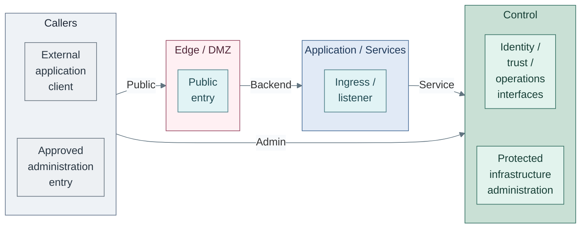
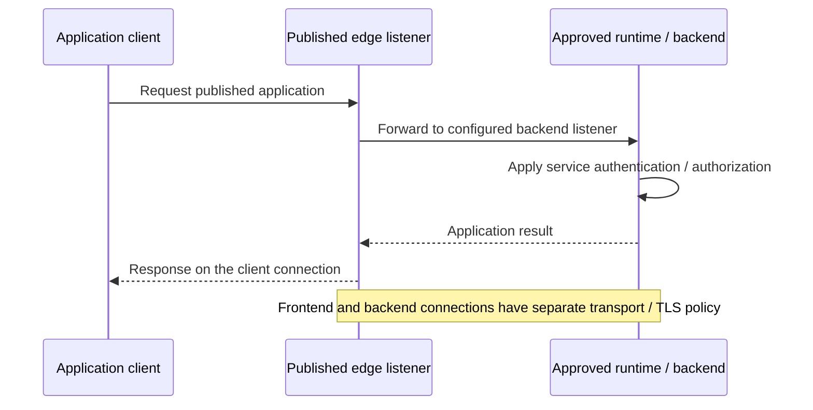

# Networking and connectivity

Networking supplies reachability, service publication and isolation between
clients, services, data interfaces and infrastructure. The capability applies
across physical and virtual networks; a selected site translates its endpoint
contracts into routing, attachment and enforcement configuration.

Start with a connection: who initiates it, which listener receives it and which
boundary enforces that scope? Published applications, private service dependencies,
outbound supply and privileged administration each answer those questions differently.

## Completed connectivity

The connected platform distinguishes published application traffic, service
dependencies, controlled egress and privileged administration. Each connection
below represents a named endpoint contract, not access to an entire zone.

*Figure: Boundary links represent named interfaces: the external client uses the public Edge
listener; Edge uses the Application / Services backend; that service uses Control identity,
trust and operations interfaces. The approved administration entry separately uses protected
infrastructure administration. The caller group is not a shared network or authority.*

Ingress and egress are distinct functions, not necessarily one gateway service.
Application entry and administrative entry have separate policy and credentials.
The figure reads from consumer to the interfaces it needs. Its boxes are network
protection layers, not tier ownership or physical hosting. Exact listeners, same-zone
dependencies, telemetry, backup and return traffic are defined by the
[firewall rule contracts](01-firewall-policy.md#rule-contracts).

Outbound software access runs in the other direction: approved internal consumers
initiate requests to the Tier 2 proxy, which reaches allowed external sources.
Tier 1 build runners and authoritative mirrors also use explicitly approved source
and artifact interfaces. Ordinary client devices occupy a separate DMZ subnet and
receive named application access. None of these paths grants access to every host
in a layer. The [software-intake sequence](../07-software-intake/README.md#cache-request-and-response)
explains the outbound exchange.

Infrastructure also has attachments outside this routed service view:

| Attachment | Completed role | Boundary |
| --- | --- | --- |
| Guest bridge or VNet | Connect selected VM and cluster-node interfaces to their approved purpose networks | Guest attachment does not grant switch, gateway or hypervisor administration |
| Host management | Reach protected infrastructure administration endpoints | Approved administration sources and target-specific credentials |
| Host quorum and storage transport | Carry the selected cluster and storage fabric traffic | Restricted membership; no general routed guest access |
| Offline ceremony fabric | Support separately controlled custody and authorized transfers | Physically separate from connected hosts and networks; no routed gateway |

The [hosting runtime design](../04-hosting/01-runtime.md) shows the guests and hosts
that consume these attachments. The physical underlay can support multiple
logical networks without making their policies or failure domains identical.

## Table of contents

- [Completed connectivity](#completed-connectivity)
- [Service reachability and publication](#service-reachability-and-publication)
- [Supplied and consumed interfaces](#supplied-and-consumed-interfaces)
- [Zone assignment](#zone-assignment)
- [Design choices](#design-choices)
- [Network catalog](#network-catalog)
- [VLAN ID strategy](#vlan-id-strategy)
- [Automation mapping](#automation-mapping)
- [Attachment constraints](#attachment-constraints)
- [Reference realization](#reference-realization)
- [Continue reading](#continue-reading)
- [References](#references)

## Service reachability and publication

Publication exposes a deliberately selected application interface. It is separate
from installing software or approving a release. A deployed backend can remain
private; a published endpoint can route to an already existing service without
changing that service's release owner.

*Figure: A published request crosses two selected connections and returns through the edge. The
backend response does not grant permission to initiate arbitrary reverse connections.*

This is the selected proxy path once a listener is commissioned. The edge starter
has no application listeners enabled: the [edge guide](../../03-deployment/stage-7-delivery/procedures/edge-proxy.md)
and [HAProxy template](../../../tier-2/ansible/roles/edge_load_balancer/templates/haproxy.cfg.j2)
define the frontend/backend realization. Internal clients can instead use an approved
private listener; they need not traverse public ingress.

Public edge load balancing belongs to Tier 2 / DMZ. Runtime ingress belongs to the
consuming service; private control/API endpoints follow their target authority and
remain separate from public publication. Outbound proxying is client-initiated supply,
not an inbound publication or artifact-promotion interface.

Each frontend/backend hop has its own transport, TLS, authorization and failure
contract. DNS names, ingress controllers and VIP counts do not establish isolation,
redundancy or backend readiness.

Clients use [stable service DNS names](../../02-conventions/service-dns.md), such as
`git.corp.example.com` or `proxy.corp.example.com`. The name identifies the accepted
service interface; numbered host names remain separate operational identities.

The [firewall policy](01-firewall-policy.md#rule-contracts) owns source/destination/listener
rules. [Software lifecycle](../10-delivery/README.md#domain-boundaries) owns accepted
versions and application change authority; [Hosting](../04-hosting/02-provisioning.md) owns
privileged infrastructure execution. Serving an application's traffic grants neither
release-promotion rights nor control over the host, cluster or network.

## Supplied and consumed interfaces

Hosting consumes approved host/guest attachments; services supply their required
listeners and dependencies. Networking provides scoped transport for application,
storage and administrative traffic. Dataset permissions and service authorization
remain with the resource owner.

Tier classification comes from authority and impact, not subnet names. Network
configuration and inventory are retained state; Operations consumes that inventory
and evidence when checking access, isolation and recovery.

## Zone assignment

Proxmox SDN zones group guest networks for deployment and permissions; gateway
firewall zones group networks for traffic policy. Matching purpose names makes
the two views easier to navigate, but does not synchronize their configuration
or create firewall rules. The [SDN mapping](../../03-deployment/foundation/proxmox/step-1c-sdn.md#step-2-create-the-vnets)
connects the reference VNets and VLANs to both groups.

The opening figure reads left to right through these protection layers:

| Layer | Firewall zone | Network purposes |
| --- | --- | --- |
| Edge | `DMZ` | public ingress, ordinary clients, outbound caches, Internet-facing build/supply services |
| Application | `Services` | shared services, access front ends, workloads |
| Control | `Control`, `Fabric` | privileged guest services; separate hardware management and host transport |
| Offline custody | none | root keys and authorized recovery ceremonies |

A tier selects the owning repo, not a VLAN or zone. One subnet belongs to one
firewall zone; group subnets only when their baseline policy matches. Add
`Lab`, `Storage`, or another zone when the required policy differs, not
because another repository exists.

Zone membership does not allow traffic. Use [named service rules](01-firewall-policy.md)
between subnets, including subnets in the same zone. Same-subnet traffic needs
host, switch, or workload enforcement. WAN and VPN entry remain boundary peers;
ordinary clients are Tier 2 members of a separate DMZ subnet. VPN membership
alone grants no control authority.

| Instance | Tier | Network / zone | Authority boundary |
| --- | --- | --- | --- |
| Public edge load balancer | 2 | `external_edge` / DMZ | Named application backends; no Tier 0 administration or foundational signing dependency |
| Ordinary outbound proxy/cache | 2 | `external_edge` or isolated egress subnet / DMZ | Approved outbound forwarding; no unsolicited WAN publication or artifact promotion authority |
| Ordinary client device | 2 | separate `client` subnet / DMZ | Named service access; never implicit peer or administrative access |
| General build runner / authoritative mirror | 1 | `delivery_edge` / DMZ | Scoped build or software-publication credentials; no Tier 0 credentials |
| Privileged workstation, jump host, bootstrap VM or infrastructure runner | 0 | `management` / Control | Explicit Tier 0 administration and independent recovery |
| Internal control/API load balancer | target tier | protected target network | Independent of public ingress; preserve target authority and recovery |

USB signing uses a private Tier 0 endpoint on its service pool, not a
separate load-balancer pair. Authorized Tier 1/2 consumers use policy-enforcing
APIs under the [cryptography contract](../08-cryptography/04-usb-hsm.md#authority-and-transport).
Any approved publication path is optional; Tier 0 retains independent private access.

Internet access alone does not select a tier. Exposure selects the network policy;
credentials and potential impact select ownership. An outbound cache has an
internal listener, but that does not require an Internet port-forward. Clients
likewise do not receive unsolicited WAN access simply by belonging to DMZ.

A privileged jump host is not an ordinary DMZ host. If remote administration
needs a perimeter entry, isolate that entry from the privileged session host and
allow only the approved access protocol. No public edge host holds Tier 0 secrets
or bridges into Control. Network location alone does not grant trust. [1]

## Design choices

Each variant realizes the same attachment and traffic contracts. The
[selection guidance](../02-organization/README.md#selected-design) records the selection for the completed environment.

| Decision | Alternatives | Stable contract |
| --- | --- | --- |
| Guest attachment | VLAN-aware bridge or SDN VNet over the host underlay | Approved purpose network, one tagging owner and the same endpoint policy |
| Policy grouping | Existing zones with explicit subnet rules, or an additional zone for different baseline policy | No implicit trust between member subnets; enforcement follows the required isolation |
| Host transport | Shared physical underlay with separated logical fabrics, or selected dedicated links/switches | Required quorum/storage reachability, restricted membership and recorded physical failure domains |
| Application publication | Existing shared proxy or a separately operated proxy | Explicit published listener and backend scope; administrative authority remains separately classified |
| Endpoint resilience | Existing qualified entry or selected proxy/balancer members | Address ownership, failover and backend readiness need separate evidence; multiple VIPs alone are not load balancing or HA |

The alternatives do not change tier ownership or automatically create redundant
paths. Cabling, switch configuration and vendor-specific policy translation
belong in the implementation procedures.

## Network catalog

The [reference network plan](../../02-conventions/network-plan.md) provides the selected
example realization: a zone-to-VNet overview, per-zone VLAN/Name/Alias/subnet/gateway
rows, and links to the owning deployment inputs. Exact allocations and deployed
host names belong in that implementation view.

The Control zone groups privileged VM services. Fabric groups hardware management
and host cluster/storage transport. Both occupy the foundational Control layer. Host-only transport remains outside guest SDN;
an existing UniFi Fabric zone does not require Proxmox SDN Fabrics or a routed gateway.

The [deployment mapping](../../02-conventions/network-plan.md#deployment-mapping) shows
current starter attachments and optional variants. In particular, protected
management VMs currently share the host-management VLAN; selecting a dedicated
VM-administration network requires explicit inputs and a planned cutover.

A service may have separate client, backend, and administrative interfaces.
Multi-interface hosts must not bridge zones. Offline custody requires physical
separation: a VLAN, missing route or deny rule on a connected fabric is not an air gap.

## VLAN ID strategy

Use the [reference VLAN ranges](../../02-conventions/network-plan.md#vlan-id-ranges)
when recording site allocations in `platform-standards.md`. VLANs identify attachments,
not security labels or ownership tiers. Keep IDs unique on shared trunks; guest IPs
and selected attachments remain tier-owned inputs.

## Automation mapping

Tier 0 operates the physical network across all tiers. Each tier selects
approved guest attachments; the generator neither creates networks nor installs
firewall rules.

Shared holds approved network references; each tier selects or overrides its guest
attachments and retains host/IP identity. The Linux guest roots select a logical network
key. Kubernetes roots select their node bridge/VNet and tagging directly.

The [network-input contract](../../08-reference/network-inputs.md#field-reference)
owns exact fields and defaults. Select one tagging owner, VNet or guest NIC, and verify
that the selected bridge, subnet and gateway match the intended network. A shared key
neither attaches a guest nor creates a route, permission or matching subnet.
Host management, quorum and storage fabrics stay outside guest inputs unless deliberate.

## Attachment constraints

Management and host fabrics support infrastructure control; guest attachments follow
the selected service purpose and policy. Tier numbers are not VLANs. Offline custody
remains separate from the routed platform.

Existing networks can satisfy the same policy; a project does not need another DMZ
when a shared proxy can publish its endpoint. Isolation and recovery requirements
apply regardless of subnet count.

The [Step 1 procedure](../../03-deployment/foundation/README.md#step-1-prepare-compute-and-templates) owns setup
order; [firewall rollout](../../03-deployment/foundation/network/firewall.md)
owns implementation and acceptance tests.

## Reference realization

The reference maps purpose networks to Proxmox bridges/SDN VNets and UniFi firewall
zones. Those products realize the same reachability and policy contracts; matching
labels do not synchronize configuration or grant access.

The [Tier 2 edge guide](../../03-deployment/stage-7-delivery/procedures/edge-proxy.md)
owns load-balancer installation and listener/VIP inputs. The
[public HTTPS path](../../03-deployment/stage-10-lab-environments/step-4b-public-https.md) owns selected
external publication and origin trust. [Cluster platform installation](../../03-deployment/stage-4-kubernetes/procedures/basic-platform.md#certificates-and-ingress)
owns the runtime ingress realization. These procedures provide implementation
details and acceptance limits; no public listener is implied by this architecture.

## Continue reading

Read [firewall policy](01-firewall-policy.md) next to turn these relationships into
scoped connection contracts. The [reference platform](../03-reference-platform.md),
[hosting runtime](../04-hosting/01-runtime.md) and [data interfaces](../06-data/README.md)
identify the endpoints and attachments being connected; [software lifecycle](../10-delivery/README.md)
retains release acceptance authority.

For realization, follow [deployment](../../03-deployment/README.md),
[Proxmox host networking](../../03-deployment/foundation/proxmox/network.md) and
[UniFi zone setup](../../03-deployment/foundation/network/unifi.md). Record site choices using
[project conventions](../../04-development/project-documentation.md#start-with-project-values).
[Host hardening](../../05-operations/01-hosting/proxmox-hardening.md) and
[client/service access](../../05-operations/04-identity.md) cover operation of the selected controls.
The [platform map](../README.md#foundational-capabilities) and
[interaction examples](../README.md#how-the-platform-works-together) provide wider context.

## References

1. [NIST SP 800-207: Zero Trust Architecture](https://csrc.nist.gov/pubs/sp/800/207/final) (accessed 2026-10-14)
