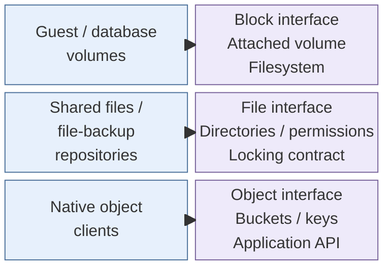
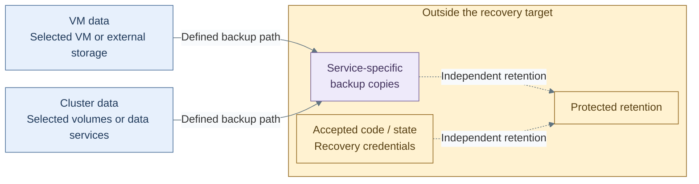

# Data and storage

Data and storage supplies persistent datasets and the interfaces used to access them.
Applications retain authoritative records, configuration and operational state through
runtime replacement. The capability can be provided by local storage, a shared system
or an existing managed data service; the selected interface and ownership remain explicit.

A service needs a particular storage interface, not simply a place with spare
capacity. First choose the access contract, then identify the authoritative data
and the independent material needed to recover it.

*Figure: Consumers access storage through their supported block, file or object interface. The rows
are distinct contracts; an available file share cannot stand in for a required object API.*

For example, a database can keep live data on block volumes and send completed
backups to a file repository. That backup destination does not become its live
database volume. A different application may also require object storage for its
live uploads. The [storage prerequisites](../../03-deployment/foundation/storage/README.md)
map these interfaces to the actual supplied consumers.

## Contents

- [Storage interfaces](#storage-interfaces)
- [Authoritative data and state](#authoritative-data-and-state)
- [Administration and consumption](#administration-and-consumption)
- [Persistence and recovery](#persistence-and-recovery)
- [Reference realization](#reference-realization)
- [Related designs and qualification](#related-designs-and-qualification)
- [References](#references)

## Storage interfaces

| Interface | Consumer contract | Typical dataset |
| --- | --- | --- |
| Block | Addressable volume with qualified attachment, filesystem and failure behavior | Guest disks, application/database data and transaction logs |
| File | Named files/directories with agreed permissions, locking and sharing semantics | Shared media, documents, archive copies and file-backup repositories |
| Object | Named objects/buckets through the required application API | Application objects, artifacts and supported database backup objects |

Interfaces can coexist on the same storage system without being interchangeable.
**Object storage** names the capability; **S3-compatible API** names the interface
preferred by the supplied object clients. It does not imply AWS-hosted infrastructure. [2]

A NAS/file-service label does not establish object serving, block storage or retention
locks. Each consumer requires its actual supported operations, trust, credentials,
performance and recovery contract. API compatibility alone does not establish those
properties, nor does another share create an independent failure domain.

## Authoritative data and state

| Material | Authority and consequence |
| --- | --- |
| Application data | The service owns business records, uploaded files and authoritative evidence; reinstalling its software does not recreate them |
| Service configuration and secrets | Accepted definitions, private configuration and key material must match the selected data; some cannot be regenerated |
| Infrastructure state | Resource bindings and ownership remain with the consuming tier/backend; a code checkout is not the original state |
| Cluster state | Runtime objects, credentials and attachment records are distinct from application volume contents |
| Derived data and caches | Rebuildability is an explicit service decision with retained source/range, not a property inferred from the runtime |

A shared storage backend does not imply a shared database for every application.
Service-native stores retain their own data and consistency requirements. Database,
media, configuration, encryption keys and externally stored objects form an explicitly
compatible service set rather than one undifferentiated volume backup.

## Administration and consumption

| Authority | Boundary |
| --- | --- |
| Storage administrator | Operates devices/pools, access paths and storage-level policy; privileged administration remains separate from application use |
| Dataset owner | Defines authoritative contents, consistency, access scope and application lifecycle |
| Dataset consumer | Receives only authorized volume/share/bucket or data-service access |
| Recovery/retention custodian | Holds independently usable recovery/deletion authority under the [operations contract](../11-operations/04-backup-recovery.md#authority-and-consistency) |

In this repository, storage administration is Tier 0 authority. Datasets and their
resource definitions/state retain their actual consuming tier; Shared holds reusable
references/helpers, not storage inventory or another tier's credentials.
A writable file credential or storage administrator may still alter/delete history.
The absence of a prune command does not enforce retention.

## Persistence and recovery

Runtime availability, persistent data and recoverability are separate contracts.
The dataset owner identifies its authoritative source and consistent recovery inputs;
the operations design defines the required copy and retention policy.

*Figure: Live VM and cluster storage feed service-specific backup paths. Recovery also needs retained
state, accepted code and credentials outside the system being recovered.*

This view describes logical data responsibilities for VM/cluster-hosted services.
It does not prescribe a backup product, claim that raw volume copies are application
consistent, or establish independent custody merely by drawing another storage box.
Scheduled full copies and continuously archived transactions have different recovery
limits, defined by the selected service contract.

Follow the figure from left to right: losing execution should leave the live
dataset recoverable, while losing that dataset requires the backup and recovery
records. A backup is usable only as part of the service's compatible data,
configuration and key set. Storage administration remains separate from those
application and recovery responsibilities.

Kubernetes persistent-volume objects express storage consumption separately from a
pod's lifecycle; the actual backend, attachment/access mode and reclaim behavior
still require an explicit design. [3] A replica count, storage capacity or snapshot
does not replace the [independent recovery model](../11-operations/04-backup-recovery.md).

## Reference realization

**Live databases:** the selected implementation keeps data/WAL on qualified
Proxmox/Ceph-backed block storage. NAS file areas receive backup copies or explicitly
selected shared files; selecting a NAS backup does not move live database volumes.

**Proxmox/Ceph:** RBD supplies live block disks and CephFS supplies files. Object serving
additionally needs a commissioned Object Gateway (RGW) or another native object endpoint.
An existing RBD/CephFS deployment does not establish that RGW exists. [1][2]
The shared storage-class profile references existing services; it installs none of them.

**NAS/UNAS qualification:** serving interfaces depend on the actual model/software.
The reviewed UNAS documentation describes SMB/NFS file access and backups **to**
object-storage destinations. Outbound backup support is not evidence of an application-facing
object-storage endpoint. Verify the required serving interface rather than inferring
its presence or absence from a NAS product name. [4][5]

The supplied implementation consumes a qualified existing object endpoint only when
required by the application. It does not deploy RGW or a NAS-to-S3 translation service
as a side effect. A missing required interface remains an explicit prerequisite.

## Related designs and qualification

- [Runtime placement](../04-hosting/01-runtime.md) and [protected infrastructure control](../04-hosting/02-provisioning.md).
- [Backup/recovery rationale and custody](../11-operations/04-backup-recovery.md); [protected evidence](../11-operations/01-protected-logging.md).
- [Selected storage prerequisites](../../03-deployment/foundation/storage/README.md) for actual interfaces, source permissions and product qualification.
- [Reference platform](../03-reference-platform.md) and [selection guidance](../02-organization/README.md#selected-design) for selected service composition.
- [Runtime relationships](../11-operations/04-backup-recovery.md#recovery-boundaries) for the cross-capability data, evidence and restore flows.

[Hosting and orchestration](../04-hosting/README.md) consumes the storage interfaces.
[Backup tasks](../../05-operations/06-resilience/README.md#backups) and
[storage recovery](../../05-operations/06-resilience/recovery/README.md) implement the
selected copy and restore procedures.

## References

1. [Proxmox Ceph integration: RBD and CephFS](https://raw.githubusercontent.com/proxmox/pve-docs/master/pveceph.adoc).
2. [Ceph Object Gateway and its S3-compatible interface](https://docs.ceph.com/en/squid/radosgw/).
3. [Kubernetes persistent-volume lifecycle and access contracts](https://kubernetes.io/docs/concepts/storage/persistent-volumes/).
4. [UNAS file-access interfaces](https://help.ui.com/hc/en-us/articles/39670142044567-Accessing-UniFi-NAS-UNAS-Drives).
5. [UNAS backup destinations](https://help.ui.com/hc/en-us/articles/30961935781655-Troubleshooting-UNAS-Backup-Issues).
