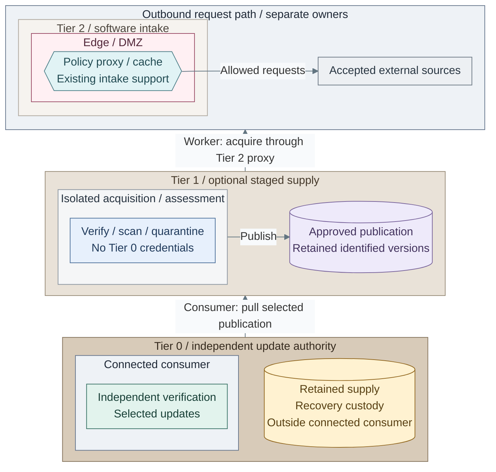
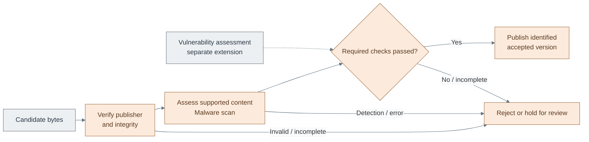

# Artifact verification and quarantine

Controlled staging adds a decision before software publication: acquire a candidate,
verify its origin and bytes, assess it, then publish an identified accepted version.
The proxy remains a transport policy service. The optional native worker realizes this design
for RPM/APT repository subsets and selected files; it does not install an OCI vulnerability gate.
Staging makes the downloaded bytes available for inspection before any consumer can
read them. The connected proxy path remains available separately and does not scan
HTTPS tunnels or create snapshots.

## Placement and authority

*Figure: Tier 1 acquires through the Tier 2 proxy and publishes only accepted content. Tier 0 pulls
selected versions and retains its own recovery supply outside the connected consumer. Boundary arrows
name the worker's proxy and consumer's publication interfaces; supplier access grants no installation authority.*

**Architecture:** the optional worker and publication interface have a separate
[deployment path](../../03-deployment/stage-3-trust/step-15b-verified-intake.md).
Publication is a scoped write; recovery custody is independent of this connected
supplier path. No online route to offline material is implied. Other tiers can also
consume approved publication.
The [runtime gate](../../../tier-1/ansible/roles/software_intake/files/runtime/tasks/source.yml)
and [publication tasks](../../../tier-1/ansible/roles/software_intake/files/runtime/tasks/publish.yml)
implement acquisition, verification, assessment and promotion as separate steps.
An existing repository product can provide these functions without a separate VM per check.
One isolated worker is a valid starting point. In the single-host reference its outage pauses
new intake and its publication endpoint; approved versions survive on disk and in independent
recovery copies. Worker count does not establish repository availability.

Tier 1 owns shared publication and the isolated intake runtime. Tier 2's cache neither approves
releases nor holds signing keys. The downloader cannot overwrite accepted releases, change policy
or administer consumers. Promotion requires a separate, scoped publication identity; routine jobs
can promote automatically under reviewed policy, with exceptions held for review.
Tier 0 independently selects/verifies versions and retains recovery content without Tier 1/2.
No online route reaches offline custody, and no lower tier initiates a privileged installation.

## Contents

- [Placement and authority](#placement-and-authority)
- [Acceptance policy](#acceptance-policy)
- [Storage and failure behavior](#storage-and-failure-behavior)
- [Evidence and operations](#evidence-and-operations)
- [Implementation boundary](#implementation-boundary)
- [References](#references)

## Acceptance policy

*Figure: Verified intake publishes only candidates that pass the selected checks; failed or incomplete checks
cannot replace the last accepted version.*

Read this gate from candidate to publication: every required check applies to the
same sealed bytes. Rejection or an incomplete check takes the hold path rather than
making a partial release visible. The vulnerability-assessment extension is not
installed by the native worker.

| Gate | Required decision | Failure |
| --- | --- | --- |
| Acquisition | Accepted source, redirects and verified TLS; complete bounded download | No publication |
| Publisher / integrity | Trusted signing identity, correct signature/digest and valid metadata | Reject; record reason and artifact identity |
| Malware | ClamAV assessment of the actual supported content with fresh definitions | Detection rejects; errors, limits, encrypted/uninspected content hold for review |
| Vulnerability — separate extension | Trivy assessment where the target is supported; policy considers exposure, severity and available fixes | Not installed by this reference; do not imply malware scanning supplies CVE policy |
| Promotion | All required checks passed for the same immutable bytes and policy revision | Previous approved version remains selected |

APT authenticates repository metadata and the referenced package hashes; RPM package verification
and repository metadata verification are distinct. Preserve vendor signatures and freshness checks.
Rebuilding an APT/RPM repository may require a separately trusted repository-metadata signing key;
copying selected packages alone does not create a consistent, authenticated snapshot. [1][2]
SHA-256 establishes identity only against a trusted expected digest. For OCI, verify the selected
publisher key or certificate identity/issuer, not merely the existence of a Cosign signature. [3]

ClamAV is malware assessment; Trivy is vulnerability assessment. Neither replaces provenance or
each other. Define target coverage and scan limits before accepting results: scanning an opaque
disk-image file does not prove every file in its guest filesystem was inspected. Never execute
candidate software to test it in the intake service. Restricted filesystem mounts are defence in
depth, not a sandbox for processing hostile files. [4][5]

## Storage and failure behavior

| Area | Access / retention contract |
| --- | --- |
| Proxy cache | Disposable performance data; never approval history or quarantine |
| Staging | Non-serving, bounded temporary area; unprivileged processing and no consumer access |
| Quarantine | Private administrator-only tree on the restricted data mount; size reserve, age expiry and incident holds |
| Approved publication | Immutable version identity, atomic selection of a complete set, read-only consumers; retain the previous accepted set |
| Tier 0 retained supply | Independently recoverable bytes, trust roots, receipts and tools; not solely a Tier 1 share or cache |

The reference deployment provisions a separate data disk and manages its XFS/ext4 filesystem,
restricted mount and growth through IaC. Only a verified new blank device is initialized;
recognized existing data keeps its filesystem identity and is mounted by UUID. A missing declared
volume or conflicting identity requires recovery rather than automatic replacement formatting.
Publisher keys and HTTPS trust remain external inputs. See the
[deployment inputs](../../03-deployment/stage-3-trust/step-15b-verified-intake.md#1-initialize-inputs).

Recheck content identity immediately before promotion and prevent modification between verification
and publication. Consumers must never resolve a partially published snapshot. Quarantine full,
scanner failure, stale definitions or incomplete assessment stops new promotion; it must not delete
or replace the last accepted release. Approved repository availability has its own backup/service
contract. A revoked or expired release may still be unusable: retention does not override trust policy.

Ordinary [proxy traffic](README.md#cache-request-and-response) remains a separate, unscanned path.
Enforcing staged intake for Tier 0 means
commissioning its package repositories/artifact sources to use approved publication, then denying
live-source bypass. Installing ClamAV beside Squid cannot enforce this over CONNECT. [6]

## Evidence and operations

Record artifact digest, publisher, source identifier, check versions/database ages, policy revision,
verdict, reason, timestamp and job identity. Exclude credentials and authenticated URL paths/queries.
The proxy's domain/status events contain no artifact digest or scan verdict; do not invent those fields.

Security decisions go to the [Tier 0 protected logging path](../11-operations/01-protected-logging.md).
After [Observability](../../03-deployment/stage-8-observability/README.md), approved read-only copies can
feed OpenSearch; Netdata/metrics track proxy/worker health, capacity, definition freshness and last
successful intake. Enforcement and recovery must continue without those Tier 1 interfaces.
Expected policy denials need records; malware, invalid provenance, scanner outages and intake delay
need severity-based alerts. A proxy denial alone is not a confirmed malicious artifact.

## Implementation boundary

The optional [verified intake installer](../../03-deployment/stage-3-trust/step-15b-verified-intake.md)
adds one Tier 1 Linux worker outside Kubernetes. DNF reposync and debmirror retain native repository
layout/metadata; curl acquires bounded selected files. Vendor GPG tooling authenticates signing
material, and a narrow format verifier binds copied indexes/packages to their metadata before
ClamAV scans that same read-only copy. Nginx serves complete versioned publications. [7][8]

Acquisition and assessment use separate unprivileged accounts. A root publisher seals the copy,
rechecks its hashes and atomically moves it into the served tree on the same filesystem. Fetch,
scan and web accounts cannot modify accepted versions. This protects against those service
identities, not compromise of the VM administrator. Each source commits independently; a failed
source does not undo another source's accepted publication.

The supplied policy supports public HTTPS sources and one pinned publisher key per source.
RPM package signatures are mandatory; metadata signatures are required when selected and available
from that vendor. Unsigned RPM metadata relies on origin TLS plus package signatures and lacks
the same signed freshness guarantee as APT. APT retains vendor Release metadata and expiry rules;
if the vendor omits `Valid-Until`, no expiry is invented. The receipt records that distinction.
Retained content can therefore become unusable when metadata expires. The worker does not create
replacement signing keys or turn a partial package copy into a newly signed repository.

Artifacts require an independently trusted digest, with optional pinned detached signatures.
Opaque guest disk images are held rather than represented as fully scanned. Large or uninspectable
archives fail the configured limits. Harbor/OCI verification, Trivy gates, automatic patch rollout,
per-user repository authorization and replicated publication remain separate integrations.
See [operations and live acceptance](../../05-operations/02-software-intake/verified-publication.md).

Accept an implementation only after proving: invalid signatures/digests reject; harmless EICAR test
content is quarantined in a dedicated test area; unsupported/oversized content and unavailable/stale
scanners cannot promote; failed publication preserves the previous release; denied bypass and
quarantine reads fail; expected security events survive the loss of the search UI.
Tests must not publish their test content into accepted consumer repositories.

Revisit this design when supported content types, publisher trust, outage tolerance or approval
ownership changes. A homelab can start with the current proxy/native verification and retained
bootstrap artifacts; staging is an additional selected control, not hidden installation complexity.

## References

Sources checked 2026-11-10.

1. [APT repository authentication](https://manpages.debian.org/trixie/apt/apt-secure.8.en.html)
2. [DNF signature and repository failure settings](https://dnf.readthedocs.io/en/latest/conf_ref.html)
3. [Cosign signature verification](https://docs.sigstore.dev/cosign/verifying/verify/)
4. [ClamAV scanning and daemon access](https://docs.clamav.net/manual/Usage/Scanning.html)
5. [Trivy vulnerability scope](https://trivy.dev/docs/latest/scanner/vulnerability/)
6. [Squid HTTPS behavior](https://wiki.squid-cache.org/Features/HTTPS)
7. [DNF reposync metadata and GPG behavior](https://dnf-plugins-core.readthedocs.io/en/latest/reposync.html)
8. [debmirror authentication and repository subsets](https://manpages.debian.org/trixie/debmirror/debmirror.1.en.html)
