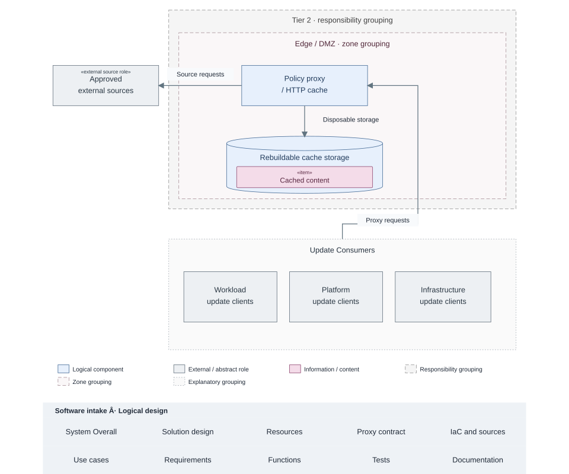
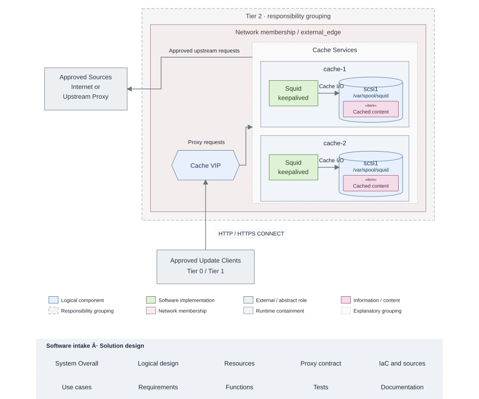

# Connected software-intake design

This pilot connects the Stage 1 logical design to the existing proxy/cache automation. The SysML v2
model defines responsibilities, reusable parts, request flows, guarded behavior and four guardrails. Separate layout
sources retain the established compact figures; the selected member instances come from the IaC examples.

[](../../../architecture/generated/software-intake/SoftwareIntakeLogicalDesign.svg)

*Logical view: update consumers request accepted sources through a policy boundary. Disposable cached
objects do not confer approval or recovery custody. This is a tailored model-derived view.*

## Contents

- [Use cases and guardrails](#use-cases-and-guardrails)
- [System and folder navigation](#system-and-folder-navigation)
- [Connected behavior](#connected-behavior)
- [Realize the design](#realize-the-design)
- [Follow a change](#follow-a-change)
- [Read the colours](#read-the-colours)
- [Build and check](#build-and-check)
- [Scope and evidence](#scope-and-evidence)
- [References](#references)

## Use cases and guardrails

Start at the [engineering map](../../../architecture/README.md), then open the
[use-case diagram and owned scenarios](../../../architecture/generated/software-intake/SoftwareIntakeUseCases.svg).
The model selects eight paths through the existing HTTP/HTTPS behavior; generated scenario walkthroughs
link each step to functions, logical owners, implementation and named checks.


An update client requests content through accepted supply, receives permitted content or an explicit
denial, and verifies publisher metadata/signatures. The existing
[HTTP and HTTPS sequences](README.md#cache-request-and-response) explain the detailed behavior,
including denied requests and cache misses. They are generated from native SysML messages, guarded
actions and succession. Their participants bind to the same logical parts used in the structural view.

The [native guardrail table](../../../architecture/README.md#guardrails)
is generated in the single architecture entry point. It contains the acceptance constraints and verification intent;
results remain separate evidence.

The [model map](../model-map.md) locates the authored context, guardrails, structure and behavior packages. A `ProxyMember` definition
provides the proxy and its local cache; both selected VMs reuse that definition. Reuse does not share
their data or imply that requests are balanced across both hosts.

## System and folder navigation

[System Overall](../../../architecture/README.md) is level 0; intake and the shared platform are
level 1 siblings. Intake's policy-proxy and object-cache folders own level 2 contracts. Platform child
folders map hosting, networking and data to the existing chapters. Other top-level designs remain mapped.
The native system part references the existing intake roles and shared platform, preserving stable IDs.
Design folders contain only PascalCase `.sysml` files, normally 1–5 per owner. The architecture root
has the only README; generated SVGs and Markdown matrices live in the matching `architecture/generated/` hierarchy. Technical
settings/layouts are in `scripts/architecture/config/`; reports and historical evidence are in
`artifacts/architecture/`. The build rejects stray design files and native sources omitted from validation.

The same build generates the linked overall and platform SVGs from
[HomelabSystemDesign.sysml](../../../architecture/models/HomelabSystemDesign.sysml) and the
[overview selection](../../../scripts/architecture/config/views/system-overall.json). Checks reject missing root boxes,
missing dependency selections, broken child/parent links and lost bindings into the existing model.
The top-level dependencies summarize responsibilities; use the selected intake resource view for exact
provider obligations. A broad shared-platform reference does not make every optional platform service
a requirement of every intake consumer. SVG links work when opened standalone; Markdown tables provide
the same navigation in viewers that disable embedded-image links.

### Focused concern views

System Overall and software intake each have focused use-case, requirement and function views.
Requirement overviews are generated Markdown matrices derived from native identities, subjects,
constraints, satisfaction assertions and verification relationships.
Requirement boxes remain useful in focused diagrams showing satisfaction or verification relationships.
The intake verification matrix lists each check's method, setup/action, pass criterion, requirement/scenario
coverage and current evidence status. Missing or stale evidence remains explicitly unverified.
The designs link directly to these views; there is no repeated frame of concern panels.
Other areas remain mapped to their existing owners rather than receiving empty diagrams.

[design-context.json](../../../scripts/architecture/config/views/design-context.json) retains design ownership,
native roots and available diagram destinations. The scoped inspection data follows native
allocations and relationships while retaining external responsibilities and incomplete coverage.
The model files carry their own native documentation. [The source projection](../../../artifacts/architecture/generated/design-context.json) supports
inspection without becoming another diagram catalogue.

The trace/view JSON files are project adapters, not artifacts required by SysML v2. Native `.sysml`
owns model-to-model relationships. The trace map binds those identities to external implementation
files and named tests; view settings select native elements/relationships and place/style them.
The build rejects missing or reversed selected connections rather than creating them from JSON.
Generated indexes are derived inspection data. Keep these roles separate when changing the model;
do not add semantic relationships or acceptance criteria to a layout or trace file.

## Connected behavior

[Engineering relationships](../../../architecture/models/software-intake/SoftwareIntakeLogicalDesign.sysml) shows the
native require, allocation, satisfaction and verification meanings. See the
[MBSE review and design loop](04-mbse-review.md) for findings, authoring ownership and native evaluation.

[SoftwareIntakeBehavior.sysml](../../../architecture/models/software-intake/SoftwareIntakeBehavior.sysml) owns messages, alternatives
and chronology. The native export supplies the branches and order; the renderer does not keep a second
message list. [sequence.json](../../../scripts/architecture/config/views/software-intake/sequence.json) owns participant
placement and formatting. Change semantic behavior in SysML, then rebuild both sequences in the README.

The [behavior trace](../../../artifacts/architecture/generated/software-intake/behavior-trace.md) connects each
message to configuration, implementation and named tests. Source checks render the actual Squid template
and inspect admission order, CONNECT restrictions, caching overrides and package verification settings.
Native Squid tests cover denial, fresh hits, expiry, conditional revalidation and privacy behavior.
[SoftwareIntakeLogicalDesign.sysml](../../../architecture/models/software-intake/SoftwareIntakeLogicalDesign.sysml) assigns messages to
product-independent functions and allocates those functions to logical parts. Scenario references own
fixed native guard values; the projection follows the existing succession and choices. The
[native verification cases](../../../architecture/models/software-intake/SoftwareIntakeVerification.sysml) own acceptance
criteria, verified requirements and subject types. `cases.json` is generated from those cases.
Checks reject missing scenario conditions, unallocated functions, unowned messages and incomplete coverage.
Successful CONNECT/TLS needs additional runtime evidence; naming a source or test does not prove it passed.
The expected model is not a network simulator and does not model every retry or transport failure.

## Realize the design

The [software-intake design](../../../architecture/models/software-intake/SoftwareIntakeLogicalDesign.sysml) owns the logical,
solution and focused resource views together. [Solution design](../../../architecture/models/software-intake/solution/SoftwareIntakeSolutionDesign.sysml)
binds product choices and VMs to the logical contracts. [Resource dependencies](../../../architecture/models/software-intake/solution/SoftwareIntakeSolutionDesign.sysml)
connect those VMs to shared virtualization, local disk storage and guest network services, then to
physical backing. The [platform boundary](../../../architecture/models/platform/SharedPlatform.sysml) maps the
existing hosting, networking and storage owners without claiming a complete platform or site inventory.

The [connected resource view](../../../architecture/generated/software-intake/solution/SoftwareIntakeResources.svg)
selects these native relationships. Logical fabric and optional storage networks are software-defined
transports over physical equipment. The local cache disks do not depend on the optional storage network.
Physical server/port identities and failure-domain placement remain site-owned inputs and acceptance.



*Solution design from IaC examples: Tier 2 owns the selected VMs and virtual disks. The shared listener selects an active owner;
it is not a separate VM. Upstreams, consumers and physical networking are existing context.*

| Logical responsibility | Selected realization | Source |
| --- | --- | --- |
| Policy proxy and eligible HTTP caching | Squid on each cache VM | [role](../../../tier-2/ansible/roles/cache_proxy/tasks/main.yml), [policy](../../../tier-2/ansible/roles/cache_proxy/templates/squid.conf.j2) |
| Stable listener with active-owner failover | keepalived VIP | [binding](../../../tier-2/ansible/roles/cache_proxy/tasks/keepalived.yml), [validation](../../../shared/ansible/roles/shared/tasks/keepalived_vip_validation.yml) |
| Rebuildable local storage | Dedicated disk and guarded mount | [VM inputs](../../../tier-2/terraform/deployments/cache/terraform.tfvars.example), [storage tasks](../../../tier-2/ansible/roles/cache_proxy/tasks/storage.yml) |
| Accepted consumer route | Bootstrap and Proxmox configuration | [bootstrap recipe](../../../tier-0/ansible/playbooks/deployment/bootstrap-software-intake.yml), [host recipe](../../../tier-0/ansible/playbooks/proxmox-hosts.yml) |

The build reads the tracked Terraform example with `python-hcl2` and Ansible YAML with PyYAML.
It checks membership, addresses, network selection, disk binding and selected module/role entry points,
then generates [SoftwareIntakeRealization.sysml](../../../artifacts/architecture/generated/software-intake/SoftwareIntakeRealization.sysml). Native SysML allocations connect the logical
proxy and cache to that realization. The official parser validates the combined model before rendering.

The [trace report](../../../artifacts/architecture/generated/software-intake/trace.md) maps model identities to owning source and existing checks.
`implementation-source` means automation exists and its selected wiring is checked; it does not mean
a running system passed acceptance. `manual-acceptance` and `external-custody` preserve those boundaries. `documented-context` marks
external platform contracts whose detailed implementation and site topology remain with their owners.

## Follow a change

Edit the owning native package linked from `architecture/README.md`; each design owner keeps its
related use cases, requirements, functions and checks together. Change member inputs in the owning
Tier 2 example. Edit layouts under `scripts/architecture/config/views/software-intake/`; they contain
placement, model identities and presentation, not an independent system inventory. Do not edit generated views
or files under `artifacts/architecture/generated/` directly. The README sequence blocks have generated-content markers;
prose outside those blocks remains authored.

From **the upstream kit checkout**, after installing the test dependencies below:

```bash
python scripts/architecture/software_intake.py impact DEF-proxy
```

Also inspect the same design from a consumer toward its providers, or from a changed provider back
to the affected consumers and scenarios:

```bash
python scripts/architecture/software_intake.py dependencies L-Proxy
python scripts/architecture/software_intake.py impact P-servers
```

The generated [resource report](../../../artifacts/architecture/generated/software-intake/resource-trace.md)
records both directions. These queries use the native relation graph, not the folder hierarchy.

**Expected:** both cache runtimes, their containing members and the logical consumers are identified,
with the relevant implementation and acceptance sources. The query is a conservative review aid.
A source change makes these strict model-element queries stale until the native build regenerates it.
For review while editing, use the [file/test reverse query](03-http-walkthrough.md#follow-a-file-or-test-backwards):
`impact --file <upstream-path>` reads the last built model and its captured trace records, reports
source drift, and does not edit code or assert conformance.

## Read the colours

These are **project colour conventions**, not a mandatory SysML or ArchiMate palette. C4 does not
prescribe colours; the Open Group's ArchiMate guidance also explains that colours have no formal
semantics. SysML permits user-defined views beyond its standard notation. [1][2][3]

Element colours and enclosure styles answer separate questions:

| Meaning | Treatment in connected model views |
| --- | --- |
| Logical component or selected software element | Blue; selected product/deployment status remains explicit |
| Tangible equipment | Warm grey |
| Function/action | Peach |
| Requirement or use-case intent | Violet; native kind is labelled |
| Verification/test case | Green; colour does not claim a passing result |
| Abstract external participant | Muted neutral box, or the appropriate actor symbol |
| Tier or zone classification | Light labelled explanatory frame; not a containing system part |
| Network membership | Pale grey-rose enclosure with an explicit network label |
| Actual runtime containment | Light blue-grey enclosure, distinct from its contained software |

The [shared notation](../../../scripts/architecture/config/views/notation.json) owns the category and enclosure mapping;
the [project palette](../../08-reference/diagrams/palette.json) owns colour values. Each view displays the
key it needs. Types, labels, shapes and relationship names retain meaning without colour. [1][4]

Tiers and zones in this example are presentation classifications, not deployable SysML parts. The
selected network name remains an explicit VM property and the real platform network dependencies
remain modeled. An enclosure alone asserts neither runtime ownership nor network reachability.
The external-source box represents an abstract repository participant; permitted origin entries are
separate admission configuration. Logical components themselves are design roles until realization
and evidence establish their implementation. Blue does not mean deployed.

## Build and check

Prepare Python 3 and the existing test dependencies in `tests/requirements.txt`.
From **the upstream kit checkout**, in the chosen development environment:

```bash
python -m pip install -r tests/requirements.txt
```

For native model builds, extract a Java 21 JDK and the official Pilot Implementation kernel and
matching library outside the repository. [toolchain.json](../../../scripts/architecture/config/toolchain.json) records tested
versions, download URLs and checksums. The pilot archive contains both the kernel JAR and library.
Engineering relationship rendering also requires Graphviz `dot` (tested 14.0.5), on PATH or selected
with `GRAPHVIZ_DOT`. Use the same renderer version when checking generated SVG snapshots.

From **the upstream kit checkout**, substitute the three extracted tool locations:

```bash
python scripts/architecture/software_intake.py build --java /path/to/jdk/bin/java --kernel /path/to/jupyter-sysml-kernel-0.63.1-all.jar --library /path/to/sysml.library
```

**Expected:** native validation, refreshed selected realization, stable model index, trace report and
System Overall, the shared-platform overview, use-case/scenario/function views, structural/resource views, both sequences and traces. Diagnostics stay under ignored `.tmp/software-intake-model/`.
`SYSML_JAVA`, `SYSML_KERNEL` and `SYSML_LIBRARY` can supply the same tool paths.

From **the upstream kit checkout**, check a committed snapshot without starting Java:

```bash
python scripts/architecture/software_intake.py check
python -B -m unittest discover -s tests -p test_tier_intake_model.py
python -B -m unittest discover -s tests -p test_tier_intake_behavior.py
python -B -m unittest discover -s tests -p test_tier_intake_use_cases.py
python -B -m unittest discover -s tests -p test_tier_system_overall.py
python -B -m unittest discover -s tests -p test_tier_design_context.py
```

**Expected:** source fingerprints, trace targets, selected IaC contracts and generated views agree.
With the three `SYSML_*` tool variables set, the use-case suite also runs two isolated native
round-trip checks. Otherwise it reports those checks as skipped.
This fast check cannot validate an edited SysML file; rebuild with the native parser after changing it.

## Scope and evidence

See the [validation record](verification.md) for the actual checks and render review.
The pilot reads **upstream example inputs**, not private site overrides, Terraform state or running hosts.
It supports a two-to-four-member VM/VIP shape with local cache disks and the example `vmbr0` attachment;
a different provider, attachment or realization needs
an explicit adapter/view change. It does not evaluate arbitrary Terraform expressions or all Ansible precedence.

Generated architecture repositories receive these model/view reference assets with the manual.
Regeneration runs in the upstream kit; copied auto-docs do not discover a private collection's inputs.
Keep a project's selected design and site evidence in its project-owned architecture files.
Stage 2 publication, exhaustive behavior/simulation and live runtime acceptance remain outside this
bounded intake model. [SysON review snapshots](../../04-development/syson.md) provide populated
graphical views; automatic graphical-to-source synchronization is not supported. Existing deployment
and operating procedures retain their execution role.

## Diagram navigation

Open [System Overall](../../../architecture/generated/HomelabSystemOverview.svg) directly in a browser.
Subsystem boxes open their SVG overviews. The bottom bar returns to the parent or whole system;
**Documentation** opens the supporting document. The [HTTP walkthrough](03-http-walkthrough.md)
follows one scenario through functions, logical allocation, IaC and tests.

System Overall and the intake logical design link directly to focused use-case, requirement,
function and test views. Mapped areas retain their documented owners; they do not receive empty
concern dashboards. `engineering-views.json` selects the small engineering catalogue. Detailed
scenario/function inspections and evidence are supporting assets, not automatically more native views.

Colours identify element kinds across all model views: logical/software, physical equipment,
function/action, requirement/use-case intent, and verification/test. The model category mapping in
`scripts/architecture/config/views/notation.json` uses the shared project palette; deployment-guide palettes remain
available outside this MBSE view set. Labels and shapes retain the specific SysML kind. Requirements
use native v2 requirement elements; BDD is a v1 diagram name. Quality constraints remain requirements,
not non-functional actions.

Detailed scenario and function assets retain named fragments. These are native
[SVG view links](https://www.w3.org/TR/SVG2/linking.html#LinksIntoSVG), with no application server,
scripts or second model inventory. Open the SVG document itself: an embedded image or a GitHub
image preview may suppress interaction. Relative links require the repository or copied manual tree.
Source files are supporting assets; the browser may show or download them depending on file type.

`intake_explorer.py` derives view destinations from scope roots, native relationships and traces.
`intake_scenario_views.py` derives selected sequences and function views from that same model.
`svg_pages.py` owns their shared presentation and navigation. Regenerate with the normal model build.
The existing Markdown projections remain available as alternate reading paths. This is a read-only
model browser, not a graphical authoring tool or a verified round trip into an EA project.

The generated reverse index/report and `asset-impact.svg` are projections of those same records.
`intake_reverse.py` follows typed usages, containment of parts, allocations, bindings, dependencies
and selected scenario messages towards consumers/intent. It excludes generic behavior containment
as a shortcut into every branch. Message-to-function and function-to-guardrail links provide context
without fanning back out through a shared requirement. Each result retains a witness path; a file-level
trace is deliberately broader than a method-level trace. Unmodeled consumers remain outside coverage.

## References

Reviewed 2026-11-19. Element/reference semantics: [1, §§7.6, 7.11]; tailored views: [1, §8.2.3.1].

1. [OMG SysML 2.0 language specification, section 8.2.3.1](https://www.omg.org/spec/SysML/2.0/Language/PDF).
2. [C4 notation and colours](https://c4model.com/diagrams/notation).
3. [ArchiMate community guidance: colour for elements](https://archimate-community.pages.opengroup.org/workgroups/archimate-101/#color-for-element).
4. [W3C: text contrast](https://www.w3.org/WAI/WCAG22/Understanding/contrast-minimum.html) and [use of colour](https://www.w3.org/WAI/WCAG22/Understanding/use-of-color.html).
