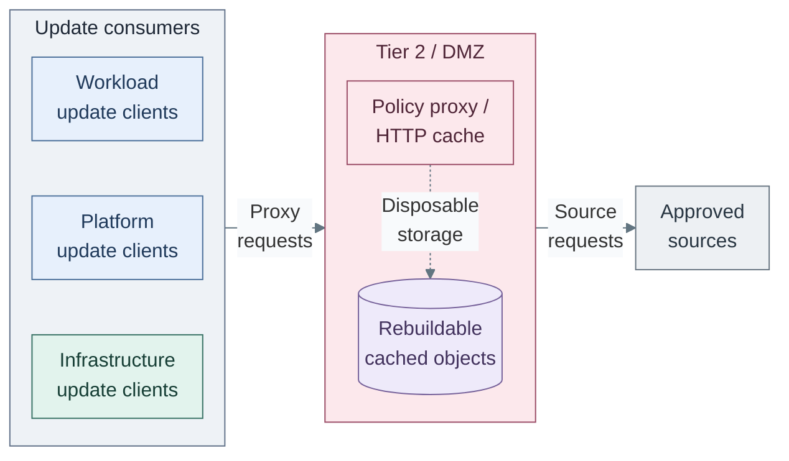
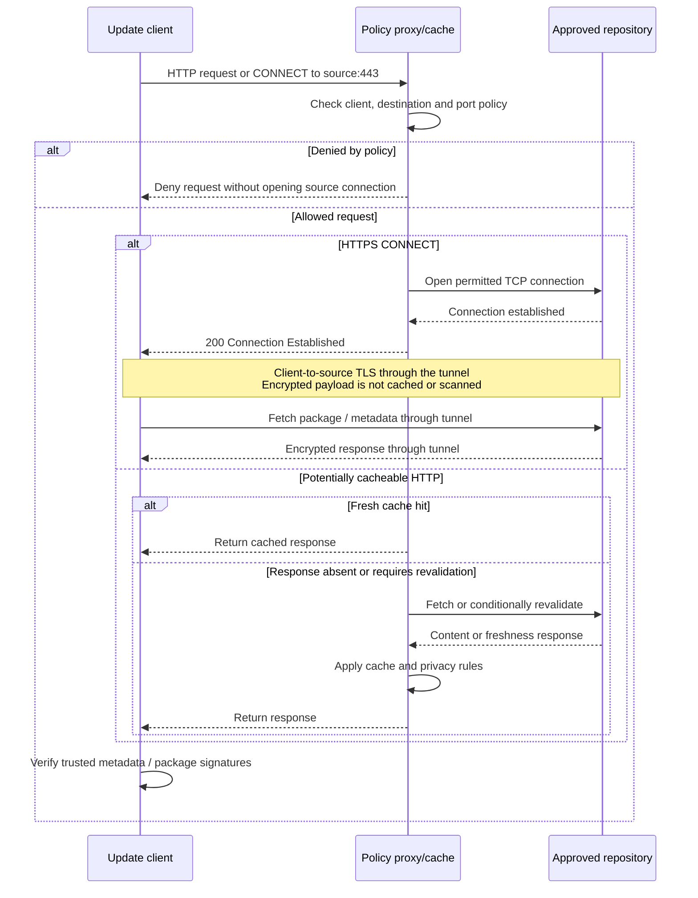

# Software intake

Software intake gives connected hosts in every tier a controlled route to package
repositories, images and update sources. A policy proxy restricts destinations;
an HTTP cache reduces eligible repeated downloads. Neither function approves an
artifact or replaces a retained repository mirror.

## Connected proxy design

*Figure: Separately owned update clients request the policy proxy inside Tier 2; the upstream
boundary link represents that proxy's requests to approved external sources. The proxy uses
the rebuildable cache below it; cached objects confer neither approval nor recovery custody.*

**Architecture (A):** requests target the proxy interface, not other Tier 2 services.
The consumer group aggregates separate owners, not a shared subnet or runtime.
The [Squid policy template](../../../tier-2/ansible/roles/cache_proxy/templates/squid.conf.j2)
and [cache inputs](../../../tier-2/ansible/group_vars/cache.yml.example) realize the proxy boundary.
Offline recovery supply remains outside this connected path.

Firewall rules allow selected consumers to the proxy listener, deny direct WAN
bypass, and restrict the proxy's upstream access. Proxy ACLs combine source CIDRs,
destination domains and permitted ports. The reference is one common policy for
all permitted clients; a stricter Tier 0 policy needs a separately scoped endpoint
or approved mirror-only route, not a claim that one broad allow-list varies by tier.
Domain access is not repository-path, package or version approval. [1]

## Contents

- [Connected proxy design](#connected-proxy-design)
- [Cache request and response](#cache-request-and-response)
- [Supply choices](#supply-choices)
- [Transport and integrity](#transport-and-integrity)
- [Verification and publication](#verification-and-publication)
- [Authority and recovery](#authority-and-recovery)
- [Realization](#realization)
- [References](#references)

## Cache request and response

The client is any machine using approved software supply; it need not belong to
one tier or run a specific package manager. The transport determines what can be cached.
HTTPS CONNECT tunnels forward encrypted bytes and do not provide object caching or scanning.

*Figure: Approved HTTPS requests use an opaque tunnel; reusable HTTP responses may be
cached or revalidated. The client verifies publisher signatures in both cases.*

The first decision is access policy; a denial never becomes a cache lookup or a
source fetch. Once CONNECT succeeds, the client verifies the source's TLS identity
and software authenticity itself. A cache hit can save a transfer, but cannot
establish that the response is an approved release. [1][2]

## Supply choices

| Option | Function | Availability and approval boundary |
| --- | --- | --- |
| A: Policy proxy with HTTP cache | Restricted clients pull from selected reachable sources | Simple initial path; cache misses and HTTPS tunnels need the upstream source |
| B: Retained repository mirrors | Clients pull selected content from internal repositories; mirror synchronization can use A | Retention, signature checks and promotion belong to the mirror owner; Tier 1 owns authoritative shared mirrors |
| C: Offline distribution | Approved content is transferred into an isolated custody boundary | No proxy route across the air gap; content and verification material must already be present |

B is the stronger fit when Tier 0 must consume only retained, approved releases
without depending on live public repositories. Synchronization and promotion are
separate operations; downloading into a mirror does not itself approve a release.
An existing mirror is valid. The repository supplies A and an optional
[verified RPM/APT and artifact publication path](../../03-deployment/stage-3-trust/step-15b-verified-intake.md)
for B. C still requires a prepared, independently verified offline supply bundle.

## Transport and integrity

| Path | Design choice and limit |
| --- | --- |
| Explicit HTTP proxy to a public HTTPS source | CONNECT preserves client-to-source TLS; Squid cannot cache or inspect the encrypted payload [2] |
| Plain HTTP repository through the proxy | Eligible responses can be cached; freshness, metadata and package verification still apply |
| Internal HTTP mirror | An explicit option for isolated distribution of signed, non-sensitive content; no plaintext credentials, tokens or private artifacts |
| Transparent HTTP interception | A distinct routing/proxy mode, not supplied by the current explicit-proxy recipe |
| Transparent HTTPS interception | Requires a reviewed TLS-interception design and client trust changes to inspect/cache payloads; transparency alone does not decrypt TLS [2] |

Internal HTTP requires signature and trusted-metadata verification, controlled
network access and an accepted tampering/replay risk. Keep public-source TLS and
release verification; do not downgrade downloads merely to obtain cache hits.
Artifacts without adequate independent verification need protected transport.
Repository HTTP is not permission to disable TLS for Proxmox APIs, identity,
secrets or security-log submission.

## Verification and publication

| Control | Current path | Staged alternative |
| --- | --- | --- |
| Source access | Squid client/domain/port policy plus independently enforced firewall egress | Same controlled acquisition route |
| Authenticity | Consumer package signatures, trusted metadata and verified TLS; a downloaded hash needs a trusted origin | Verify publisher identity and content before publication, then verify again at consumption |
| Malware assessment | Not supplied by the proxy; CONNECT payloads remain encrypted | ClamAV on supported staged content, with explicit scan limits and current definitions |
| Vulnerability assessment | Separate from source access and authenticity | Trivy for supported images/SBOMs; risk-based promotion rather than rejecting every reported CVE |
| Retention | Cache objects are disposable; no approval history | Identified approved versions, separate quarantine and independently retained Tier 0 recovery supply |

The [artifact-verification design](01-verification.md) defines the optional staging,
quarantine and promotion boundary. Its native worker is an optional selected realization;
the Trivy/OCI extension is not installed by that worker.
The initial path remains the small proxy pair with native consumer verification.
A clean malware scan cannot establish a publisher's identity or prove the absence of malware. [3]

## Authority and recovery

- Tier 2 owns the ordinary proxy/cache and its rebuildable data, not Tier 0 credentials.
- Tier 1 owns authoritative shared mirrors and artifact services, with scoped publication rights.
- Tier 0 authorizes and executes its updates. Lower tiers may supply approved bytes,
  never initiate privileged installations or gain management access through this path.
- A proxy setting is client configuration, not firewall enforcement or an update scheduler.
- Bootstrap and recovery retain approved tools, packages/images and verification material
  independent of the cache, mirrors, hosted identity and registries. Missing supply must
  fail closed, not silently enable direct Internet access.

## Realization

[Software intake](../../03-deployment/stage-1-software-intake/README.md) deploys the
Tier 2 Squid/keepalived reference. Each consuming tier owns its local proxy inputs;
Shared supplies reusable package-manager and shell configuration.
[Proxmox update access](../../05-operations/02-software-intake/host-updates.md) covers the
Tier 0 host integration; [cache operations](../../05-operations/02-software-intake/README.md) covers the
proxy pair. [Artifact supply](../10-delivery/01-artifact-supply.md) covers registry
authority and distribution, not HTTP cache behavior.

## References

Sources checked 2026-11-10.

1. [Squid access controls](https://www.squid-cache.org/Doc/config/acl/)
2. [Squid HTTPS and CONNECT behavior](https://wiki.squid-cache.org/Features/HTTPS)
3. [ClamAV scanning scope](https://docs.clamav.net/manual/Usage/Scanning.html)
