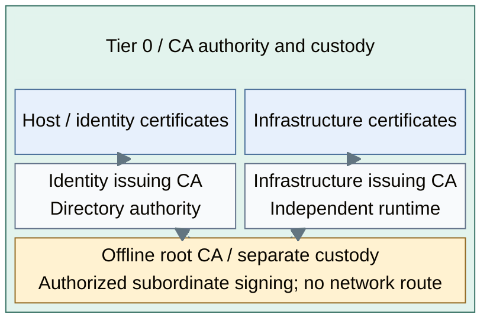
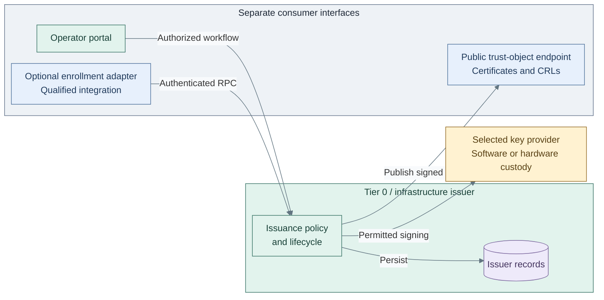
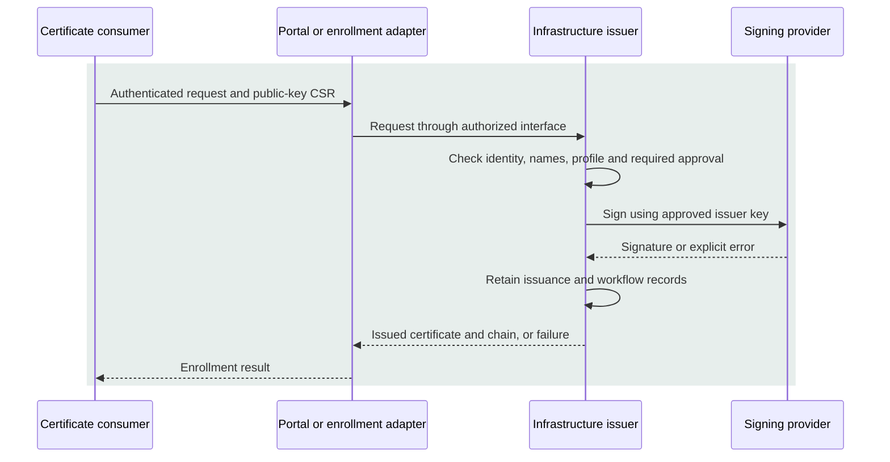

# Certificate authority design

The infrastructure certificate authority (CA) turns approved names and public keys
into certificates, with issuance history, renewal and revocation. An offline root
authorizes online issuers; routine issuance then runs independently of identity,
Kubernetes and the secret service.

## Trust hierarchy

The [cryptography overview](README.md#completed-design) owns the cross-tier trust
map, including optional application and lab authorities. This view expands the
two Tier 0 issuers under the infrastructure root.

*Figure: The offline root authorizes two sibling issuers. Upward arrows represent certificate
signing, so neither routine issuance nor shared root trust grants access to the other issuer.*

These arrows represent certificate signing, not network connections. The directory
pair replicates one identity CA; it does not create an unrelated issuer per host.
External signing uses FreeIPA's two-phase CA installation interface. [1]
The infrastructure portal manages infrastructure-issuer records; sharing a root
does not combine FreeIPA's certificate inventory or administration with that portal.

## Contents

- [Trust hierarchy](#trust-hierarchy)
- [Service boundaries](#service-boundaries)
- [Enrollment and publication](#enrollment-and-publication)
- [Custody and recovery](#custody-and-recovery)
- [Alternatives and realization](#alternatives-and-realization)
- [References](#references)

## Service boundaries

The infrastructure issuer applies policy, the signing provider holds its key, and
the portal exposes authorized certificate workflows. Enrollment adapters translate
client protocols into a restricted issuer interface. Publication exposes signed
public objects to verifiers without exposing the key or administrative workflows.

| Function | Intended placement | Boundary |
| --- | --- | --- |
| Offline trust | Separately controlled ceremony system | Root key, CA database, subordinate signing and root CRLs; no routine online service [2] |
| Infrastructure issuance | Independent Tier 0 / Control runtime | Approved profiles, requests, approvals and certificate lifecycle |
| Application state | Issuer-owned database and protected configuration | Issuance/workflow history and sessions are recoverable with the signing identity |
| Identity issuance | Dedicated Tier 0 directory runtime | Its own supported CA custody and replication, separate from the infrastructure issuer |
| Enrollment adapter | Separate service at the issuer, when selected | ACME-to-authenticated-RPC translation; no CA policy or root authority |
| Public trust objects | Stable Tier 0 publication endpoint, optionally independently mirrored | Signed CA certificates and fresh CRLs only; no signing key or portal administration |

The infrastructure issuer starts and recovers using local database/configuration, bootstrap resolution,
independent administration and its selected key provider. It does not require FreeIPA,
Keycloak, Vault, cluster ingress or Tier 1/2 services. Optional federated portal login
retains independently tested recovery access.

## Enrollment and publication

*Figure: Portal and adapter requests enter issuer policy; signing depends on the provider to the
right. Signed trust objects return to a separate publication interface for certificate verifiers.*

The placement view separates access from authority. The sequence below follows one
authorized leaf request; an operator portal and an automated adapter both reach
issuer policy through their selected interface. The adapter is optional, separately
qualified integration work, not an endpoint supplied by the baseline portal installer.

*Figure: The consumer receives a certificate only after issuer authorization and successful signing;
the root key is absent from this routine workflow.*

Each tier's enrollment clients contact the infrastructure issuer directly. Renewal
follows the selected enrollment contract; it does not grant broader names or profiles.
Verifiers retrieve published CA certificates and fresh certificate revocation lists
(CRLs) independently of this issuance exchange.

Community enrollment includes SCEP, EST and RPC; native ACME is Enterprise-only. [3]
The acme2certifier OpenXPKI handler supplies a possible Community ACME adapter, not
an automatic guarantee of compatible authorization, renewal or recovery. [4]
Portal approval and automated enrollment are separate workflows. Backend policy binds
the authenticated identity to allowed names, SANs, leaf profiles, usages and validity;
submitted profile names or ACME External Account Binding alone do not grant issuance.
OpenXPKI's enrollment policy supports signer authorization and profile mapping. [5]

CA administration and subordinate-CA signing are never normal enrollment permissions.
Publication remains reachable during the required outage envelope without portal login;
clients verify signed objects. Publishing revocation data and enforcing it at a client
are separate responsibilities. No OCSP responder is implied by the Community CA;
that is a separately selected component when required. [6]

## Custody and recovery

The root, infrastructure issuer, FreeIPA CA and Vault seal have separate key purposes.
Each can select its own [A-D custody variant](03-hsm-selection.md). A reachable USB gateway
or network HSM is not an OpenXPKI provider until the exact runtime, module, mechanisms,
key attributes and permissions have been qualified together.

One active issuer with rehearsed recovery is the initial availability model. More HSMs
can improve the selected key-provider service, but do not replicate the CA database,
sessions or workflows. An application-HA variant must cover all those state boundaries.

The recovery set includes database, approved configuration, signing-provider recovery,
administrative access and OpenXPKI DataVault material. DataVault protects application
data and is unrelated to HashiCorp Vault; losing its material can prevent recovery. [7]
Routine reconciliation must fail on a missing signing identity, never generate a new
CA or overwrite issuance/revocation state. Image rollback is not database rollback.

## Alternatives and realization

The reference uses OpenXPKI Community as the permanent infrastructure issuer and
portal, with local MariaDB state and clca for offline root ceremonies. FreeIPA retains its own identity CA
as the root's sibling issuer. HashiCorp Vault remains a secret service. These choices
realize the distinct roles in the trust hierarchy rather than replacing one another.

An existing independently operated CA, another qualified issuer or Enterprise native
ACME can satisfy the same outward contract. Selecting one changes the integration,
not tier ownership or root custody. The reference OS/package exception and Community
boundaries belong to the [issuer deployment contract](../../03-deployment/stage-3-trust/procedures/issuer.md).
The [support map](../../08-reference/implementation-support.md) records installer coverage;
[CA operations](../../05-operations/03-cryptography/certificate-authority.md) owns maintenance evidence.

Follow [Cryptographic trust](../../03-deployment/stage-3-trust/README.md) for installation
and [cryptographic trust operations](../../05-operations/03-cryptography/README.md) for ongoing tasks.

## References

Sources checked 2026-10-17.

1. [FreeIPA Ansible server role: externally signed CA](https://github.com/freeipa/ansible-freeipa/blob/master/roles/ipaserver/README.md)
2. [clca: offline CA state and supported key interfaces](https://github.com/openxpki/clca/blob/master/README.md)
3. [OpenXPKI endpoint and edition boundaries](https://openxpki.readthedocs.io/en/master/frontend/endpoints.html)
4. [acme2certifier OpenXPKI handler](https://github.com/grindsa/acme2certifier/blob/master/docs/openxpki.md)
5. [OpenXPKI enrollment authorization and profiles](https://openxpki.readthedocs.io/en/master/lifecycle/enrollment.html)
6. [OpenXPKI maintainer clarification: separate OCSP responder](https://sourceforge.net/p/openxpki/mailman/openxpki-users/thread/1193537499.1054529.1632739794972%40mail.yahoo.com/)
7. [OpenXPKI configuration and DataVault recovery material](https://github.com/openxpki/openxpki-config/blob/community/QUICKSTART.md)
