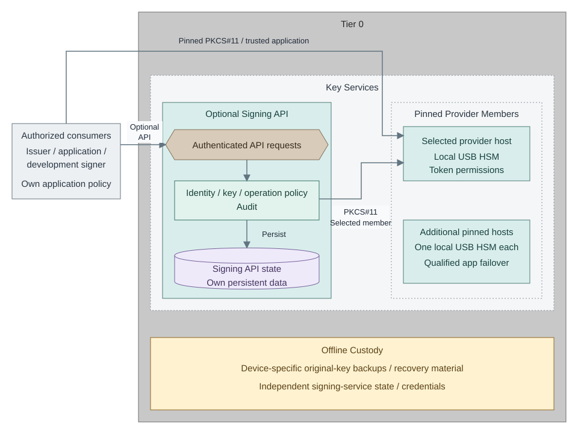
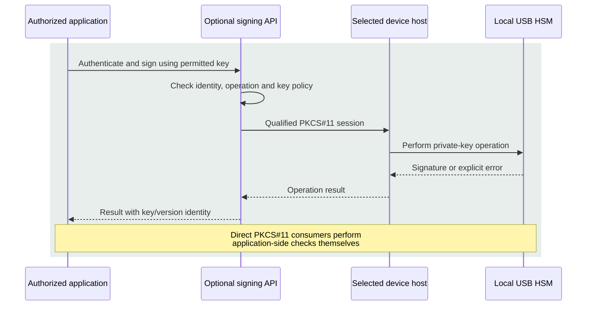

# USB-backed key services

USB-backed providers protect keys for compatible CA, secret-service and application operations.
A local issuer, remote PKCS#11 client and signing API use different authority and failure
contracts, even when they use the same hardware.

## Shared interfaces

*Figure: The consumer link selects the signing API or direct PKCS#11 access to a pinned device host.
The API selects a pool member for qualified application failover. Each device retains its own keys.
Device backups remain separate from signing-API state.*

Read the figure as two consumer contracts. A trusted application can own the
PKCS#11 sessions and policy itself, or use a signing API that checks identity,
operation and key policy on its behalf. Both paths ultimately use a selected
provider host and its local device. Neither path transfers HSM administration
or infrastructure-issuer authority to ordinary development jobs.

| Interface | Consumer responsibility | Reference realization |
| --- | --- | --- |
| Local PKCS#11 | Issuer owns policy and uses one qualified device | OpenXPKI and its local provider |
| Remote PKCS#11 | Application owns sessions, mechanisms and safe reconnects; token permissions bound clients | Native p11-kit over restricted SSH with pinned host keys [1] |
| Signing API | Client authenticates and requests allowed operations on a named key | Optional OpenBao external-key Transit service, with explicit mount grants and key policy [4] |

Remote PKCS#11 exposes device operations; SSH access alone is not an application signing policy.
The API has separate state and credentials. YubiHSM's connector stays loopback-only. [2]
General development jobs should use an application signing identity with exact key/operation policy.
Reserve raw PKCS#11 access for trusted applications that need it; a general runner receives neither
the infrastructure issuer's key authority nor HSM administration credentials.

An accepted external signing application can instead use **E1: Client failover**,
**E2: Private VIP**, or **E3: Private VIP and proxies** on its own service hosts.
The retained [ingress scaffold](../../../tier-0/ansible/roles/hsm_proxy_ingress) renders
an opt-in backend only; it installs neither that application nor a complete VIP/frontend.
Its health and session checks must follow that application's supported HA model.
The supplied SSH remoting path uses pinned member endpoints rather than this scaffold.

## Contents

- [Shared interfaces](#shared-interfaces)
- [Initial scope](#initial-scope)
- [Ceremony and deployment hosts](#ceremony-and-deployment-hosts)
- [Request and response](#request-and-response)
- [Hardware compatibility](#hardware-compatibility)
- [Failure and recovery](#failure-and-recovery)
- [Implementation](#implementation)
- [References](#references)

## Initial scope

HSM is a reusable **key-protection capability**, not a CA role. Each consumer needs its own key,
authorization and recovery contract. The initial reference keeps these responsibilities separate
so the issuer can start and recover without the secret service or an optional signing API:

| Consumer | Protected key purpose | Reference selection |
| --- | --- | --- |
| Offline root CA | Root signing key | Encrypted software custody by default; a separately qualified offline HSM may replace it, but is not served from the online pool |
| Online infrastructure issuer | Its own subordinate-CA signing key | Original key through a qualified local provider first; device-loss recovery accepted before consumers depend on it |
| Secret service | Separate seal/wrapping key, or separately selected managed application keys | Vault starts with Shamir unseal; native PKCS#11 seal requires Enterprise and qualified device mechanisms, not merely working CA signatures [7] |
| Development/application signing | Separate application signing keys | Optional remote key access or signing API for explicitly authorized consumers; never the infrastructure CA's key |

Compatible online services may share provider infrastructure **only where key access is actually
isolated**. Separate labels are not an access-control boundary. The supplied raw PKCS#11 remoting
exposes a dedicated token to its authorized consumer; it does not implement per-object authorization.
Use separate devices/domains or a qualified policy-enforcing API when that isolation cannot be enforced.
Do not reuse the CA signing key as a seal or application key.

An offline root may use an HSM, but its key/device stays outside routine online service access.
Keeping a root key on an always-connected pool does not make it offline. Root ceremony, online
issuer and Vault integration therefore have separate deployment paths within the same capability.
The [seal choices](06-vault-seal.md) describe the secret-service path and its remaining qualification.

The [Trust stage](../../03-deployment/stage-02-trust/README.md) owns installation order
and qualification; shared interfaces are added only for a selected consumer need.
Device initialization, key creation and wrapped-key recovery are controlled custody
operations; ordinary deployment preserves keys.

## Ceremony and deployment hosts

A **ceremony host** is the trusted computer temporarily used to initialize a device, enter its
administrative credentials and handle wrapped-key recovery. It is a role, not another name for bootstrap.
The online issuer/provider later uses the commissioned device with narrower signing permissions.

| Host choice | Intended use |
| --- | --- |
| Dedicated trusted workstation | Preferred for production commissioning and recovery; prepare verified tools, restrict connectivity during the ceremony, then return recovery material to independent custody |
| Existing `boot-1` | Explicit learning or constrained-site option for the online issuer's device; pause deployment jobs, restrict access and remove temporary device/recovery attachments afterward |
| Offline root workstation | Separate root-signing custody; a normal connected bootstrap VM does not satisfy this role |

Reusing bootstrap shares its trust with deployment tools, downloaded artifacts and administrators.
USB passthrough also trusts the Proxmox host and its administrators; a VM on that host is not an
independent offline boundary. A compromised ceremony host can capture entered PINs or misuse an
attached device even when the private key cannot be exported in plaintext.

Record the selected host and ceremony evidence. Keep recovery shares and their unlock secrets
independent of bootstrap, its VM backups and the online issuer. The
[PicoHSM procedure](../../03-deployment/stage-02-trust/procedures/picohsm.md) owns preparation and cleanup;
device-family recovery requirements still apply. [3][6]

## Request and response

*Figure: The signing workflow returns a result without exporting the private key. A broken session
produces an error; transport cannot determine whether retrying an operation is safe.*

The return path matters: a disconnected session can leave the caller unsure whether
the device completed an operation. Safe retries and key/version checks belong to
the selected application integration, not to a generic TCP or HTTP health check.

## Hardware compatibility

| Device | Provider qualification | Independent recovery |
| --- | --- | --- |
| YubiHSM 2 | Yubico module, local connector and scoped authentication key/domains/capabilities; PIN includes authentication-key ID [2] | Wrapped objects and retained wrapping material on a compatible spare [3] |
| PicoHSM | USB CCID/PCSC with OpenSC for qualified RSA/ECDSA; selected sc-hsm-embedded middleware for mechanisms such as AES that need it [5] | Supported DKEK backup/restore with separately retained shares [6] |

Support for both families does not make backups interchangeable. Keep a replicated key and
its recovery devices within one qualified family unless separately tested transfer proves
otherwise. Match serials, object identity and public-key fingerprints; a label alone proves nothing.

Select assurance from the exact hardware, firmware, physical protection and threat model.
PKCS#11 compatibility is not certification. Qualify each consumer's mechanisms: issuer
compatibility does not prove seal compatibility. Never activate with factory credentials.

## Failure and recovery

| Failure | Required behavior |
| --- | --- |
| Device/host lost | Select a qualified endpoint and open a new session; an in-flight operation may have an unknown result |
| Wrong key on another endpoint | Fail against the approved public-key identity; do not silently create/import a replacement |
| API member lost | Follow native application quorum/retry semantics; key availability is an additional requirement |
| All online members lost | Recover application state and device keys independently of the unavailable service |
| VM moved | Explicit USB affinity/mobility policy preserves access to its assigned device |

Two tokens do not form a key cluster. Remoting neither replicates objects nor resumes sessions;
replicated application state does not back up HSM keys. A single-node learning API provides no HA.

## Implementation

Stage 2 provisions hosts and native USB attachment through the owning Terraform root.
The [provider role](../../../tier-0/ansible/roles/hsm_provider) installs selected middleware,
checks device identity and binds an inactive issuer to its original key. Physical commissioning,
approved SDK supply and offline custody remain prerequisites.

The [USB deployment](../../03-deployment/stage-02-trust/step-1b-usb-hsm.md) owns remoting;
the [Secrets stage](../../03-deployment/stage-06-secrets/README.md) owns the optional signing API.
HashiCorp Vault remains the reference secret store. Its Enterprise PKCS#11 seal/managed-key
features are separate from the open-source API option; see [seal choices](06-vault-seal.md).
No implicit product migration, key replication or generic load-balancer HA is supplied.

Follow the [USB provider pool](../../03-deployment/stage-02-trust/step-1b-usb-hsm.md) or
[single-device issuer](../../03-deployment/stage-02-trust/step-1d-single-usb.md) procedure
for the selected arrangement. [Hardware custody and recovery](../../05-operations/03-cryptography/usb-hsm.md)
owns subsequent operation.

## References

1. [p11-kit remoting](https://p11-glue.github.io/p11-glue/p11-kit/manual/remoting.html)
2. [YubiHSM 2 PKCS#11](https://docs.yubico.com/hardware/yubihsm-2/hsm-2-user-guide/hsm2-tools-pkcs11.html)
3. [YubiHSM backup and restore](https://docs.yubico.com/hardware/yubihsm-2/hsm-2-user-guide/hsm2-backup-restore.html)
4. [OpenBao external keys](https://openbao.org/docs/api/system/external-keys/)
5. [PicoHSM provider capabilities](https://github.com/polhenarejos/pico-hsm/blob/master/doc/usage.md)
6. [PicoHSM backup and restore](https://github.com/polhenarejos/pico-hsm/blob/master/doc/backup-and-restore.md)
7. [Vault native PKCS#11 seal requirements](https://developer.hashicorp.com/vault/docs/configuration/seal/pkcs11)
