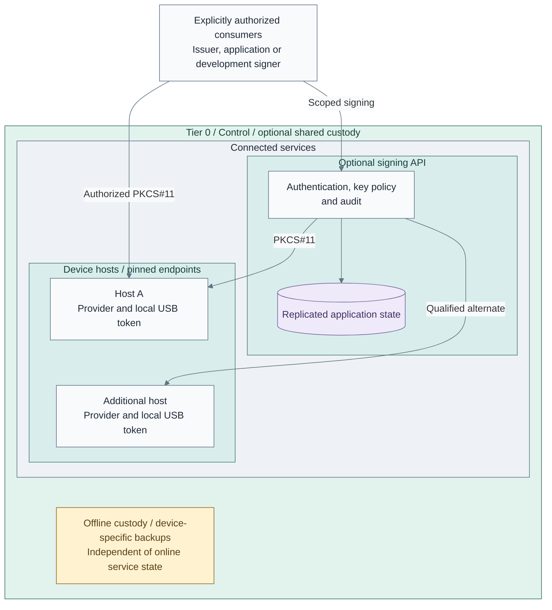
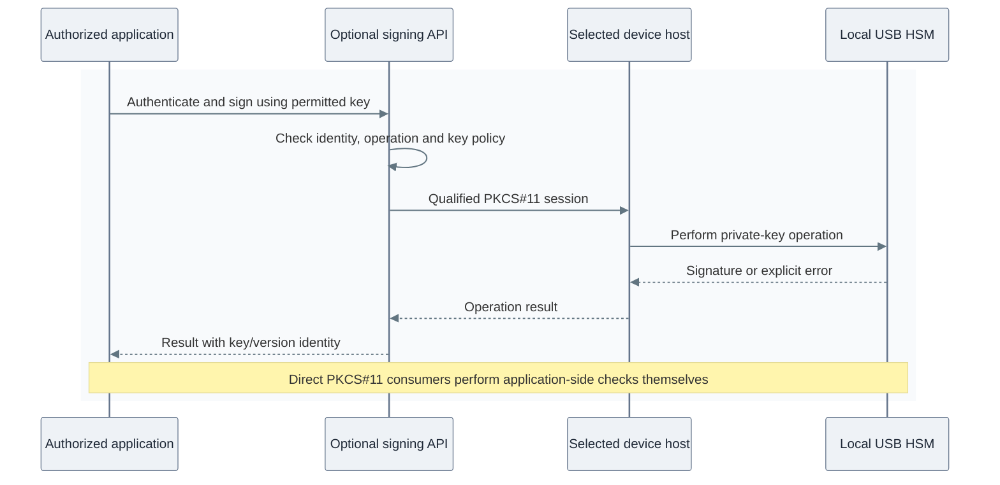

# USB-backed key services

Read this before selecting shared hardware custody for PKI, secrets or development signing.
A local issuer, remote PKCS#11 client and signing API use different authority and failure
contracts, even when they use the same hardware.

**Deploy:** [USB provider pool](../../03-deployment/stage-3-trust/step-1b-usb-hsm.md) or
[single-device issuer](../../03-deployment/stage-3-trust/step-1d-single-usb.md).
**Operate:** [hardware custody and recovery](../../05-operations/03-cryptography/usb-hsm.md).

## Contents

- [Initial scope](#initial-scope)
- [Shared interfaces](#shared-interfaces)
- [Request and response](#request-and-response)
- [Hardware compatibility](#hardware-compatibility)
- [Failure and recovery](#failure-and-recovery)
- [Implementation](#implementation)
- [References](#references)

## Initial scope

The initial reference separates four responsibilities:

| Responsibility | Initial choice and consequence |
| --- | --- |
| Root custody | Offline root CA and independent recovery custody |
| Online issuance | Original issuer key through a qualified local provider; device-loss recovery is accepted before consumers depend on it |
| Secrets | HashiCorp Vault with default Shamir unseal and independently held shares; an HSM-backed issuer does not require an HSM-backed Vault seal |
| Shared signing | Optional remote key access or signing API for explicit consumers; PKI, application signing and seal keys retain distinct identities and permissions |

This limits the initial PKI/Vault dependency chain. The [Trust stage](../../03-deployment/stage-3-trust/README.md)
owns installation order and qualification; shared interfaces are added only for a selected consumer need.

Device initialization, key creation and wrapped-key recovery are controlled custody
operations; ordinary deployment preserves keys.

## Shared interfaces

*Figure: Consumers select a policy-enforcing signing API or authorized PKCS#11 access;
device hosts and application state have separate recovery responsibilities. Both interfaces are optional.*

| Interface | Consumer responsibility | Reference realization |
| --- | --- | --- |
| Local PKCS#11 | Issuer owns policy and uses one qualified device | OpenXPKI and its local provider |
| Remote PKCS#11 | Application owns sessions, mechanisms and safe reconnects; token permissions bound clients | Native p11-kit over restricted SSH with pinned host keys [1] |
| Signing API | Client authenticates and requests allowed operations on a named key | Optional OpenBao external-key Transit service, with explicit mount grants and key policy [4] |

Remote PKCS#11 exposes device operations; SSH access alone is not an application signing policy.
The API has separate state and credentials. YubiHSM's connector stays loopback-only. [2]
General development jobs should use an application signing identity with exact key/operation policy.
Reserve raw PKCS#11 access for trusted applications that need it; a general runner receives neither
the infrastructure issuer's key authority nor HSM administration credentials.

An accepted external signing application can instead use **E1: Client failover**,
**E2: Private VIP**, or **E3: Private VIP and proxies** on its own service hosts.
The retained [ingress scaffold](../../../tier-0/ansible/roles/hsm_proxy_ingress) renders
an opt-in backend only; it installs neither that application nor a complete VIP/frontend.
Its health and session checks must follow that application's supported HA model.
The supplied SSH remoting path uses pinned member endpoints rather than this scaffold.

## Request and response

*Figure: The signing workflow returns a result without exporting the private key. A broken session
produces an error; transport cannot determine whether retrying an operation is safe.*

## Hardware compatibility

| Device | Provider qualification | Independent recovery |
| --- | --- | --- |
| YubiHSM 2 | Yubico module, local connector and scoped authentication key/domains/capabilities; PIN includes authentication-key ID [2] | Wrapped objects and retained wrapping material on a compatible spare [3] |
| PicoHSM | USB CCID/PCSC with OpenSC for qualified RSA/ECDSA; selected sc-hsm-embedded middleware for mechanisms such as AES that need it [5] | Supported DKEK backup/restore with separately retained shares [6] |

Support for both families does not make backups interchangeable. Keep a replicated key and
its recovery devices within one qualified family unless separately tested transfer proves
otherwise. Match serials, object identity and public-key fingerprints; a label alone proves nothing.

Select assurance from the exact hardware, firmware, physical protection and threat model.
PKCS#11 compatibility is not certification. Qualify each consumer's mechanisms: issuer
compatibility does not prove seal compatibility. Never activate with factory credentials.

## Failure and recovery

| Failure | Required behavior |
| --- | --- |
| Device/host lost | Select a qualified endpoint and open a new session; an in-flight operation may have an unknown result |
| Wrong key on another endpoint | Fail against the approved public-key identity; do not silently create/import a replacement |
| API member lost | Follow native application quorum/retry semantics; key availability is an additional requirement |
| All online members lost | Recover application state and device keys independently of the unavailable service |
| VM moved | Explicit USB affinity/mobility policy preserves access to its assigned device |

Two tokens do not form a key cluster. Remoting neither replicates objects nor resumes sessions;
replicated application state does not back up HSM keys. A single-node learning API provides no HA.

## Implementation

Stage 3 provisions hosts and native USB attachment through the owning Terraform root.
The [provider role](../../../tier-0/ansible/roles/hsm_provider) installs selected middleware,
checks device identity and binds an inactive issuer to its original key. Physical commissioning,
approved SDK supply and offline custody remain prerequisites.

The [USB deployment](../../03-deployment/stage-3-trust/step-1b-usb-hsm.md) owns remoting;
the [Secrets stage](../../03-deployment/stage-6-secrets/README.md) owns the optional signing API.
HashiCorp Vault remains the reference secret store. Its Enterprise PKCS#11 seal/managed-key
features are separate from the open-source API option; see [seal choices](06-vault-seal.md).
No implicit product migration, key replication or generic load-balancer HA is supplied.

## References

1. [p11-kit remoting](https://p11-glue.github.io/p11-glue/p11-kit/manual/remoting.html)
2. [YubiHSM 2 PKCS#11](https://docs.yubico.com/hardware/yubihsm-2/hsm-2-user-guide/hsm2-tools-pkcs11.html)
3. [YubiHSM backup and restore](https://docs.yubico.com/hardware/yubihsm-2/hsm-2-user-guide/hsm2-backup-restore.html)
4. [OpenBao external keys](https://openbao.org/docs/api/system/external-keys/)
5. [PicoHSM provider capabilities](https://github.com/polhenarejos/pico-hsm/blob/master/doc/usage.md)
6. [PicoHSM backup and restore](https://github.com/polhenarejos/pico-hsm/blob/master/doc/backup-and-restore.md)
