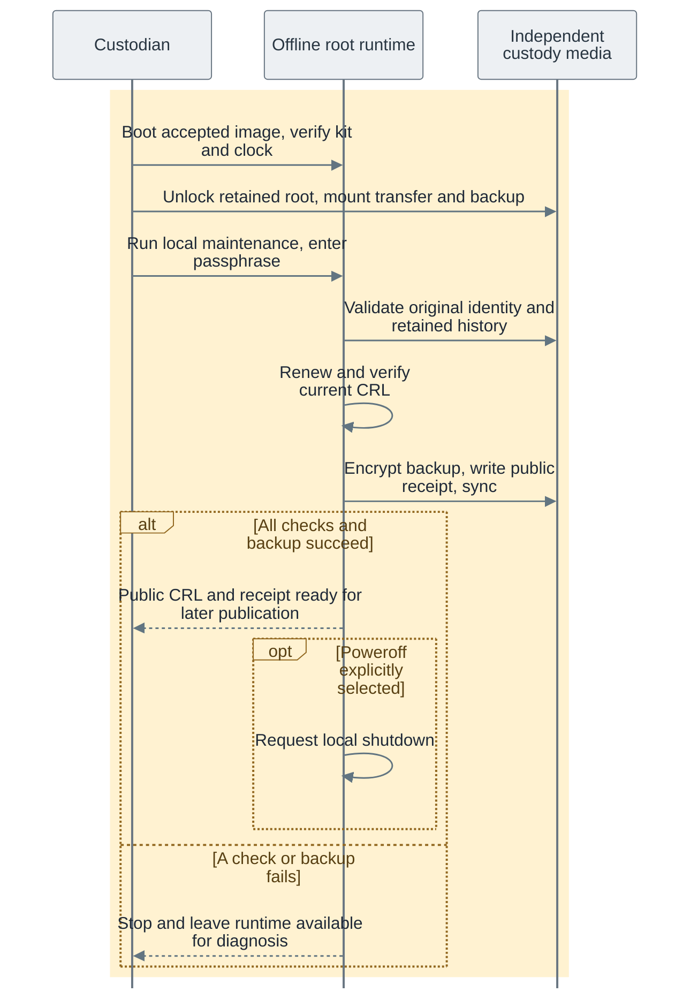
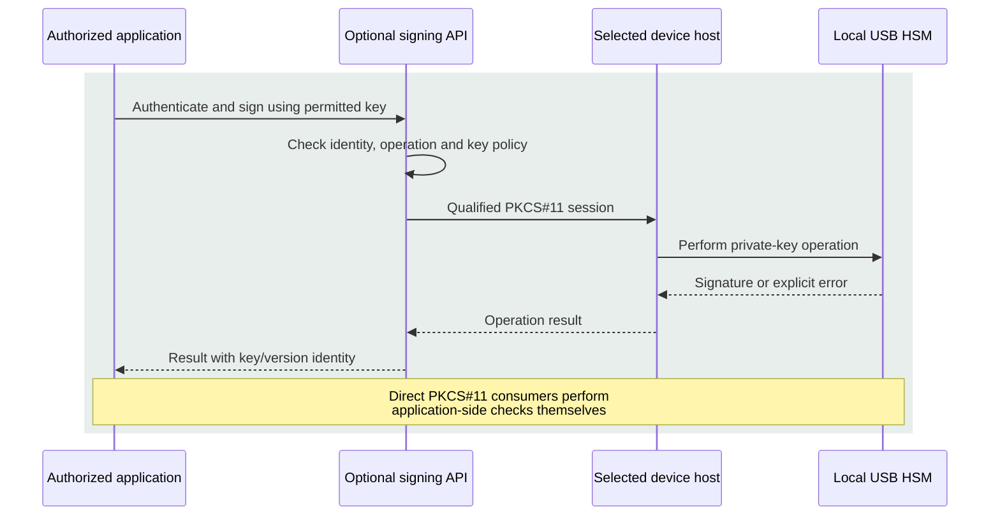

# USB-backed key services

USB-backed providers protect keys for compatible CA, secret-service and application operations.
A local issuer, remote PKCS#11 client and signing API use different authority and failure
contracts, even when they use the same hardware.

## Shared interfaces

*Figure: The consumer link selects the signing API or direct PKCS#11 access to a pinned device host.
The API selects a pool member for qualified application failover. Each device retains its own keys.
Device backups remain separate from signing-API state.*

Read the figure as two consumer contracts. A trusted application can own the
PKCS#11 sessions and policy itself, or use a signing API that checks identity,
operation and key policy on its behalf. Both paths ultimately use a selected
provider host and its local device. Neither path transfers HSM administration
or infrastructure-issuer authority to ordinary development jobs.

| Interface | Consumer responsibility | Reference realization |
| --- | --- | --- |
| Local PKCS#11 | Issuer owns policy and uses one qualified device | OpenXPKI and its local provider |
| Remote PKCS#11 | Application owns sessions, mechanisms and safe reconnects; token permissions bound clients | Native p11-kit over restricted SSH with pinned host keys [1] |
| Signing API | Client authenticates and requests allowed operations on a named key | Optional OpenBao external-key Transit service, with explicit mount grants and key policy [4] |

Remote PKCS#11 exposes device operations; SSH access alone is not an application signing policy.
The API has separate state and credentials. YubiHSM's connector stays loopback-only. [2]
General development jobs should use an application signing identity with exact key/operation policy.
Reserve raw PKCS#11 access for trusted applications that need it; a general runner receives neither
the infrastructure issuer's key authority nor HSM administration credentials.

An accepted external signing application can instead use **E1: Client failover**,
**E2: Private VIP**, or **E3: Private VIP and proxies** on its own service hosts.
The retained [ingress scaffold](../../../tier-0/ansible/roles/hsm_proxy_ingress) renders
an opt-in backend only; it installs neither that application nor a complete VIP/frontend.
Its health and session checks must follow that application's supported HA model.
The supplied SSH remoting path uses pinned member endpoints rather than this scaffold.

## Contents

- [Shared interfaces](#shared-interfaces)
- [Initial scope](#initial-scope)
- [Ceremony and deployment hosts](#ceremony-and-deployment-hosts)
- [Request and response](#request-and-response)
- [Hardware compatibility](#hardware-compatibility)
- [Failure and recovery](#failure-and-recovery)
- [Implementation](#implementation)
- [References](#references)

## Initial scope

HSM is a reusable **key-protection capability**, not a CA role. Each consumer needs its own key,
authorization and recovery contract. The initial reference keeps these responsibilities separate
so the issuer can start and recover without the secret service or an optional signing API:

| Consumer | Protected key purpose | Reference selection |
| --- | --- | --- |
| Offline root CA | Root signing key | Encrypted software custody by default; a separately qualified offline HSM may replace it, but is not served from the online pool |
| Online infrastructure issuer | Its own subordinate-CA signing key | Original key through a qualified local provider first; device-loss recovery accepted before consumers depend on it |
| Secret service | Separate seal/wrapping key, or separately selected managed application keys | Vault starts with Shamir unseal; native PKCS#11 seal requires Enterprise and qualified device mechanisms, not merely working CA signatures [7] |
| Development/application signing | Separate application signing keys | Optional remote key access or signing API for explicitly authorized consumers; never the infrastructure CA's key |

Compatible online services may share provider infrastructure **only where key access is actually
isolated**. Separate labels are not an access-control boundary. The supplied raw PKCS#11 remoting
exposes a dedicated token to its authorized consumer; it does not implement per-object authorization.
Use separate devices/domains or a qualified policy-enforcing API when that isolation cannot be enforced.
Do not reuse the CA signing key as a seal or application key.

An offline root may use an HSM, but its key/device stays outside routine online service access.
Keeping a root key on an always-connected pool does not make it offline. Root ceremony, online
issuer and Vault integration therefore have separate deployment paths within the same capability.
The [seal choices](06-vault-seal.md) describe the secret-service path and its remaining qualification.

The [Trust stage](../../03-deployment/stage-02-trust/README.md) owns installation order
and qualification; shared interfaces are added only for a selected consumer need.
Device initialization, key creation and wrapped-key recovery are controlled custody
operations; ordinary deployment preserves keys.

## Ceremony and deployment hosts

A **ceremony environment** is a trusted, temporary place for privileged key operations. Separate
connected preparation, device administration and offline root authority, even when their operating
images share public tools.

*Figure: The reference realization separates `boot-1`, its public image builder, `cadm-1` and ORCA.
Dashed transfers carry verified public tools, not root secrets or an online route to ORCA.
The three root media have independent physical backing; a VM does not make its hypervisor offline.*

| Responsibility | Allowed work | Retained custody |
| --- | --- | --- |
| Connected stager / `boot-1` | Fetch/build public tools, run IaC, carry public CSRs and certificates | Deployment inputs; no root state, HSM administration PINs or recovery secrets |
| Device administration / `cadm-1` | Initialize a selected HSM, change credentials, create approved objects and test wrapped recovery | Independent vendor-compatible recovery material; runtime may be replaced |
| Offline root / ORCA | Sign approved subordinate requests and renew the root CRL | Original encrypted CA state, policy, serial and CRL history; separate transfer and backup media |
| Online issuer / `ca-1` | Issue certificates using the commissioned subordinate key | Its own issuer state and narrowly authorized provider credential |

Use separate API identities for ceremony provisioning and start/stop. The operator receives only
`VM.Audit` and `VM.PowerMgmt` on the selected session IDs; provisioning separately owns the selected
pool, ISO upload store and accepted USB mappings. Neither API identity authorizes root signing or
holds root-unlock secrets. The [API access procedure](../../03-deployment/foundation/proxmox/api-access.md#ceremony-automation-identity)
owns the exact grants and removes inherited general automation access to these sessions. Disable the
provisioning token before a ceremony so it cannot replace the selected ISO or alter device attachment.
These scopes do not reduce the authority of an existing hypervisor administrator.

Prefer a dedicated physical workstation for commissioning and root custody. An optional ceremony
VM explicitly trusts the host and its administrators: passthrough does not prevent PIN capture,
guest-memory inspection or misuse of an attached HSM. Reusing `boot-1` remains an explicit
constrained-site fallback for the **online issuer's device**, with automation paused and temporary
attachments removed afterward. It is not the normal root environment.

Public image replacement preserves the original signing identity and state. Build updates while
connected, rehearse with disposable keys and separate test media, then boot the accepted image before
attaching real custody media. Images contain public tools only. A package refresh is not proof of a
byte-for-byte reproducible image or permission to change the retained root's pinned tooling policy.

The same selected ISO supplies a general ceremony workbench: `cadm-1` boots its OS and HSM tools,
while a separate root session opens retained CA state. Device attachment does not supply an OS,
and normal online signing does not run through `cadm-1`. The
[live-session and credential figures](../../03-deployment/stage-02-trust/procedures/ceremony-environment.md#understand-the-live-image)
separate disposable runtime, persistent keys and disk/root/backup unlock responsibilities.

### Operator-assisted root maintenance

*Figure: Maintenance automates the work after a custodian has started and unlocked the root.
Publication happens later on the connected side. The helper never starts a VM, unlocks media or downloads updates.*

The local `maintain [--poweroff]` helper combines renewal, encrypted backup and a public receipt.
It does not remove human approval or keep root-unlock secrets on the stager. A scoped runtime operator
may start a NIC-less VM at a custodian's request; signing and unlocking still happen locally at its console.
A scheduled check of the **published** CRL validates its signature against the pinned public root,
then warns when the expected ceremony interval is exceeded and escalates as expiry approaches.
An independent dead-man alarm detects a missed checker run. With the reference 90-day CRL, plan
ceremonies within 60 days; a due or failed check calls the custodian, never unlocks the root.
The [root operations guide](../../05-operations/03-cryptography/offline-root.md) owns scheduling and alarms.

Follow [ceremony-environment deployment](../../03-deployment/stage-02-trust/procedures/ceremony-environment.md)
for the selected image and host path, then the [PicoHSM commissioning procedure](../../03-deployment/stage-02-trust/procedures/picohsm.md)
or the selected vendor procedure. Keep device recovery secrets independent of bootstrap, its backups
and the issuer. [3][6] [Root operations](../../05-operations/03-cryptography/offline-root.md) owns
later ceremonies and recovery of the original CA state.

## Request and response

*Figure: The signing workflow returns a result without exporting the private key. A broken session
produces an error; transport cannot determine whether retrying an operation is safe.*

The return path matters: a disconnected session can leave the caller unsure whether
the device completed an operation. Safe retries and key/version checks belong to
the selected application integration, not to a generic TCP or HTTP health check.

## Hardware compatibility

| Device | Provider qualification | Independent recovery |
| --- | --- | --- |
| YubiHSM 2 | Yubico module, local connector and scoped authentication key/domains/capabilities; PIN includes authentication-key ID [2] | Wrapped objects and retained wrapping material on a compatible spare [3] |
| PicoHSM | USB CCID/PCSC with OpenSC for qualified RSA/ECDSA; selected sc-hsm-embedded middleware for mechanisms such as AES that need it [5] | Supported DKEK backup/restore with separately retained shares [6] |

Support for both families does not make backups interchangeable. Keep a replicated key and
its recovery devices within one qualified family unless separately tested transfer proves
otherwise. Match serials, object identity and public-key fingerprints; a label alone proves nothing.

Select assurance from the exact hardware, firmware, physical protection and threat model.
PKCS#11 compatibility is not certification. Qualify each consumer's mechanisms: issuer
compatibility does not prove seal compatibility. Never activate with factory credentials.

## Failure and recovery

| Failure | Required behavior |
| --- | --- |
| Device/host lost | Select a qualified endpoint and open a new session; an in-flight operation may have an unknown result |
| Wrong key on another endpoint | Fail against the approved public-key identity; do not silently create/import a replacement |
| API member lost | Follow native application quorum/retry semantics; key availability is an additional requirement |
| All online members lost | Recover application state and device keys independently of the unavailable service |
| VM moved | Explicit USB affinity/mobility policy preserves access to its assigned device |

Two tokens do not form a key cluster. Remoting neither replicates objects nor resumes sessions;
replicated application state does not back up HSM keys. A single-node learning API provides no HA.

A single local device can be the initial deployment. Preserve its supported wrapped-key recovery
material from the first ceremony; additional same-family devices retain distinct physical identities.
Moving the unchanged issuer key to a pool changes provider access, not CA authority or history.
The [growth procedure](../../05-operations/03-cryptography/usb-hsm.md#single-device-to-pool) owns that
transition; [Stage 6](../../03-deployment/stage-06-secrets/step-1c-seal-integration.md#review-single-device-growth-before-adding-consumers)
revisits it before additional consumers, independently of the secret service's seal choice.

## Implementation

Stage 2 provisions hosts and native USB attachment through the owning Terraform root.
The [provider role](../../../tier-0/ansible/roles/hsm_provider) installs selected middleware,
checks device identity and binds an inactive issuer to its original key. Physical commissioning,
approved SDK supply and offline custody remain prerequisites.

The [USB deployment](../../03-deployment/stage-02-trust/step-1b-usb-hsm.md) owns remoting;
the [Secrets stage](../../03-deployment/stage-06-secrets/README.md) owns the optional signing API.
HashiCorp Vault remains the reference secret store. Its Enterprise PKCS#11 seal/managed-key
features are separate from the open-source API option; see [seal choices](06-vault-seal.md).
No implicit product migration, key replication or generic load-balancer HA is supplied.

Follow the [USB provider pool](../../03-deployment/stage-02-trust/step-1b-usb-hsm.md) or
[single-device issuer](../../03-deployment/stage-02-trust/step-1d-single-usb.md) procedure
for the selected arrangement. [Hardware custody and recovery](../../05-operations/03-cryptography/usb-hsm.md)
owns subsequent operation.

## References

1. [p11-kit remoting](https://p11-glue.github.io/p11-glue/p11-kit/manual/remoting.html)
2. [YubiHSM 2 PKCS#11](https://docs.yubico.com/hardware/yubihsm-2/hsm-2-user-guide/hsm2-tools-pkcs11.html)
3. [YubiHSM backup and restore](https://docs.yubico.com/hardware/yubihsm-2/hsm-2-user-guide/hsm2-backup-restore.html)
4. [OpenBao external keys](https://openbao.org/docs/api/system/external-keys/)
5. [PicoHSM provider capabilities](https://github.com/polhenarejos/pico-hsm/blob/master/doc/usage.md)
6. [PicoHSM backup and restore](https://github.com/polhenarejos/pico-hsm/blob/master/doc/backup-and-restore.md)
7. [Vault native PKCS#11 seal requirements](https://developer.hashicorp.com/vault/docs/configuration/seal/pkcs11)
