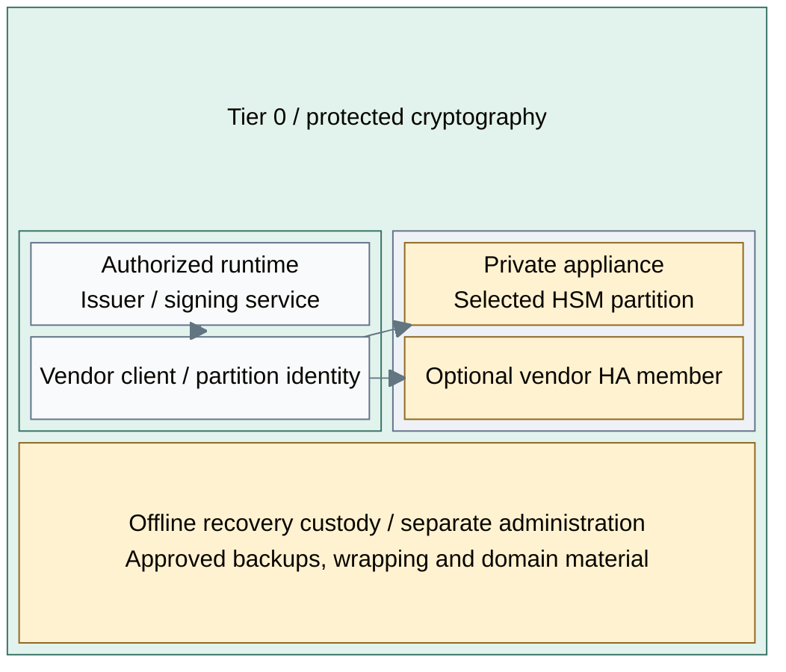

# Network HSM design

Option D from [key protection](03-hsm-selection.md) separates the cryptographic
provider from issuer/signing hosts. Authorized clients access selected appliance
partitions through the vendor's supported client and transport.

## Components and boundaries

*Figure: A service uses a vendor client to reach its authorized partition on the right.
An optional HA member belongs to the selected vendor model; offline recovery remains separate.*

Read the path from service to client to partition. The application requests an
approved key operation; its configured client authenticates to the selected partition.
Network reachability permits a connection, while client and partition policy determine
which keys and operations it may use. Administration and recovery use separately
controlled authority rather than the application's ordinary credentials.

## Contents

- [Components and boundaries](#components-and-boundaries)
- [Client and partition authority](#client-and-partition-authority)
- [Failure and recovery contract](#failure-and-recovery-contract)
- [References](#references)

## Client and partition authority

A network appliance brings its own client libraries, connection trust, partition
ownership, recovery media and failover mechanism. Luna, for example, provides client HA groups over
compatible partitions; synchronization has product-specific conditions. [1]

| Design concern | Required property |
| --- | --- |
| Consumer access | Only approved clients and key operations; network reachability is not authorization |
| Administration | Separate management and custody permissions, owned by Tier 0 for platform-wide keys |
| Availability | Selected failure domains and vendor-supported replication/HA behavior |
| Recovery | Independent approved backups and wrapping/domain material; HA is not backup |
| Offline root | Separate custody; an online partition is not an air-gapped root |

An existing enterprise HSM can satisfy this design without creating USB gateway
VMs. Physical/network appliance provisioning is not implemented by the repository.
Cloud-hosted providers require the separately assessed
[external key-custody boundary](../01-background/02-key-custody.md).

## Failure and recovery contract

The selected application must support its partition's mechanisms and access model.
The design specifies behavior for member/client loss, rejected operations and
independent restore. No certification is inferred from the word HSM.

The optional member in the figure improves availability only under that qualified
contract. Key-provider availability does not recover the issuer's records or a signing
application's state. Conversely, restoring application state is insufficient when its
original key identity or partition credentials are unavailable. The recovery set must
cover both sides independently of the failed service.

The [network HSM procedure](../../03-deployment/stage-3-trust/step-1c-network-hsm.md)
owns installation and acceptance steps.

## References

1. [Thales Luna redundancy and reliability](https://thalesdocs.com/gphsm/luna/7/docs/network/Content/Product_Overview/redundancy_and_reliability.htm) (checked 2026-10-08)
