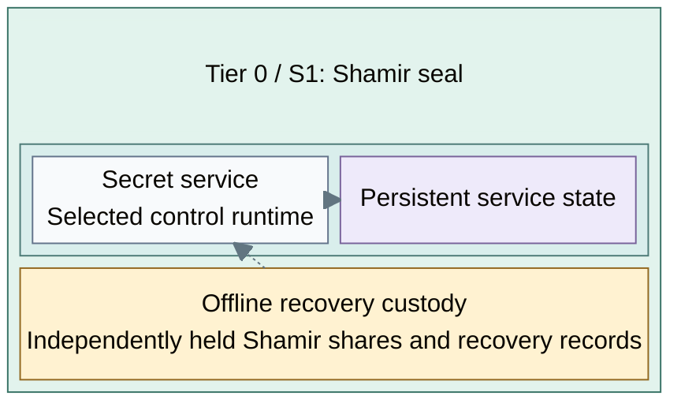
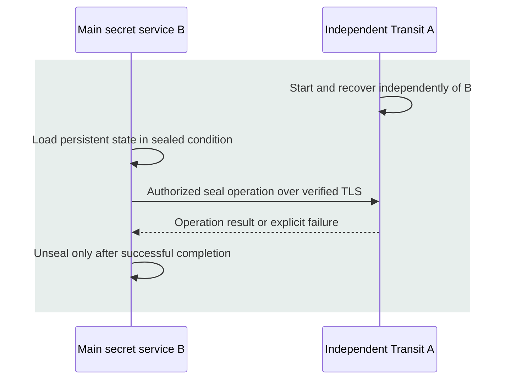

# Secret-service seal patterns

A seal protects the secret service's startup key material. It is separate from
offline root custody, the PKI signing provider, and application-secret authorization.
The reference product is Vault; alternative implementations need their own compatibility review.

For provider-backed seals, the secret service consumes the selected provider;
the reference HSM service starts independently of Vault. Hardware-backed key generation
and private-key operations use a [separate consumer integration](04-usb-hsm.md#authority-and-transport).

## Seal placement

The selected runtime can be the Tier 0 cluster or a dedicated secret-service host.
The initial S1 reference keeps startup under custodian control without an online
seal-provider dependency.

*Figure: S1 retains persistent service state and separately held unseal shares. The upward dashed
link is an authorized custody transfer during unseal or recovery, not an online provider connection.*

The service's persistent state and its unseal material have separate custody and
recovery responsibilities. A data restore still needs the selected startup material;
holding shares alone does not restore lost service data. The seal also does not
replace application authentication, access policy or audit.

## Table of contents

- [Seal placement](#seal-placement)
- [Pattern choices](#pattern-choices)
- [Transit dependency](#transit-dependency)
- [Recovery contract](#recovery-contract)
- [Realization](#realization)
- [References](#references)

## Pattern choices

Select one startup contract for the main service. S2 and S3 replace the S1 unseal
path with a qualified provider dependency; they do not add signing authority.

| Pattern | Function | Consequence |
| --- | --- | --- |
| S1: Shamir | Authorized custodians supply unseal shares | Simple independent bootstrap; restart/recovery needs an operator process |
| S2: Transit | A separately recoverable service performs unseal cryptography for the main service | Adds a live dependency and a scoped credential; not native HSM seal [1] |
| S3: Native PKCS#11 | A supported implementation delegates seal operations to a compatible provider | Vault requires Enterprise for this feature; OpenBao documents a separate PKCS#11 path [2][3] |

S1 is the default reference. Both VM and Kubernetes installers expose S2 configuration;
S3 consumes a qualified licensed provider package/image and credential interface through
[the seal deployment option](../../03-deployment/stage-6-secrets/step-1c-seal-integration.md).
These selections are not automatic upgrades applied by the existing role. Device
choice is independent: [key-protection options A-D](03-hsm-selection.md).

## Transit dependency

S2 moves routine unseal to an independent service A. The main service B uses a
scoped credential and verified provider connection; B's ordinary secret consumers
do not acquire that credential or direct authority over A.

*Figure: Under S2, B's startup request travels to A on the right and its result returns to B.
A must already be usable through an independent startup and recovery path.*

A has a narrowly scoped purpose, audit and independent recovery. B's restart
depends on A under S2, so A cannot depend on B's secrets or unavailable hosted platform.
Hardware protecting A's recovery material is a proposed custody integration;
the repository does not implement it.

S2 can remove routine manual unseal of B, but does not make B's barrier key
HSM-wrapped or give Vault Community Edition Enterprise seal wrapping.
The actual seal and recovery guarantees depend on the selected implementation. [1][2]

## Recovery contract

Seal dependencies and custodians are explicit. The design defines startup behavior
when the provider is unavailable, independent recovery material, credential ownership
and supported data restoration. A seal change requires a separate migration and
rollback plan in deployment; it is not an automatic consequence of service maturity.

Root CA custody is not the secret-service seal. An offline backup of an online
key does not become a root CA, and HSM presence alone proves neither recovery nor compliance.

## Realization

[The Secrets stage](../../03-deployment/stage-6-secrets/README.md#step-1-deploy-the-secret-service) integrates the
secret service using [the selected seal procedure](../../03-deployment/stage-6-secrets/step-1c-seal-integration.md).
Administration owns subsequent recovery and rotation; architecture records the
dependency and custody contract.

## References

Sources checked 2026-10-08.

1. [HashiCorp Transit seal](https://developer.hashicorp.com/vault/docs/configuration/seal/transit)
2. [HashiCorp PKCS#11 seal](https://developer.hashicorp.com/vault/docs/configuration/seal/pkcs11)
3. [OpenBao PKCS#11 seal](https://openbao.org/docs/configuration/seal/pkcs11/)
