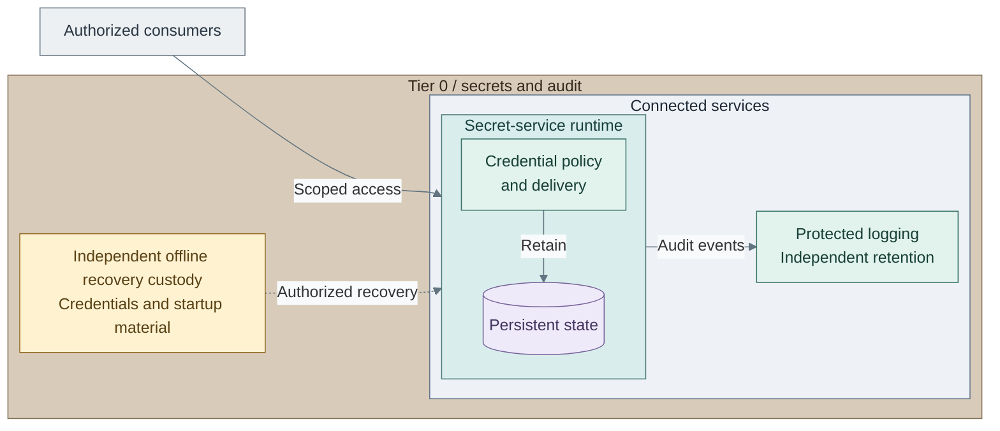

# Secrets

The secret service gives authorized consumers scoped access to credentials and
records that access. Persistent service state, audit retention and startup/recovery
material have separate responsibilities, so recovery can proceed when the normal
service or its login path is unavailable.

*Figure: Consumers enter a policy-controlled secret runtime. Audit events flow to independent
protected logging on the right; offline custody below the connected services supports authorized recovery.*

The service mediates credential access; it does not transfer its administrative
authority to consumers. The figure's three durable concerns remain distinct:
credential state must be restored, audit history must remain protected, and custodians
must be able to supply the selected recovery/startup material independently.

## Contents

- [Certificate and secret consumption](#certificate-and-secret-consumption)
- [Startup and recovery](#startup-and-recovery)
- [Optional signing](#optional-signing)
- [Realization](#realization)

## Certificate and secret consumption

Follow the consumer's responsibilities from startup to access:

1. **Establish the service connection.** Use approved trust material to validate the
   endpoint. Certificate issuance and renewal follow the issuer's authenticated
   enrollment and certificate policy, independently of credential retrieval.
2. **Authenticate the consumer.** Use the selected workload or operator identity
   contract. Access must be scoped to the required credential paths and operations;
   authentication grants neither other tenants' secrets nor service administration.
3. **Use the authorized credential.** The service supplies the allowed result and
   records access through its audit integration. The consuming application retains
   its own authorization and credential lifecycle responsibilities.
4. **Maintain both lifecycles.** Certificate renewal, secret rotation and recovery
   remain explicit workflows. Availability of one service does not replace the
   other's trust, policy or retained state.

The [certificate hierarchy](README.md#completed-design) shows offline authorization
of intermediates. The [CA design](01-certificate-authority.md) then follows routine
enrollment, the signing-provider interface and public trust-object publication.

## Startup and recovery

The seal protects startup material; it does not select the CA's key custody or
authorize application requests. The reference starts with HashiCorp Vault and
independently held Shamir shares. [Seal patterns](06-vault-seal.md) explains the
separate Transit and native-provider alternatives and their dependency consequences.

Recovery combines service data, accepted credentials and the selected startup
material. The service or its IdP cannot be the sole repository for the inputs
needed to restore it. Protected audit retention has its own storage and recovery
contract; restoring the credential store does not restore that evidence.

## Optional signing

An application that needs hardware-backed private-key operations can add the
independent [signing API option](../../03-deployment/stage-6-secrets/step-11b-openbao.md).
It has separate state and policy. An external-key signature uses the selected
provider for the operation; a software signing key protected only by a startup seal
has a different custody boundary. [Shared key services](04-usb-hsm.md) owns this design.

Software, USB and network-HSM realizations retain these roles while changing
custody, availability and recovery properties. Root keys and online keys can use
different providers. A reachable gateway alone does not establish integration.

## Realization

The [Secrets deployment](../../03-deployment/stage-6-secrets/README.md) also adds
control tools and independent monitoring. Those services retain their own operational
and recovery boundaries; [operations and resilience](../11-operations/README.md)
explains them. Use [secrets operations](../../05-operations/03-cryptography/README.md)
for credential handling, backup and recovery tasks.
