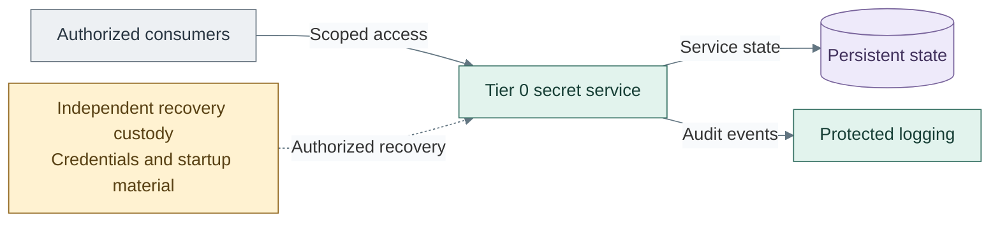

# Secrets

Secrets provides scoped credential storage, access, audit and independent recovery.
Its deployment also adds control tools and independent monitoring; those services
have their own operational and recovery boundaries.

*Figure: Authorized consumers access the Tier 0 secret service, which retains state and emits protected audit
events; independent custody supports recovery.*

Seal and recovery choices are separate from certificate-signing key custody.
HashiCorp Vault with Shamir is the initial reference path. Applications needing hardware-backed
signing can add the independent [signing API option](../../03-deployment/stage-6-secrets/step-1d-openbao.md).
It has separate state and policy; an external-key signature is different from a software key
protected only by the service's startup seal. [Shared key services](04-usb-hsm.md) owns that design.

| View | Guide |
| --- | --- |
| Secret-service interfaces and custody | [Cryptography and secrets](README.md) |
| Seal choices and independent recovery | [Secret-service seals](06-vault-seal.md) |
| Control visibility, inventory and recovery | [Operations and resilience](../11-operations/README.md) |
| Deploy secrets and supporting control services | [Secrets deployment](../../03-deployment/stage-6-secrets/README.md) |
| Operate secret and control services | [Secrets operations](../../05-operations/03-cryptography/README.md) |

## Certificate and secret consumption

The [certificate hierarchy](README.md#completed-design) is the
authoritative cross-tier trust view. It distinguishes offline authorization of
intermediates from routine online issuance. The
[cryptography domain](README.md) expands signing, key custody,
secret storage and seal/unseal as separate components.
The [CA design](01-certificate-authority.md) expands the infrastructure
portal, authorized enrollment adapter, separate identity CA and public-object publication.

| Consumer interaction | Required boundary |
| --- | --- |
| Certificate consumer to online issuer | Approved certificate policy and authenticated issuance or renewal |
| Issuer to signing provider | Explicitly supported provider integration and permitted key operations |
| Workload to secret service | Scoped credential delivery and audit; no implied access to other tenants or administration |
| Secret service to seal mechanism | Selected startup/key-protection contract, independent of certificate signing |
| Root ceremony to issuing authority | Authorized transfer of signed intermediate certificates and trust material; no normal network route |

Software, USB and network-HSM realizations retain these roles while changing
custody, availability and recovery properties. Root keys and online keys can use
different providers. A reachable gateway alone does not establish integration.
