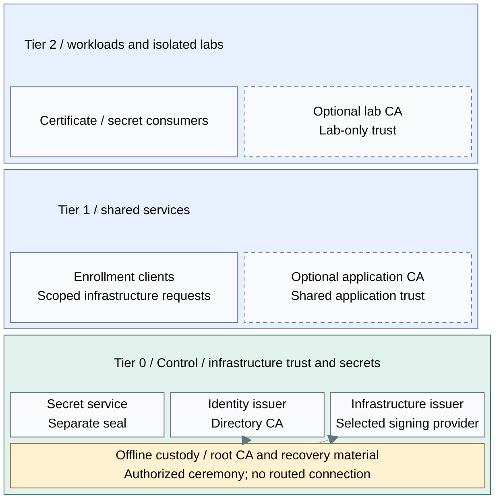

# Cryptography and secrets

Cryptography establishes trust, protects key custody and delivers credentials.
Root custody, online issuance, signing and secret storage are separate functions;
one product need not implement all of them. Together they provide the certificate
trust and secret interfaces of the [platform architecture](../README.md).

## Completed design

Routine consumers depend on the online issuer and secret service. Root custody
remains separately controlled, and signing and secret-service startup protection
retain independent provider choices.

*Figure: Online consumers sit above Tier 0 trust services; the upward dashed arrows transfer
offline-signed intermediate certificates, not network traffic. Optional CAs have their own trust scope.*

Read the figure from the consumers down to their trust foundation. An infrastructure
client enrolls with the online issuer, which applies certificate policy and uses its
selected signing provider. The root key stays offline: it authorizes the intermediate
issuer during a ceremony rather than participating in routine requests. The identity
issuer is a sibling authority for directory and host identities.

Each tier's infrastructure clients enroll directly with Tier 0's online issuer;
Tier 1 is not an enrollment proxy for Tier 2. Secret consumers use separately
authorized APIs. The [enrollment view](01-certificate-authority.md#enrollment-and-publication)
expands those online paths without overlaying them on the placement map.
Tier 1 enrollment clients do not hold infrastructure CA signing keys.

## Table of contents

- [Completed design](#completed-design)
- [Components and interfaces](#components-and-interfaces)
- [Independent choices](#independent-choices)
- [Design constraints](#design-constraints)
- [Detailed views](#detailed-views)
- [Realization](#realization)

## Components and interfaces

### Establish trust, then issue online

The offline root signs intermediate CA certificates under separately controlled
custody. The online issuer owns approved certificate profiles, issuance records,
renewal and revocation. Its key provider performs permitted cryptographic operations;
it does not decide which names a consumer may request. A reachable gateway becomes
a backend only through supported application/provider integration.

The [CA design](01-certificate-authority.md) follows this boundary through the
portal, enrollment adapter and public trust-object publication. Public certificates
and revocation data can be distributed without distributing signing authority.

### Deliver credentials through a separate service

The secret service authorizes credential retrieval or delivery, records audit events
and retains recoverable state. Its seal protects startup material. That seal is
independent of the CA signing backend, even when both use hardware. Optional shared
signing has its own key identities, permissions and recovery contract.
The [secrets design](08-secrets.md) explains consumption; [seal patterns](06-vault-seal.md)
explain startup and recovery.

### Keep narrower trust scopes explicit

Application-specific trust can instead use a shared Tier 1 CA or a lab-local Tier 2 CA.
These optional authorities do not automatically chain to, or gain the permissions of,
the infrastructure root. Their trust stores, allowed names, keys and recovery remain
scoped to their consumers. Any cross-signing or subordinate delegation requires a
separate policy and path-constraint review; neither is installed by these examples.

### Supply trust and consume independent foundations

| Boundary | Interface and connected function |
| --- | --- |
| Supplied to identity and services | Public trust material and policy-scoped certificate issuance, renewal and revocation |
| Supplied to authorized clients | Scoped secret retrieval or delivery with audit and independent recovery |
| Consumed from hosting and networking | Issuer and secret-service runtime with approved network access |
| Consumed from data services | Issuer records and secret-service persistence with [explicit storage and recovery contracts](../06-data/README.md); key custody remains separately controlled |
| Consumed from access policy | Authorized service identities, consumer roles and separately controlled custodian authority |
| Consumed from recovery arrangements | Protected backups, recovery credentials and startup material independent of the affected service |

## Independent choices

Choose the boundary for each key purpose, then select its realization. Root and online
keys can use different providers; secret-service placement does not select its seal.
These are independent decisions, with no requirement to pass through every option.

| Decision | Alternatives | Design |
| --- | --- | --- |
| Key custody | A: software; B: single USB; C: replicated USB gateways; D: network HSM | [Key-protection options](03-hsm-selection.md) |
| Issuer location | Existing authority; dedicated VM; cluster service | Same offline-root/online-issuer boundary; no self-bootstrap dependency |
| Issuer implementation | OpenXPKI Community reference; existing qualified CA or Enterprise alternative | [CA and enrollment design](01-certificate-authority.md); no assumed native Community ACME or OCSP |
| Secret-service placement | Dedicated VM; Kubernetes service; existing approved service | Same access and recovery contract; migration needs explicit data/state ownership |
| Secret-service seal | Shamir; independent Transit service; supported native PKCS#11 | [Seal patterns](06-vault-seal.md), independent of A-D |
| Shared signing interface | Native PKCS#11 remoting; separately deployed policy-enforcing API | [USB-backed key services](04-usb-hsm.md); HashiCorp Vault remains the initial secret store |

Hardware can be selected initially or introduced later without changing its purpose.
The reference realization uses OpenXPKI for infrastructure issuance, FreeIPA's sibling
identity CA and HashiCorp Vault for secrets. Those product choices implement the roles
above; they do not merge their authority or recovery boundaries.

## Design constraints

| Concern | Required property |
| --- | --- |
| Custody | Key purpose, authorized operations and custodians are explicit for each provider |
| Isolation | Offline root material is not available to online issuers or ordinary consumers |
| Lifecycle | Rotation and revocation preserve the intended trust and consumer compatibility |
| Recovery | Device/provider loss cannot require the unavailable secret service to restore its own keys |
| Foundational path | Tier 0 issuance/signing and recovery do not depend on Tier 1/2 runtimes; private endpoints share the capacity-sized USB service pool |

Software custody can satisfy an accepted threat model. Hardware presence alone
does not establish the required isolation, recovery or compliance properties.

## Detailed views

Continue with [certificate authority design](01-certificate-authority.md) to follow
issuance, then [algorithm selection](02-algorithm-selection.md) and
[key-protection options A-D](03-hsm-selection.md) to understand the signing boundary.
The USB and network-provider details branch from that choice.

For credential consumers, read [secret access and audit](08-secrets.md), then the
[seal design](06-vault-seal.md) for startup dependencies. Finally,
[post-quantum readiness](07-post-quantum.md) explains which transport, signature and
storage paths need separate migration qualification.

## Realization

Implementation procedures: [trust and custody](../../03-deployment/stage-3-trust/README.md#step-1-prepare-issuer-and-key-custody)
and [secret-service integration](../../03-deployment/stage-6-secrets/README.md#step-1-deploy-the-secret-service).
Device ceremonies remain authorized procedures; the HSM automation supplies native USB
attachments, provider packages/configuration and non-destructive identity inspection. Single-issuer
binding preserves the original hardware key. Application-specific replication/HA remains a separate contract.
For an existing software issuer, follow the administration
[hardware migration procedure](../../05-operations/03-cryptography/hardware-migration.md)
for controlled rollover and recovery.

[Cryptography and credential tasks](../../05-operations/03-cryptography/README.md)
owns day-to-day operation. [YubiHSM performance](../../08-reference/yubihsm-performance.md)
provides benchmark timings and limits when sizing the selected hardware path.
