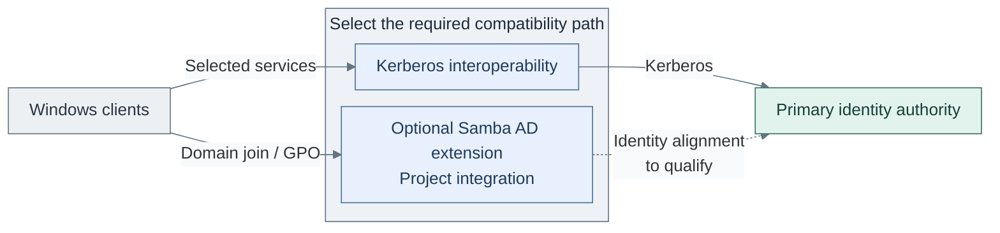

# Windows support

## Purpose

Windows integration extends the primary identity model for Windows clients.
It is an optional compatibility function, not an alternative owner for the
platform's DNS, PKI or secret-service foundations.

*Figure: The client requirement selects service interoperability or a domain extension. The existing
authority stays to the right; the dashed alignment link is integration work, not an installed trust.*

The two branches solve different needs. Selected Kerberos-backed services can be
enough for a small environment; domain join and Group Policy Objects (GPOs) call for
an explicitly selected AD-compatible domain. Neither branch is a prerequisite for
the primary directory or secret service.

## Table of contents

- [Purpose](#purpose)
- [Position in the repo](#position-in-the-repo)
- [Current design direction](#current-design-direction)
- [Support modes](#support-modes)
- [Boundaries](#boundaries)
- [Read more](#read-more)
- [References](#references)

## Position in the repo

Windows integration starts after a usable primary identity, DNS and certificate
foundation. It consumes those contracts and adds client-specific behavior. The
repository supplies no complete Windows-domain installer: the domain branch in the
figure is project integration, including qualification of its identity alignment.

## Current design direction

FreeIPA with Kerberos remains the reference primary authority. The directory and
its DNS/identity CA use the `identity` network; the infrastructure issuer uses
`cryptography`, with offline root custody in `ceremony`. Samba and Windows support
extend this foundation for selected clients. Domain join, GPO and Windows logon
belong to this optional path, with their own operating and recovery responsibilities.

## Support modes

Use the smallest Windows support layer that solves the real requirement.

| Mode | Use it when | Notes |
| --- | --- | --- |
| FreeIPA Kerberos interoperability | Windows clients only need access to selected Kerberos-backed services, such as Samba shares | This can avoid a full Windows domain for small environments, but test the exact client behavior carefully. |
| Samba AD extension | Windows clients need domain join, GPO, or native Windows domain behavior | Keep users and groups anchored to the primary identity model where possible. |

The blog walkthrough linked below is useful as a practical example of Rocky
Linux, FreeIPA, Samba, and Windows Kerberos interoperability. Treat it as a lab
pattern to validate, not as the default identity foundation deployment.[1]

FreeIPA and Red Hat document service-specific requirements and limitations around
Windows clients, NTLM behavior and domain-member support. Qualify the selected mode
against those boundaries rather than treating it as a general domain installer. [2][3][4]

## Boundaries

Primary identity and secret-platform startup remain independent of Windows support.
The extension owns its domain/client behavior and operations; the primary authority
retains its identity namespace. Moving that ownership is an intentional change to
the environment's authority model, beyond selecting a compatibility mode.

Before accepting a branch, establish the required client behavior and supported
identity mapping, then verify it with the exact clients and services. Recovery must
preserve the chosen ownership boundary rather than make the primary foundation
depend on the extension it supports.

## Read more

- [Identity foundation path](../../03-deployment/stage-5-identity/procedures/freeipa.md)
- [Hardware-backed user authentication](../../03-deployment/stage-6-secrets/step-21b-hardware-authentication.md)
- [Vault foundation deployment](../../03-deployment/stage-6-secrets/step-1b-vault-vm.md)
- [Deployment readiness](../../03-deployment/readiness.md)
- [Design decision log](../../07-decisions/README.md)

## References

1. [Configuring Rocky Linux, FreeIPA and Samba for Kerberos Support on Windows Clients](https://lachlan.nz/blog/rocky-freeipa-samba-windows/)
2. [FreeIPA Samba file server integration](https://www.freeipa.org/page/Howto/Integrating_a_Samba_File_Server_With_IPA.html)
3. [FreeIPA NTLMSSP Samba note](https://www.freeipa.org/page/Howto/Integrating_a_Samba_File_Server_With_IPA/NTMLSSP.html)
4. [Red Hat, setting up Samba on an IdM domain member](https://docs.redhat.com/en/documentation/red_hat_enterprise_linux/10/html/using_external_red_hat_utilities_with_identity_management/setting-up-samba-on-an-idm-domain-member)
