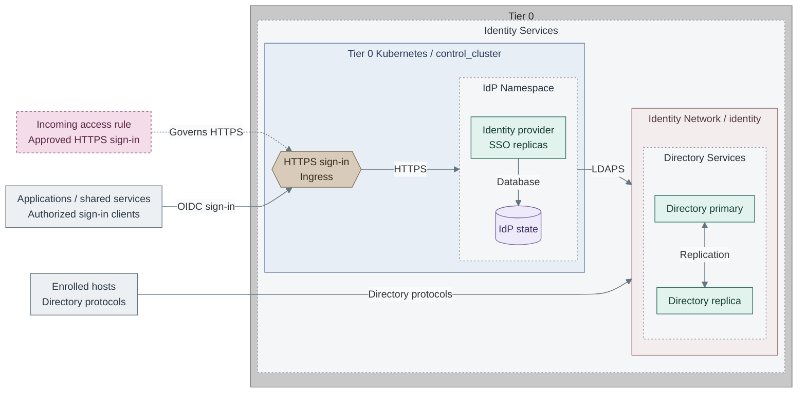
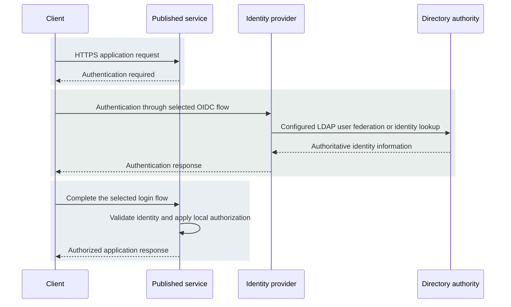

# Identity and access

Identity establishes subjects and exposes authentication interfaces. Authorization
remains local to each service: a successful login is not permission to administer
the platform. This domain supplies directory authority and federated access to the
[platform architecture](../README.md).

## Completed design

Hosts use directory authority directly; applications use an identity provider
(IdP) and retain their own permission mappings. The IdP depends on the directory,
which remains outside the cluster it helps administrators access.

*Figure: Authorized consumers enter from outside Tier 0. Within the dotted Identity services grouping,
Kubernetes on `control_cluster` is to the left of directory authority on `identity`.
The IdP namespace contains the application and its state below it. Enrolled hosts use the directory directly.*
The incoming-rule annotation sits outside Tier 0 and points directly to the warm-beige ingress.
Identity services is a functional grouping, not a network or a shared runtime.

The figure separates ownership from access. Publishing an authentication endpoint
to a consuming tier does not give that tier control of the directory or IdP runtime.
The IdP's database, TLS and directory failover are explicit integration requirements;
directory replication alone does not make application login highly available.

The directory retains one replicated identity CA under the offline root, as a sibling
of the infrastructure issuer. Their certificate inventories and custody remain
separate; see the [CA design](../08-cryptography/01-certificate-authority.md).

Arrows identify logical consumers and dependencies, not every browser redirect
or token exchange. [Service access](#service-access) expands
the login interaction. Enrolled hosts consume directory services directly;
applications consume the IdP and retain their own authorization.

## Table of contents

- [Completed design](#completed-design)
- [Terminology](#terminology)
- [Service access](#service-access)
- [Components and interfaces](#components-and-interfaces)
- [Design choices](#design-choices)
- [Administrative authentication](#administrative-authentication)
- [Design constraints](#design-constraints)
- [Detailed views](#detailed-views)
- [Realization](#realization)

## Terminology

Identity and access management (IAM) covers identity lifecycle, authentication and
access policy. [1] In the figure, **identity management (IdM)** is directory authority:
it maintains users, groups and enrolled hosts, and supplies DNS, directory and Kerberos
services. An **identity provider (IdP)** authenticates subjects and supplies identity
information to relying applications. [2] **Single sign-on (SSO)** reuses a sign-in
session across participating services; each service still owns authorization. [4]

The reference uses FreeIPA as the dedicated directory primary and replica, and
Keycloak as the IdP in Tier 0 Kubernetes. [3][4] Keycloak's connection to the directory
is **LDAP user federation**, configured read-only over verified LDAPS. The directory
remains the source for users and groups. **Identity brokering** instead delegates
authentication to another IdP, such as an upstream OIDC or SAML provider. [4]

## Service access

Published services expose named application endpoints. For an OpenID Connect (OIDC)-capable
service, the IdP uses directory authority and the service applies
its own authorization. This is a logical authentication scenario; exact token
exchanges depend on the selected application integration.

*Figure: Authentication travels from the client through the IdP to directory authority; responses
return to the client, then the service validates the login and applies its own authorization.*

Read the final exchange as a second decision: an authenticated identity can still
lack permission for the requested operation. Group claims and service roles need
explicit mappings; an IdP session does not carry platform administration rights.

The service endpoint may be reached through the shared edge proxy and application
ingress. This does not publish its administrative interfaces. Direct directory
protocols, machine credentials and non-OIDC services use their own explicit
integration contracts.

## Components and interfaces

Give each client-facing interface a stable [service DNS name](../../02-conventions/service-dns.md),
such as `sso.internal.example.com` for sign-in or `ldap.internal.example.com` for qualified directory access.
Directory members keep their own host identities and protocol-specific discovery records.

Standalone infrastructure and stable internal service aliases use
`platform_internal_domain`. An enrolled host uses `platform_domain`; a directory
server uses that domain while its authority is commissioned. Inventory records the
host's `platform_domain_role` as `standalone`, `member` or `authority`. The
[host-domain convention](../../02-conventions/service-dns.md#select-each-hosts-domain)
connects these names to administrative ownership and the selected directory workflow.

### Keep application access separate from control

| Capability | Reference placement | Supplied interface |
| --- | --- | --- |
| Directory authority (IdM) | Tier 0 / Control; dedicated VMs on `identity` | Host enrollment, directory, DNS and Kerberos |
| Identity provider (IdP / SSO) | Tier 0 / Control; Kubernetes on `control_cluster` | Approved application-facing OIDC endpoints |
| Service authorization | Consuming service and its owning tier | Scoped application or cluster permissions |
| Operator access | Protected administration and independent recovery arrangements | Separately authorized control interfaces |

An IdP is an application-facing service with high-impact identity authority.
Its login endpoint can be consumed from Tier 1 and Tier 2 without exposing its
administration or moving its runtime into the Services zone. The `access`
network can host a deliberately selected front end; it is not the reference
placement of the IdP. A published front end does not bridge networks or grant
directory administration.

### Keep dependencies recoverable

The directory's independent runtime, the IdP's database and the service's own policy
are separate state boundaries. Certificate trust, DNS/time and backup access must be
available along their selected startup and recovery paths. Restoring the directory
does not restore IdP sessions, client configuration or application permissions.

| Boundary | Interface and connected function |
| --- | --- |
| Supplied to hosts | Directory enrollment, DNS, LDAP and Kerberos within the selected authority scope |
| Supplied to applications | OIDC identity and group claims; each service owns its permission mappings |
| Consumed from hosting | Dedicated directory runtime and IdP runtime, with scoped lifecycle control |
| Consumed from data services | Directory persistence and the IdP's database/storage contract; [data ownership](../06-data/README.md) remains explicit |
| Consumed from cryptography | Certificate trust, service TLS and supported operator credential integration |
| Consumed from operations | Independent recovery records, backup targets and access/audit visibility |

## Design choices

Start with the authority contract: either deploy the dedicated directory pair or
consume an existing approved authority. The latter must supply the required schema,
protected directory endpoint, namespace ownership, availability and independent
recovery. It replaces installation, not those obligations.

| Decision | Variants | Consequence |
| --- | --- | --- |
| Authority | A: new dedicated directory pair; B: existing approved authority | B replaces installation with an interface, ownership and recovery contract |
| Normal operator access | Bootstrap credentials; hardware-backed OTP/PIV or appropriate phishing-resistant mechanisms | Credential capability and application support must be verified separately |
| Windows clients | Selected service interoperability; optional [AD-compatible extension](01-windows-integration.md) | An extension does not silently replace the primary identity authority |
| Instance boundary | Shared identity; isolated project/domain authority where justified | Isolation adds enrollment, trust and recovery responsibilities |

User authentication devices and server HSMs have different purposes.
A server's key custody does not by itself provide strong user authentication.

## Administrative authentication

Keep user authentication separate from machine credentials. Constrain Kerberos
delegation, use service principals rather than forwarded user passwords, and prefer
scoped or short-lived SSH/API credentials. A compromised host must not acquire a
reusable identity that grants unrelated service administration.

Hardware-backed OTP/PIV and phishing-resistant FIDO2/WebAuthn are explicit integration
choices, with different supported protocols. Harden privileged users first and retain
the separately authorized recovery path; selecting an identity service does not
configure every application or eliminate bootstrap/recovery passwords.
See [hardware authentication choices](../../03-deployment/stage-06-secrets/step-21b-hardware-authentication.md)
for supplied integration and acceptance boundaries.

## Design constraints

| Concern | Required property |
| --- | --- |
| Authority | Defined namespaces and replication boundaries; one owner for each identity source |
| Authorization | Each consumer maps identity to its own scoped permissions |
| Availability | Directory replication and IdP persistence have separate failure and recovery contracts |
| Recovery | The IdP cannot be the only means to recover itself or replace lost operator credentials |

## Detailed views

Use [Windows and AD-compatible integration](01-windows-integration.md) only when
client requirements call for that extension. [Service boundaries](../02-organization/README.md)
explains shared versus isolated authority consumption. For the selected products and
hosting, [component allocation](../03-reference-platform.md#service-placement) locates
the directory, IdP and database; the [platform overview](../README.md) places
authentication in complete service access.

## Realization

Implementation procedures: [directory authority](../../03-deployment/stage-05-identity/procedures/freeipa.md)
and [IdP integration](../../03-deployment/stage-05-identity/README.md#step-2-deploy-identity-federation).
Windows integration is an explicit project option, not a supplied domain installer.
The [Identity stage](../../03-deployment/stage-05-identity/README.md) owns installation;
[identity operations](../../05-operations/04-identity.md) owns routine access and recovery.

## References

Sources checked 2026-10-09.

1. [NIST: Identity and access management](https://csrc.nist.gov/glossary/term/Identity_and_access_management)
2. [NIST: Identity provider](https://csrc.nist.gov/glossary/term/Identity_Provider)
3. [FreeIPA: About](https://www.freeipa.org/page/About)
4. [Keycloak: Server administration](https://www.keycloak.org/docs/latest/server_admin/index.html)
