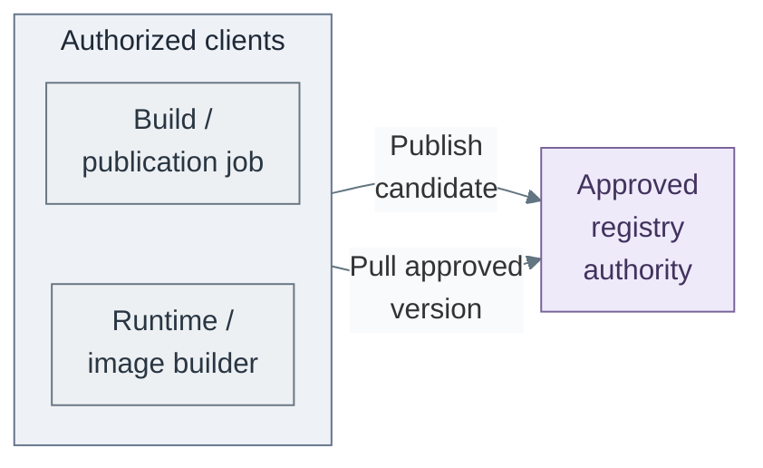

# Artifact supply design

Source control owns definitions and proposed changes. The registry owns promoted
artifacts. A distribution layer accelerates pulls but is not the authority for
which artifact is approved.

## Contents

- [Components and variants](#components-and-variants)
- [Availability and dependencies](#availability-and-dependencies)
- [References](#references)

## Components and variants

*Figure: Client-boundary links represent candidate publication by the build job and approved-version
pulls by the runtime or image builder, with separate registry permissions. These are requests to the
registry authority; candidate publication does not approve a release.*

The direct supply path gives each artifact a version identity that the release policy
can select. Builds need scoped publication rights; runtimes and image builders need
only their authorized pull scope. The registry retains content and enforces access,
while promotion policy determines which version a consumer may use.

External package caches, retained mirrors and offline supply belong to
[controlled software intake](../07-software-intake/README.md), including Tier 0 updates
and OS/template inputs. An HTTP cache is not an OCI (Open Container Initiative) registry.
[Artifact verification](../07-software-intake/01-verification.md) can add checks and quarantine
before publication; neither registry storage nor a successful scan approves a release.

The following choices change service ownership or distribution. They do not change
the distinction between artifact identity, approval and authorized retrieval.

| Option | Design | Reference example | Trade-off |
| --- | --- | --- | --- |
| A | Registry integrated with source control | GitLab registry [1] | Simple project-local ownership; coupled service lifecycle |
| B | Independent platform registry | Harbor [2] | Separate artifact policy and recovery; another stateful service |
| C | B plus distribution acceleration | Harbor plus Dragonfly [3] | Additional capacity/distribution function and operating responsibility |

An existing registry is valid for any compatible consumer. The reference products
are examples, not required stages. C does not replace B's artifact authority.
Kubernetes and image-based Linux can consume all suitable variants.

In C, consumers use the separately commissioned distribution layer to accelerate
retrieval of content from B's authoritative registry. It adds operating responsibility;
it does not select approved versions or replace retained recovery copies.

## Availability and dependencies

Every variant needs scoped push/pull, approved promotion, retention and recovery.
Independent bootstrap needs approved artifact availability, not a specific hosted
registry. Distribution acceleration is justified by measured pull demand.

Harbor's cluster HA pattern depends on external ingress, database/cache and artifact
storage readiness; increasing application replicas alone is insufficient. [2]
Recovery copies for Tier 0 remain independent of the delivery platform.

[Registry integration](../../03-deployment/stage-7-delivery/procedures/registry.md)
owns implementation and acceptance.
The supplied Tier 1 [delivery installer](../../../tier-1/ansible/roles/delivery_platform/tasks/harbor.yml)
realizes B with single-instance Harbor and persistent volumes; it does not establish
the HA pattern above. The [GitLab installer](../../../tier-1/ansible/roles/development_platform/templates/gitlab-values.yml.j2)
disables its bundled registry, so installing source control alone does not realize A.
Distribution acceleration remains a separately commissioned integration.

## References

Sources checked 2026-11-09.

1. [GitLab container registry](https://docs.gitlab.com/user/packages/container_registry/)
2. [Harbor HA deployment](https://goharbor.io/docs/main/install-config/harbor-ha-helm/)
3. [Dragonfly project documentation](https://d7y.io/docs/)
