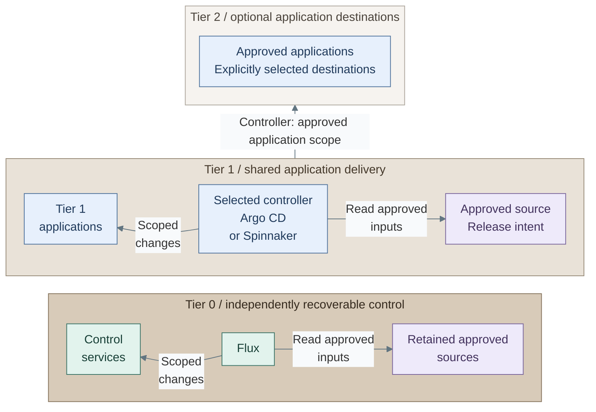

# Delivery controller patterns

Tier 0 uses Flux for its independently recoverable control-service deployment.
Tier 1 selects its own delivery platform for shared services and approved Tier 2
applications. Its controller is not selected by this kit.

## Table of contents

- [Authority and ownership](#authority-and-ownership)
- [Choices](#choices)
- [Selection criteria](#selection-criteria)
- [Realization](#realization)
- [References](#references)

## Authority and ownership

*Figure: Each controller reads its own approved source to the right and changes authorized
targets to the left or above. The Tier 1 boundary arrow denotes its controller's approved application
scope in Tier 2. Tier 1 has no release path into Tier 0.*

The controller reads a selected revision, evaluates its release policy and submits changes
using destination credentials. Applications sit left of their controller; authoritative
source inputs sit to its right. Runtime image retrieval uses the separate artifact-supply
interface shown in the [delivery sequence](README.md#application-delivery).

Tier 1 delivery has no Tier 0 Kubernetes credentials, Proxmox credentials or
authority over infrastructure state. Infrastructure requests use the separate
[protected execution contract](../04-hosting/02-provisioning.md). Read-only source
retrieval by Tier 0 Flux does not transfer that authority to the source service.

Each Kubernetes object has one reconciler or pipeline owner. Multiple tools must
not independently control the same application resources. Tier 2 cluster lifecycle
remains distinct from scoped application deployment to that cluster.

## Choices

Tier 0 favors a focused reconciliation path. Tier 1 chooses between two operating
models according to application ownership and release policy. Cluster size alone
does not select the controller.

| Scope or option | Design role | Consequence |
| --- | --- | --- |
| Tier 0: Flux | Reconcile approved control-service definitions | Independent source credentials, decryption keys and recovery copies |
| Tier 1 A: Argo CD | Application-centric Kubernetes GitOps | Projects scope sources, destinations, resource kinds and application roles [1] |
| Tier 1 B: Spinnaker | Release orchestration through deployment pipelines | Pipeline stages express promotion, approval and deployment actions [2] |
| Tier 2 | Application target with scoped delivery access | May consume Tier 1 delivery or a separately selected local controller |

Argo CD projects bound the approved sources, Kubernetes destinations and application roles.
Spinnaker expresses promotion, approval and deployment as pipeline stages. [1][2]
A separately selected Tier 2 controller is an alternative release writer for its objects;
it must not compete with the Tier 1 controller pictured above.

## Selection criteria

Record the selected controller, application ownership, source/revision policy,
destination credentials, RBAC/OIDC, secret handling, promotion/rollback and recovery
in the generated project's architecture record before enabling delivery.

For Argo CD, restrict projects instead of using permissive default destinations;
protect the controller namespace and privileged projects. For Spinnaker, define
account permissions and approved pipeline actions; pipeline approval is not a
replacement for target authorization. [1][2]

## Realization

[Stage 7](../../03-deployment/stage-7-delivery/README.md) provisions the platform runtime
and guides selection of [Argo CD](../../03-deployment/stage-7-delivery/step-2a-argocd.md)
or [Spinnaker](../../03-deployment/stage-7-delivery/step-2b-spinnaker.md).
[Cluster foundation](../../03-deployment/stage-4-kubernetes/procedures/kubernetes.md#cluster-foundation)
defines shared readiness gates. Native installation does not replace controller
commissioning, scoped destination approval or recovery qualification.
The supplied [Argo CD projects](../../../tier-1/ansible/roles/delivery_platform/templates/argocd-projects.yml.j2)
permit selected local Tier 1 namespaces; Tier 2 destinations require separately approved integration.
The [Flux configuration](../../../shared/ansible/roles/cluster_platform/templates/flux.yml.j2)
uses its own selected source revision and decryption credentials.
[Development platform](03-development-platform.md) separates these application controllers
from the later GitLab/runner installation and opt-in trusted infrastructure CI.

## References

1. [Argo CD projects](https://argo-cd.readthedocs.io/en/stable/user-guide/projects/).
2. [Spinnaker pipelines](https://spinnaker.io/docs/concepts/pipelines/).
