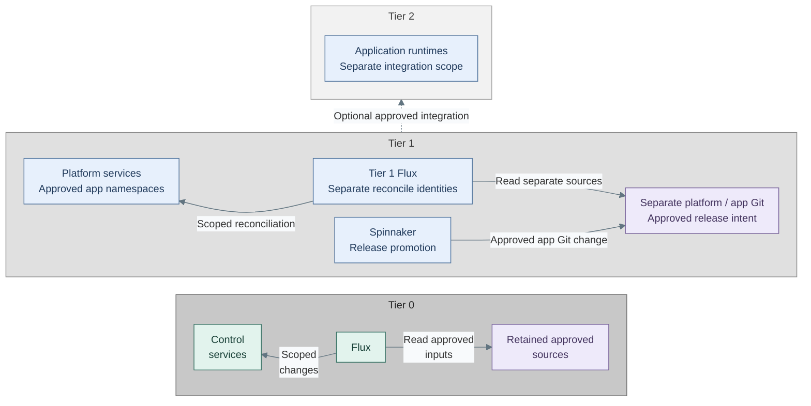

# Delivery controller patterns

Tier 0 uses Flux for its independently recoverable control-service deployment.
Tier 1 selects independent Flux for Kubernetes services/application reconciliation and Spinnaker
for approved application Git promotion. [D-041](../../07-decisions/README.md#d-041) retains Tier 0's
boundary. Tier 2 integration remains a separate explicit scope.

## Authority and ownership

*Figure: Tier 1 Flux reads separate platform/application sources and reconciles authorized targets;
Spinnaker promotes application Git. Tier 0 Flux remains independent. The dashed Tier 2 integration
is separately approved. There is no Tier 1 release path into Tier 0.*

Flux reads the selected source revision and reconciles with its scoped identity; Spinnaker's
application approval/promotion is the separate Git change. Targets sit left of the reconciler; authoritative
source inputs sit to its right. Runtime image retrieval uses the separate artifact-supply
interface shown in the [delivery sequence](README.md#application-delivery).

Tier 1 delivery has no Tier 0 Kubernetes credentials, Proxmox credentials or
authority over infrastructure state. Infrastructure requests use the separate
[protected execution contract](../04-hosting/02-provisioning.md). Read-only source
retrieval by Tier 0 Flux does not transfer that authority to the source service.

Each Kubernetes object has one reconciler or pipeline owner. Multiple tools must
not independently control the same application resources. Tier 2 cluster lifecycle
remains distinct from scoped application deployment to that cluster.

## Table of contents

- [Authority and ownership](#authority-and-ownership)
- [Choices](#choices)
- [Selection criteria](#selection-criteria)
- [Realization](#realization)
- [References](#references)

## Choices

Tier 0 retains focused independent reconciliation. The selected Tier 1 pattern combines release
orchestration and reconciliation with separate authorities; alternatives remain explicit choices.

| Scope or option | Design role | Consequence |
| --- | --- | --- |
| Tier 0: Flux | Reconcile approved control-service definitions | Independent source credentials, decryption keys and recovery copies |
| Selected Tier 1: Flux plus Spinnaker | Flux owns platform/application resources; Spinnaker promotes application Git | [Separate sources, identities, lifecycle and recovery](flux-ownership.md); no direct application writes from Spinnaker |
| Tier 1 alternative A: Argo CD | Application-centric Kubernetes GitOps | Projects scope sources, destinations, resource kinds and application roles [1] |
| Tier 1 alternative B: direct Spinnaker | Release orchestration and direct deployment pipelines | Pipeline stages express promotion, approval and deployment actions [2] |
| Tier 2 | Application target with scoped delivery access | May consume Tier 1 delivery or a separately selected local controller |

Argo CD projects bound the approved sources, Kubernetes destinations and application roles.
Spinnaker expresses promotion, approval and deployment as pipeline stages. [1][2]
A separately selected Tier 2 controller is an alternative release writer for its objects;
it must not compete with the Tier 1 controller pictured above.

## Selection criteria

Record the selected controller, application ownership, source/revision policy,
destination credentials, RBAC/OIDC, secret handling, promotion/rollback and recovery
in the generated project's architecture record before enabling delivery.

For Argo CD, restrict projects instead of using permissive default destinations;
protect the controller namespace and privileged projects. For Spinnaker, define
account permissions and approved pipeline actions; pipeline approval is not a
replacement for target authorization. [1][2]

## Realization

[Stage 7](../../03-deployment/stage-07-delivery/README.md) provisions the platform runtime
and selects [Flux ownership](flux-ownership.md) with
[Spinnaker promotion](../../03-deployment/stage-07-delivery/step-2b-spinnaker.md).
[Argo CD](../../03-deployment/stage-07-delivery/step-2a-argocd.md) and direct Spinnaker remain
alternatives; existing installations require explicit adoption and one writer per resource.
[Cluster foundation](../../03-deployment/stage-04-kubernetes/procedures/kubernetes.md#cluster-foundation)
defines shared readiness gates. Native installation does not replace controller
commissioning, scoped destination approval or recovery qualification.
The supplied [Argo CD projects](../../../tier-1/ansible/roles/delivery_platform/templates/argocd-projects.yml.j2)
permit selected local Tier 1 namespaces; Tier 2 destinations require separately approved integration.
The [Flux configuration](../../../shared/ansible/roles/cluster_platform/templates/flux.yml.j2)
uses its own selected source revision and decryption credentials.
[Development platform](03-development-platform.md) separates these application controllers
from the later GitLab/runner installation and opt-in trusted infrastructure CI.

## References

1. [Argo CD projects](https://argo-cd.readthedocs.io/en/stable/user-guide/projects/).
2. [Spinnaker pipelines](https://spinnaker.io/docs/concepts/pipelines/).
