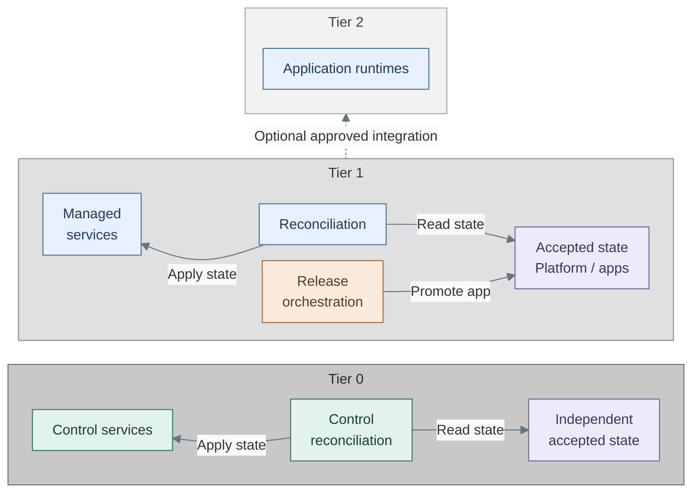
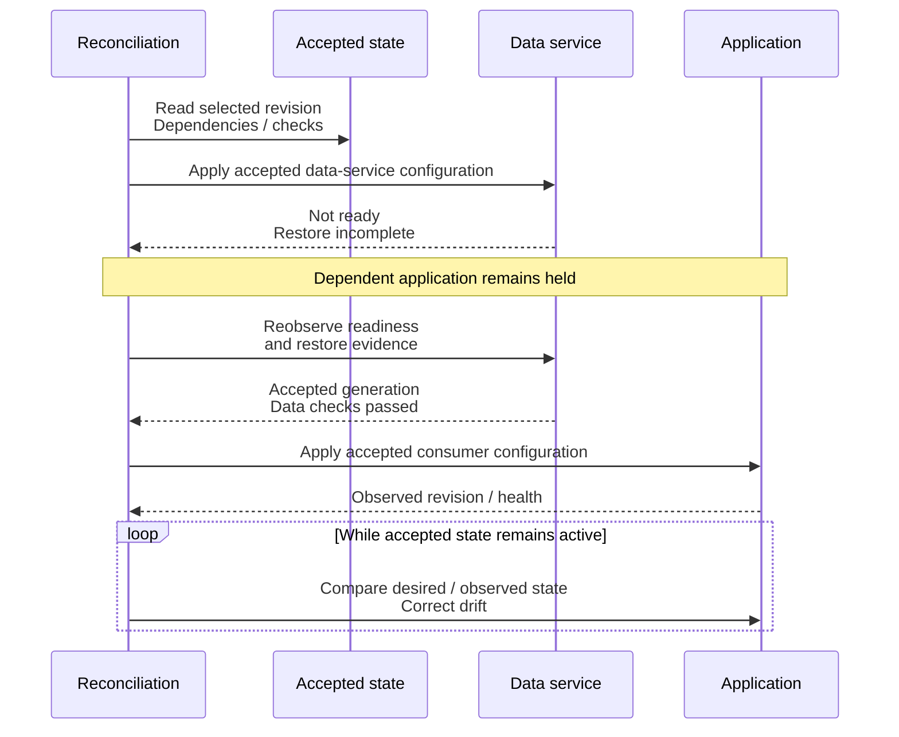

# Release orchestration and reconciliation

Delivery must answer two questions: which release may advance, and how the running system stays
aligned with that accepted choice. Separate these responsibilities and their authority.

*Figure: Release orchestration advances application intent. Reconciliation reads that intent and
controls its authorized resources. Platform and application state have separate write permissions;
Tier 0 retains independent reconciliation and recovery. The boxes are logical roles, not products.*

## Contents

- [Responsibilities](#responsibilities)
- [Dependency ordering](#dependency-ordering)
- [Failure and recovery](#failure-and-recovery)
- [Selection criteria](#selection-criteria)
- [Realization](#realization)

## Responsibilities

| Capability | Responsibility | Authority boundary |
| --- | --- | --- |
| Release orchestration | Coordinate a release request, policy/evidence checks, required approval, promotion and outcome verification | Submit only the accepted application change; no infrastructure or platform administration |
| Desired-state reconciliation | Observe accepted state, compare it with runtime state, apply scoped changes and correct drift continuously | One active owner per resource; separate platform and application identities |
| Dependency ordering | Hold a component until declared prerequisites and lifecycle checks are ready | Operates within the reconciliation scope; readiness does not authorize a release |
| Change authorization | Bind an authenticated decision to the exact artifact, configuration, destination and proposed change | The credential holder rejects unapproved or changed operations, including direct API calls |
| Infrastructure lifecycle and bootstrap | Provision hosts/clusters and establish the minimum reconciliation runtime | Independent protected execution and recovery authority |

These are responsibilities, not a requirement for five services. A product may implement several
roles if their permissions and guarantees remain enforceable. The selected design uses accepted
state as the handoff: the release workflow publishes intent, and the reconciler owns runtime writes.
The [release sequence](README.md#application-delivery) shows that handoff;
[approval controls](04-approval-controls.md) define which changes may cross it.

## Dependency ordering

Continuous reconciliation includes dependency coordination: controllers must exist before their
custom resources, storage before databases, and restored compatible data before application writers.
File order alone establishes none of those conditions.

*Figure: Dependency gates delay consumers until their prerequisites satisfy the declared checks.
The loop maintains accepted state; it does not choose a new release or substitute for native data recovery.*

This is **desired-state reconciliation with dependency ordering**. Release orchestration coordinates
the wider release workflow, which may include human decisions, tests and promotion between targets.
Neither function's successful status alone proves end-to-end service availability.

## Failure and recovery

- A rejected or changed proposal must not advance accepted state. An unavailable approval service
  cannot grant access to the publication or target credentials.
- An unavailable source or release portal must not authorize destruction of running workloads.
  Reconciliation reports a blocked condition and retains the last accepted intent.
- Maintenance pauses the actual reconciliation graph, drains in-flight work and controls application
  writers. It preserves unrelated scopes and intentional pauses before controlled resumption.
- Recovery uses independently retained state, artifacts, keys and native data backups. Restore
  prerequisites before consumers, fence stale executions, verify data, then resume accepted state.

Tier 1 delivery holds no Tier 0 runtime credentials or infrastructure state authority.
[Infrastructure execution](../04-hosting/02-provisioning.md) and
[recovery](../11-operations/04-backup-recovery.md) retain their own protected paths.

## Selection criteria

Select products against the responsibilities above: scoped identities, authenticated approval,
immutable artifact/configuration identity, exact revision reporting, dependency/health gates,
controlled pause/resume, drift correction and independent recovery. Record administrative bypasses
and edition/version limits. A product name or pipeline diagram proves none of those controls.

For another deployment model, a pipeline can own runtime writes directly. That changes the ownership
contract: another reconciler must not compete for the same objects. A local controller in another
tier is likewise an explicit scope selection, not an inherited permission grant.

## Realization

[D-041](../../07-decisions/README.md#d-041) records the selected product composition.
The [Tier 1 implementation](../../08-reference/tier-1-delivery.md) maps each product to these roles;
its [approval profile](../../08-reference/spinnaker-approval.md) records exact native behavior and enforcement.
Follow [Stage 7](../../03-deployment/stage-07-delivery/README.md) to deploy it and
[delivery operations](../../05-operations/05-delivery.md) to maintain it.
