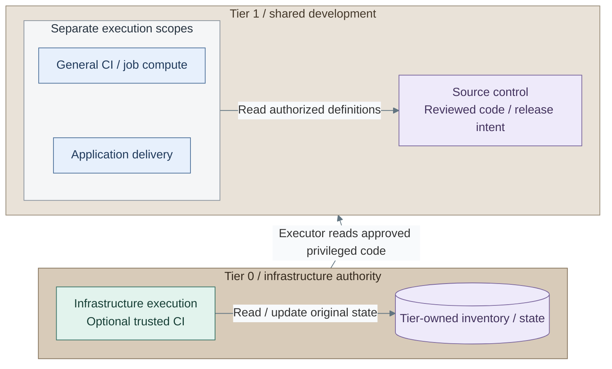
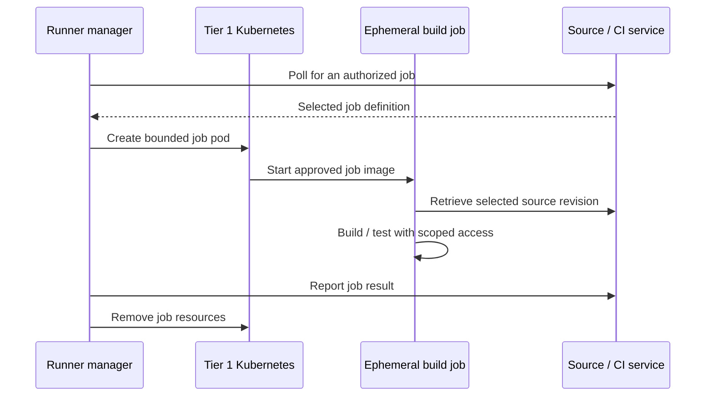

# Development platform

Source control owns reviewed code and coordinates CI. Application delivery owns
release/reconciliation. Infrastructure execution owns credentials and state.
These are distinct functions even when one product exposes several interfaces.

## Contents

- [Service arrangement](#service-arrangement)
- [Build-job communication](#build-job-communication)
- [Privileged CI](#privileged-ci)
- [Identity and secrets](#identity-and-secrets)
- [Failure and recovery](#failure-and-recovery)
- [Realization](#realization)

## Service arrangement

*Figure: General CI and delivery read source control to their right without acquiring infrastructure state.
The upward boundary link is the Tier 0 executor's approved-code read from that source service; its original
inventory and state remain within Tier 0.*

The reference source service is GitLab in Tier 1 Kubernetes. It consumes dedicated
Tier 1 database, cache and repository VMs plus scoped object storage. Tier 1 owns
the application and its data; the storage owner retains object-storage administration.
The VM-hosted source-control variant satisfies the same service and recovery boundaries.

General CI uses a Tier 1 runner manager and ephemeral job pods. Application delivery
uses the separately selected Argo CD or Spinnaker controller; Tier 0 keeps Flux and
its independently recoverable source trust and bootstrap keys. Their release behavior
is explained in [controller patterns](02-controllers.md), rather than repeated here.

Infrastructure CI uses a separate Tier 0 runner VM with original tier-local inventory
and state. Its direct trusted CI path is an explicit opt-in described below.
Tier 2 lab environments receive allocated runtime and tenant access without hypervisor,
Talos administrator or infrastructure-state access.

A Kubernetes runner provisions job pods, not an isolated Kubernetes cluster per
job. The supplied runner uses the Tier 1 Services cluster; its namespace and
non-privileged job settings do not reserve isolated build nodes. Worker capacity,
build-node isolation and cluster lifecycle remain separate concerns. Untrusted
builds require the [isolated execution boundary](../04-hosting/03-kubernetes.md#scheduling-and-capacity),
not merely this runner installation. A source-control deployment is not a provisioning service.

## Build-job communication

The runner manager controls job-pod lifecycle. The job receives only its selected
source and artifact access; the manager's Kubernetes permissions are not job credentials.

*Figure: A manager polls for work and creates a bounded job pod, then reports the result
and cleans up. Each job is a pod within the accepted cluster, not a new isolated cluster.*

The supplied [runner values](../../../tier-1/ansible/roles/development_platform/templates/runner-values.yml.j2)
and [access policy](../../../tier-1/ansible/roles/development_platform/templates/runner-support.yml.j2)
separate manager access from job access. The Podman runner alternative changes job placement;
it does not grant infrastructure credentials. Image-based Linux is a further image-lifecycle
choice after accepting the selected build runtime.

## Privileged CI

The selected reference offers **direct trusted CI** as an explicit opt-in.
The dedicated infrastructure project can execute reviewed IaC and read bounded
credentials through Vault. Its maintainers, GitLab administrators and anyone able
to alter GitLab's signing keys, runtime, storage or backups are Tier 0 trusted
principals. Tier 1 runtime placement does not make those administrators lower-trust.
Separating the project from general builds does not remove this transitive trust.

This changes the stricter independently authorized request pattern: branch
protection, a runner tag and JWT claim checks do not protect Tier 0 from a compromised
trusted GitLab control plane. The opt-in must be recorded and reviewed when access,
hosting or organizational ownership changes. Use a separately authorizing executor
instead when Tier 1 administrators must not hold that trust.

Ordinary CI, Argo CD and Spinnaker never receive infrastructure credentials.
Future lab users submit bounded request data to a trusted dispatcher; their code,
Terraform/providers, hooks and job definitions are not executed on the privileged runner.

## Identity and secrets

Keycloak provides normal human SSO; each service owns permission mappings and
independent emergency access. GitLab job ID tokens are a separate workload issuer.
Vault binds exact project/namespace, protected branch, audience and optionally
runner source addresses before granting one secret-read scope.
Short-lived Vault tokens do not make a static backend credential short-lived.

## Failure and recovery

Normal hosted changes may pause if GitLab, Vault or SSO is unavailable. Existing
infrastructure must keep running, and Tier 0 can recover from independent retained
code, artifacts, original state and credentials.
The reference bootstrap executor is a Tier 0 management VM hosted on Proxmox.
It is outside Kubernetes, but cannot be the only recovery environment for its
own hypervisor or storage. Independently retained backups, tools and credentials
must support restoration on an available recovery host. A protected workstation
is an alternative executor; neither placement alone establishes offline custody.
The [bootstrap recovery contract](../../05-operations/06-resilience/recovery/bootstrap.md)
owns that independence.

## Realization

[Delivery](../../03-deployment/stage-7-delivery/README.md) selects the Tier 1 controller.
[Development platform](../../03-deployment/stage-9-development/README.md) installs
GitLab/general runners and configures the direct-CI handover.
[Lab environments](../../03-deployment/stage-10-lab-environments/README.md) consume the accepted
platform without granting users its infrastructure authority.
The [GitLab values](../../../tier-1/ansible/roles/development_platform/templates/gitlab-values.yml.j2)
define the Kubernetes application's data interfaces; the deployment guide owns the VM alternative
and joint recovery acceptance. [Development operations](../../05-operations/05-delivery.md)
owns recurring access, maintenance and recovery work.
