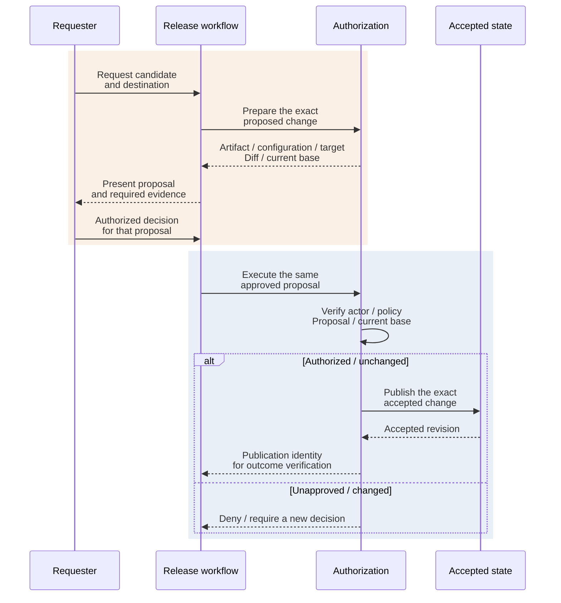

# Release authorization

An approved release identifies one artifact, configuration revision and destination. The component
holding publication or deployment credentials must enforce that decision, including requests made
outside the normal user interface.

*Figure: Authorization is enforced where the write credential is held. The requester may also be an
approver if policy permits role overlap; this view does not claim two-person approval. Reconciliation
and service checks establish the release outcome after publication.*

## Contents

- [Authority and bypasses](#authority-and-bypasses)
- [Approval binding](#approval-binding)
- [Required denial tests](#required-denial-tests)
- [Selected implementation](#selected-implementation)

## Authority and bypasses

| Role | Allowed responsibility | Boundary |
| --- | --- | --- |
| Requester | Propose a candidate and view evidence | No write credential or unrestricted privileged execution |
| Approver | Authorize or reject the presented operation | Required role is checked against authenticated identity |
| Release workflow | Coordinate policy, decisions, promotion and verification | Changing workflow context or restarting a stage cannot create approval authority |
| Credential holder | Publish or apply only the authorized change | Rechecks the actual decision and exact operation before writing |
| Runtime reconciler | Maintain accepted resources with scoped credentials | Cannot approve a different candidate or widen its own permissions |
| Administrator / recovery operator | Repair policy, identities, sources or infrastructure | Explicit privileged bypass with independently retained evidence |

The credential holder is a security boundary, not necessarily a separate product or network service.
Use native enforcement where it supplies these guarantees; isolate enforcement when a workflow's
execution permissions also allow arbitrary privileged actions.

## Approval binding

The decision covers the artifact identity, configuration revision, destination, proposed change,
execution identity and current accepted base. A changed payload, expired decision or changed base
requires a new decision. A retry may observe the same completed publication; it cannot reuse
approval to publish another change.

Separate application promotion from platform and infrastructure authority. Source access and branch
protection must enforce this boundary as well as runtime permissions. Credentials stay outside
requester-controlled execution, and caller-supplied identities cannot replace authenticated actors.

One authorized judgment is the minimum selected policy. Requiring distinct approvers, preventing
self-approval or providing immutable evidence needs explicit additional controls. Administrative
authority remains capable of changing the gate; record who holds it and how recovery is audited.

## Required denial tests

| Attempt | Required result |
| --- | --- |
| Direct execution, skipped decision, stage restart or forged actor | No write without the actual authorized decision |
| Change artifact, configuration, destination, diff or accepted base | Denied; obtain a new decision |
| Replay approval for another execution or superseded release | Denied; only the same completed result may be observed |
| Submit arbitrary privileged work or select another identity | Cannot acquire the write credential or wider target access |
| Authorized unchanged proposal | Only the exact accepted revision reaches the permitted target |

These are acceptance requirements. UI restrictions, rendered manifests and mocked API responses
do not establish live enforcement.

## Selected implementation

The [selected approval profile](../../08-reference/spinnaker-approval.md) records the product roles,
native API/version findings, enforcement mechanism, edition limits and implementation tests.
[D-041](../../07-decisions/README.md#d-041) records that selection.
The [logical delivery design](02-controllers.md) remains the contract when products change.
