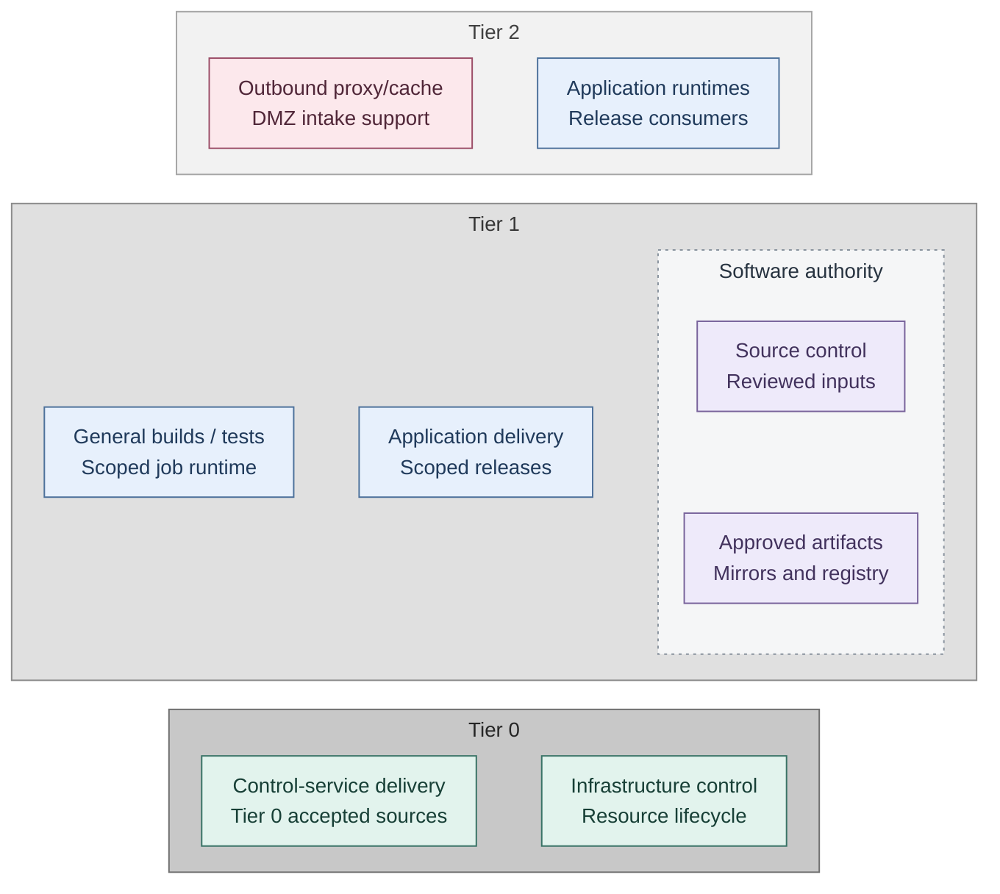
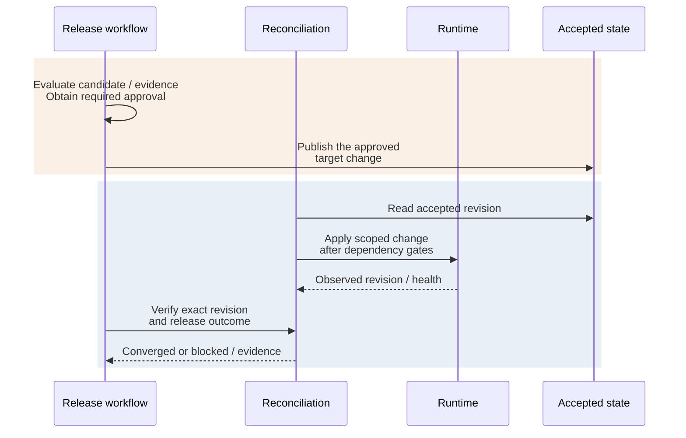

# Delivery and software lifecycle

Software passes through controlled intake, reviewed source, builds, approved artifacts
and scoped release delivery. These functions have different owners and can use different
tools; a downloaded package or successful build alone is not release approval.

## Completed design

The view places lifecycle functions by ownership. Source authority and approved
artifact supply sit to the right of their build/deployment consumers. These are
stable capabilities, not a pipeline execution order or an installed-service inventory.

*Figure: Builds and release delivery consume source and artifact authorities in Tier 1.
Tier 0 retains separate control-service delivery and infrastructure authority; this is a placement map.*

Read the Tier 1 row as cooperating services. Source control retains reviewed definitions;
build jobs read those definitions and publish versioned candidates. A delivery controller
separates release decisions from continuous reconciliation of authorized targets.
The sequence below follows those handoffs rather than the map's placement order.

Tier 0 separately accepts sources; source access does not transfer control authority.
Retained code, artifacts, keys and recovery remain usable without hosted Tier 1 services.

The cache is an intake support function. Its actual request/response paths are in
[software intake](../07-software-intake/README.md); public edge load balancing is not a software
lifecycle component. Infrastructure control marks the separate protected authority for
infrastructure changes, not an installed self-service request API.

## Contents

- [Completed design](#completed-design)
- [Application delivery](#application-delivery)
- [Components and interfaces](#components-and-interfaces)
- [Design choices](#design-choices)
- [Design constraints](#design-constraints)
- [Realization](#realization)

## Application delivery

This sequence shows the handoffs between reviewed definitions, build outputs and an
existing runtime. Release orchestration coordinates the decision to advance a candidate;
reconciliation makes the accepted state real and maintains it.

*Figure: Release orchestration authorizes a candidate produced by the build process; reconciliation
applies and maintains the accepted state. The runtime retrieves its identified artifact through
[artifact supply](01-artifact-supply.md). Release acceptance checks application behavior beyond controller health.*

## Components and interfaces

The handoffs carry different kinds of authority. Intake admits external packages and artifacts;
source review accepts definitions; a build produces a candidate; release policy authorizes a
particular version for a particular target. Registry storage and a successful build do not
collapse those decisions into one approval.

The runtime retrieves the identified artifact from its approved supply path. The reconciler
uses target credentials to apply the accepted state and observe rollout status. Operators use that
status, service telemetry and recovery evidence to decide whether the release is acceptable.
Application rollback still needs the application's own data compatibility contract.

Application traffic follows [Networking](../05-networking/README.md#service-reachability-and-publication),
not the release pipeline. A new base template does not update existing VMs; workload
maintenance and hardware-facing provisioning remain separate operations.
Infrastructure changes belong to [Hosting](../04-hosting/02-provisioning.md).

## Design choices

Separate [release orchestration and desired-state reconciliation](02-controllers.md). The first
coordinates requests, evidence, approval and promotion. The second continuously corrects drift,
orders components by dependency readiness and reports the result. One suite or several products
can implement these roles; each managed object still has one active writer.
[Approval controls](04-approval-controls.md) define the authority and immutable change boundary.

Then select [artifact supply](01-artifact-supply.md): an existing compatible registry or
an independently operated registry, with distribution acceleration only where justified.
The [software-intake design](../07-software-intake/README.md) owns external acceptance and
retained upstream content; this chapter adds builds and release delivery to that supply path.

Kubernetes build pods and external VM runners are placements of build execution,
not interchangeable network grants. [Development platform](03-development-platform.md)
explains their isolation and the privileged infrastructure-project trust exception.

## Design constraints

Each target retains one authorized release writer, scoped credentials and its own
data/rollback contract. General CI cannot administer Tier 0. Tier 0 retains accepted
code, artifacts, credentials and state independently of hosted source control.
An unavailable portal or repository must not authorize workload destruction.

## Realization

Stage 7 establishes delivery using an existing bootstrap source and approved artifacts.
Stage 9 adds hosted source control and general CI; delivery must therefore work before the
new GitLab service exists. Observability is established between those deployment stages.

**Deploy:** [Stage 7: Delivery](../../03-deployment/stage-07-delivery/README.md), then follow
its onward path through Observability to [Stage 9: Development](../../03-deployment/stage-09-development/README.md).
**Operate:** [Delivery and development](../../05-operations/05-delivery.md).
The [support map](../../08-reference/implementation-support.md) distinguishes supplied installers
from required existing interfaces and project integrations.
The [selected delivery implementation](../../08-reference/tier-1-delivery.md) maps these architectural
roles to the chosen products, their configuration and verification limits.
