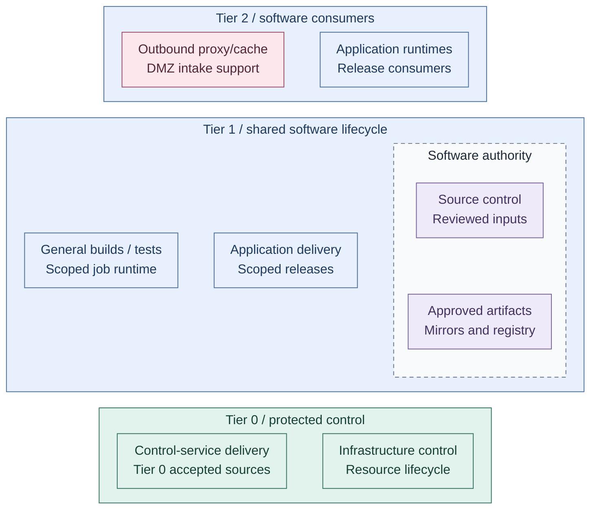
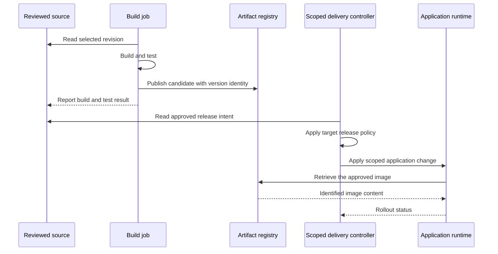

# Delivery and software lifecycle

Software passes through controlled intake, reviewed source, builds, approved artifacts
and scoped release delivery. These functions have different owners and can use different
tools; a downloaded package or successful build alone is not release approval.

Read this before choosing the [delivery controller](02-controllers.md) or
[development platform](03-development-platform.md). [Software intake](../07-software-intake/README.md)
owns external package/artifact acceptance; [Hosting](../04-hosting/02-provisioning.md)
owns infrastructure changes rather than ordinary application releases.

## Contents

- [Completed design](#completed-design)
- [Application delivery](#application-delivery)
- [Components and interfaces](#components-and-interfaces)
- [Design choices](#design-choices)
- [Design constraints](#design-constraints)
- [Realization](#realization)

## Completed design

The view places lifecycle functions by ownership. Source authority and approved
artifact supply sit to the right of their build/deployment consumers. These are
stable capabilities, not a pipeline execution order or an installed-service inventory.

*Figure: Software intake, source, builds and delivery occupy distinct ownership and protection boundaries.*

**Architecture:** this view shows placement and authority. The
[controller design](02-controllers.md) shows approved-input and scoped-change flows.
Tier 0 separately accepts sources; source access does not transfer control authority.
Retained code, artifacts, keys and recovery remain usable without hosted Tier 1 services.

The cache is an intake support function. Its actual request/response paths are in
[software intake](../07-software-intake/README.md); public edge load balancing is not a software
lifecycle component. Infrastructure control marks the separate protected authority for
infrastructure changes, not an installed self-service request API.

## Application delivery

This sequence shows the handoffs between reviewed definitions, build outputs and an
existing runtime. The selected release policy decides what is approved; exact triggers
depend on GitOps reconciliation or pipeline orchestration.

*Figure: Builds publish candidates; approved release intent drives scoped deployment,
and the runtime retrieves the selected artifact independently of the controller.*

## Components and interfaces

- [Software intake](../07-software-intake/README.md) admits approved external sources and retained content.
- [Development platform](03-development-platform.md) retains source and executes general build jobs.
- [Artifact supply](01-artifact-supply.md) identifies and retains versions for authorized consumers.
- [Delivery controllers](02-controllers.md) apply accepted application releases within the target's scope.
- [Operations](../11-operations/README.md) supplies rollout findings and recovery evidence.

Application traffic follows [Networking](../05-networking/README.md#service-reachability-and-publication),
not the release pipeline. A new base template does not update existing VMs; workload
maintenance and hardware-facing provisioning remain separate operations.

## Design choices

Choose the controller in [controller patterns](02-controllers.md): Tier 0 uses Flux;
Tier 1 selects Argo CD or Spinnaker. Reconciliation and release orchestration have
different triggers, ownership and failure behavior. Choose the registry and optional
distribution acceleration in [artifact supply](01-artifact-supply.md).

Kubernetes build pods and external VM runners are placements of build execution,
not interchangeable network grants. [Development platform](03-development-platform.md)
explains their isolation and the privileged infrastructure-project trust exception.

## Design constraints

Each target retains one authorized release writer, scoped credentials and its own
data/rollback contract. General CI cannot administer Tier 0. Tier 0 retains accepted
code, artifacts, credentials and state independently of hosted source control.
An unavailable portal or repository must not authorize workload destruction.

## Realization

**Deploy:** [Stage 7: Delivery](../../03-deployment/stage-7-delivery/README.md), then
[Stage 9: Development platform](../../03-deployment/stage-9-development/README.md).
**Operate:** [Delivery](../../05-operations/05-delivery.md) and
[Development platform](../../05-operations/05-delivery.md).
The [support map](../../08-reference/implementation-support.md) distinguishes supplied installers
from required existing interfaces and project integrations.
