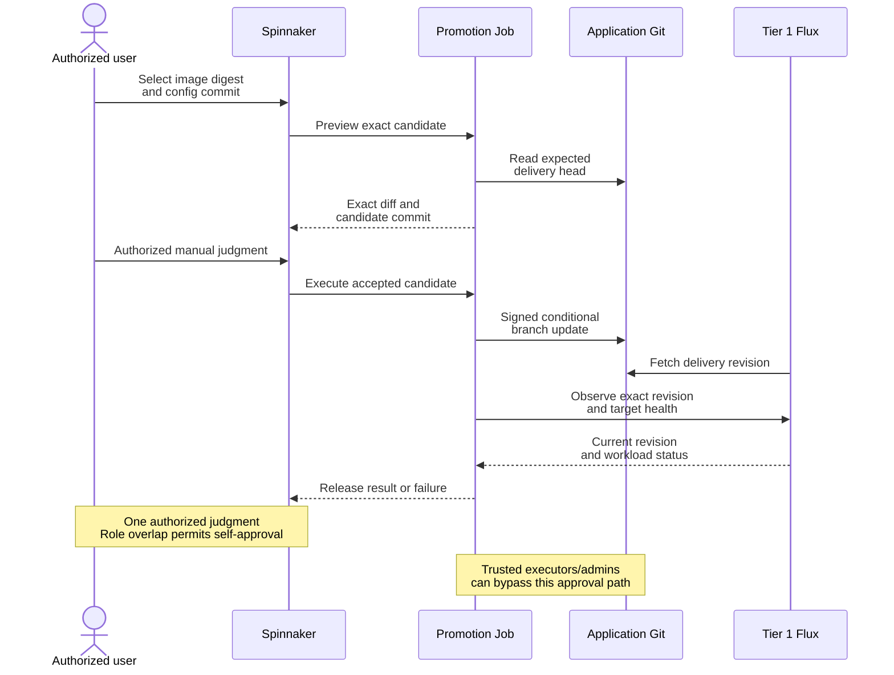

# Promotion approval controls

The selected release path uses Spinnaker Fiat authorization and manual judgment, separate GitLab CE
projects and restricted Flux identities. It requires no paid GitLab approval enforcement, commercial
Spinnaker extension or Kargo. [D-041](../../07-decisions/README.md#d-041) defines ownership.

*Figure: The reviewed pipeline binds judgment to an exact candidate and observes its deployment.
It does not make executor/API/Git administrators subject to an independent approval authority.*
[Pipeline source](../../../tier-1/pipelines/flux-promotion.yml.j2).

## Contents

- [Authority and bypasses](#authority-and-bypasses)
- [What judgment actually enforces](#what-judgment-actually-enforces)
- [Free editions and version evidence](#free-editions-and-version-evidence)
- [Required denial tests](#required-denial-tests)
- [References](#references)

## Authority and bypasses

| Actor | Authorized action | Limit or bypass to record |
| --- | --- | --- |
| Release requester | Execute a reviewed promotion pipeline with exact candidate/target parameters | Execution rights do not authorize editing pipelines or judgment membership |
| Judgment role member | Continue/stop the exact pending change presented by the pipeline | One authorized judgment; overlapping requester/approver membership permits self-approval |
| Promotion Job identity | Compare expected application head and publish the approved application change | Application project write only; no platform/bootstrap project access |
| Spinnaker Run Job account | Create/observe promotion Jobs in `delivery-promotion`; read approved application status | Cannot write application workloads, Flux objects or platform privileges |
| Pipeline/permission administrator | Import/update pipeline definitions, Fiat rules and execution identities | Can bypass/replace the gate; separate and record this privileged group |
| GitLab project/group/instance administrator | Manage protected branches, memberships, credentials and repository contents | Can grant direct writes or alter protection; CE is not immutable approval enforcement |
| Platform/recovery administrator | Advance approved source pins, suspend/resume applications, repair/reinstall Flux | Explicit independent path; retain custody receipt and operation evidence |
| Cluster/infrastructure or identity administrator | Change runtime/identities below the release gate | Can bypass controls; follow protected authority and evidence procedures |

GitLab CE branch protection uses role-based permissions. Use a dedicated bot account whose membership
is limited to the separate application project; do not grant ordinary developers its delivery-branch
write role. Disable force push and inspect overlapping protection rules. Maintainer-or-higher actors
retain administrative bypasses. Direct Git writes do not traverse Spinnaker judgment. [1][2]

The executor's permission to create Jobs in `delivery-promotion` can mount that namespace's Git/signing
credentials through an arbitrary Job. Direct Gate/API execution and pipeline restarts are therefore
trusted bypass surfaces, even with native preconditions against a skipped judgment. Record and test
this limit; the supplied controls do not constitute an independent non-bypassable approval authority.

## What judgment actually enforces

The pinned Spinnaker `2026.3.2` source revision is
`42da7f83e7db090429bfa3f2fddeff34f0b124a7`, from the
[software manifest](../../../tier-1/ansible/roles/delivery_platform/files/software.yml).
Its `ManualJudgmentStage` checks `requiredJudgmentRoles` (falling back to `selectedStageRoles`) against
the last modifying user. `ManualJudgmentAuthorization` accepts a user with any required role or a Fiat
administrator. Disabled Fiat or an empty required-role list bypasses that role check. [3][4]

Set nonempty judgment roles and keep Fiat enabled. An unauthorized judgment remains pending.
This is one authorized continuation, not distinct multiple approvers or prevention of requester
self-approval. Mutable execution/database records do not establish immutable audit evidence.
Export release/pipeline revisions, proposed diff, actor, execution ID, Git commit and reconciliation
result to the commissioned evidence destination; protection/retention is a separate custody contract.
The supported stage also requires Echo. [3][5]

## Free editions and version evidence

| Component | Evidence and scope |
| --- | --- |
| Spinnaker OSS | Pinned source's Apache-2.0 license permits internal/company use without subscription; native Fiat/manual judgment code is in that revision [3][4][6] |
| GitLab CE | MIT-licensed CE code and free protected-branch permissions; no paid approval-count, CODEOWNERS enforcement or protected-environment approval dependency [1][2][7] |
| Flux | Apache-2.0 controllers; native reconciliation/impersonation/drift settings provide the selected deployment mechanism [8] |
| Harbor / chart `1.18.0` | Harbor `2.14.0` is Apache-2.0 [9] |
| MySQL Community `8.4.11` | GPLv2 community server with the published additional permissions [10] |
| Redis `8.2.9` | Select the available AGPLv3 license for this design; retain its license/source obligations, including modified network-service use [11] |
| Envoy `1.39.5` / restic `0.19.1` | Apache-2.0 / BSD-2-Clause respectively [12][13] |

Checked 2026-11-14. Spinnaker pinned source was inspected in the local upstream checkout at that exact
revision; web retrieval of its commit URLs was unavailable. Current GitLab feature documentation was
checked online. GitLab/Flux chart versions remain exact site inputs rather than a universal kit pin:
retain each accepted chart's app version, source/license revision and branch/API denial results in the
deployment record. Do not label an unspecified site version verified. Recheck when upgrading.
The pinned supporting-product license files above were checked online on 2026-11-15. The selected
community components require no commercial subscription for the supplied functions; preserve their
actual license and redistribution/source obligations when building retained images and recovery media.

Operational costs remain: native source upgrades, chart/Job compatibility, credential rotation,
pipeline import review, CE membership/branch audits and independent evidence/backup custody.
Stronger separation of duties or immutable approval evidence requires another explicit control decision.

## Required denial tests

Test both UI and direct APIs: unauthorized judgment; execution without the role; pipeline editing;
account use; direct branch push/force-push; application-bot writes to platform/bootstrap projects;
Run Job account writes outside its namespace; application reconciliation of RBAC/CRDs/platform objects;
and obsolete direct Spinnaker tokens after adoption. Test overlapping requester/approver membership
and administrator bypasses, then record their actual limits. A template or successful UI example is
insufficient. See [live acceptance](../../03-deployment/stage-07-delivery/procedures/flux-platform.md#promotion-and-acceptance).

## References

1. [GitLab branch protection permissions](https://docs.gitlab.com/user/project/repository/branches/protection_rules/).
2. [GitLab merge request approvals and Free limitations](https://docs.gitlab.com/user/project/merge_requests/approvals/).
3. [Pinned ManualJudgmentStage source](https://github.com/spinnaker/spinnaker/blob/42da7f83e7db090429bfa3f2fddeff34f0b124a7/orca/orca-echo/src/main/groovy/com/netflix/spinnaker/orca/echo/pipeline/ManualJudgmentStage.groovy).
4. [Pinned ManualJudgmentAuthorization source](https://github.com/spinnaker/spinnaker/blob/42da7f83e7db090429bfa3f2fddeff34f0b124a7/orca/orca-echo/src/main/java/com/netflix/spinnaker/orca/echo/util/ManualJudgmentAuthorization.java).
5. [Spinnaker manual judgment stage](https://spinnaker.io/docs/reference/pipeline/stages/#manual-judgment).
6. [Pinned Spinnaker Apache-2.0 license](https://github.com/spinnaker/spinnaker/blob/42da7f83e7db090429bfa3f2fddeff34f0b124a7/LICENSE).
7. [GitLab CE license](https://gitlab.com/gitlab-org/gitlab-foss/-/blob/master/LICENSE).
8. [Flux license](https://github.com/fluxcd/flux2/blob/main/LICENSE) and [HelmRelease permissions/drift](https://fluxcd.io/flux/components/helm/helmreleases/).
9. [Harbor 2.14.0 license](https://github.com/goharbor/harbor/blob/v2.14.0/LICENSE).
10. [MySQL Community 8.4.11 license](https://github.com/mysql/mysql-server/blob/mysql-8.4.11/LICENSE).
11. [Redis 8.2.9 license options](https://github.com/redis/redis/blob/8.2.9/LICENSE.txt).
12. [Envoy 1.39.5 license](https://github.com/envoyproxy/envoy/blob/v1.39.5/LICENSE).
13. [restic 0.19.1 license](https://github.com/restic/restic/blob/v0.19.1/LICENSE).
