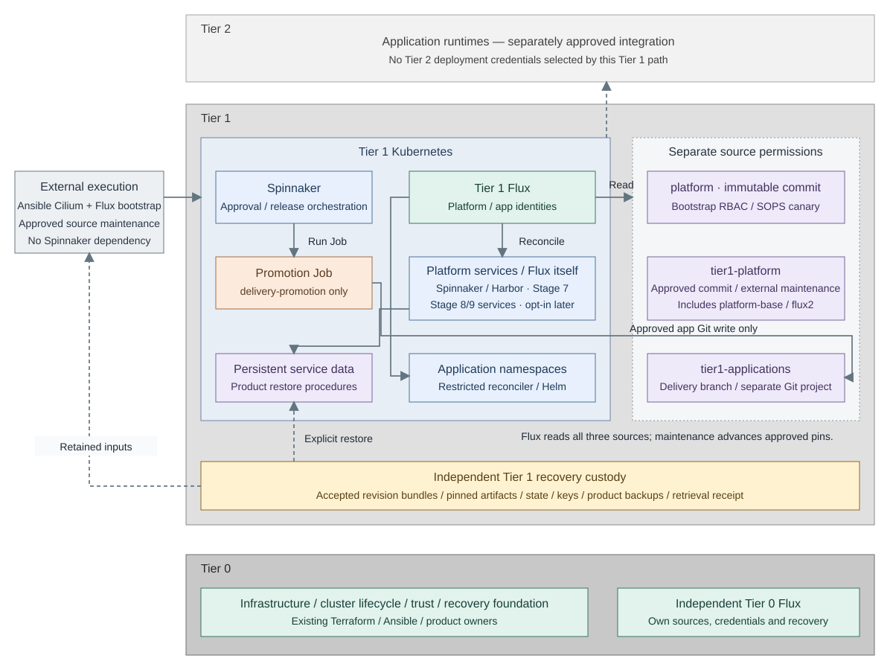

# Tier 1 Flux ownership

Tier 1 selects independent Flux reconciliation for Kubernetes platform services and application
deployment. Spinnaker approves and promotes application release intent. Infrastructure lifecycle and
product data recovery keep their existing owners. [D-041](../../07-decisions/README.md#d-041) records
this choice; adoption and live acceptance are separate from accepting the design.

*Figure: Selected ownership and control flow. Solid arrows name operations; dashed arrows show
independent recovery inputs or the unselected Tier 2 integration. Tier 0 keeps separate Flux,
credentials and recovery. Stage 8/9 services are later, explicit selections.*
[Editable SVG and render record](../../08-reference/diagrams/tier1-flux-ownership-render.md).
[Cluster bootstrap](../../../shared/ansible/roles/cluster_platform),
[native delivery renderer](../../../tier-1/ansible/roles/delivery_platform), and
[project-owned cluster configuration](../../../tier-1/clusters/tier1) implement the selected boundary.
This is an architecture view, not a live deployment inventory or acceptance record.

## Contents

- [Owners](#owners)
- [Three source contracts](#three-source-contracts)
- [Reconciliation and service lifecycle](#reconciliation-and-service-lifecycle)
- [Promotion authority](#promotion-authority)
- [Maintenance and recovery](#maintenance-and-recovery)
- [Alternatives and qualification](#alternatives-and-qualification)
- [References](#references)

## Owners

| Scope | Ongoing owner |
| --- | --- |
| Proxmox, VMs, cluster lifecycle and services outside Kubernetes | Existing Terraform/Ansible and product owners |
| Minimum networking, trust, source credentials, decryption material and initial Flux installation | Ansible bootstrap |
| All selected Tier 1 Kubernetes platform components, including Cilium and Flux after bootstrap | Tier 1 Flux, using platform-approved configuration |
| Release requests, manual judgment and application promotion orchestration | Spinnaker |
| Application resources and drift correction in approved namespaces | Flux with restricted application reconciliation |
| Persistent service contents and compatibility after migrations | Product-specific backup/restore owners |

Ansible role defaults remain `ansible` for compatibility. Fresh Tier 1 inputs explicitly select
`cluster_platform_management: flux` and `cluster_platform_tier: 1`. Initial Cilium and Flux are
bootstrap prerequisites; storage CSI, cert-manager, ingress, CloudNativePG, optional Barman plugin
and their configuration move to Flux. Cilium and Flux themselves have one post-bootstrap Flux owner.
Tier 1 node security collectors retain early Talos patch preparation, then publish their retained
per-node chart identities and credentials through `platform/security-logging` under the same Flux owner.
The initial Helm release is `flux2` in `flux-system`; its self-management HelmRelease
`platform-base-flux2` lives in `flux-system`, rendered under `platform/base`. Its `releaseName`
remains `flux2`, with target/storage namespace `flux-system`. The child health Kustomization is
`platform-base-flux2-release`. Ansible stops upgrading that release after adoption.

## Three source contracts

| Flux source | Revision and contents | Who can advance it |
| --- | --- | --- |
| `platform` | Exact immutable bootstrap commit; `./clusters/tier1/bootstrap`; RBAC and SOPS canary only | External authorized bootstrap/recovery maintenance |
| `tier1-platform` | Separate exact approved commit; platform dependencies, Flux2 self-management and selected services | External authorized platform maintenance, independently of Spinnaker |
| `tier1-applications` | Protected delivery branch in an entirely separate application Git project | Restricted promotion identity after approval; platform/recovery administrators retain bypass authority |

Bootstrap contains no moving source refs and no duplicate Flux HelmRelease. Source refs and accepted
bootstrap/platform revisions are managed externally. An immutable bootstrap pin does not follow new
commits: platform maintenance must explicitly advance `tier1-platform`, then observe that exact revision.
The application writer has no membership, deploy key or token granting platform/bootstrap project writes.
Directory separation in one GitLab CE project cannot provide this boundary. [1]

Platform HelmRelease objects live in `flux-system`; preserve each original `releaseName`,
`targetNamespace` and `storageNamespace`. The platform `platform-reconciler` ServiceAccount lives in
`flux-system`. `application-reconciler` receives only the approved application namespace permissions;
application HelmReleases live in those namespaces and use restricted reconciliation identities.
An application source must never supply platform RBAC, namespaces, CRDs, source credentials or Flux
controller configuration. Explicit impersonation is required for Kustomizations and HelmReleases. [2][3]

## Reconciliation and service lifecycle

Use pinned native HelmRelease definitions for chart-managed products and Flux Kustomizations for
maintained manifests. Existing pinned native renderers produce reviewable service payloads; empty
`clusters/` starters are not installers. Generated SOPS exports carry encrypted Secrets, while public
configuration contains no plaintext values, private certificates, tokens or Helm release secrets.

Controller readiness precedes custom resources; Secrets/certificates and persistent data readiness
precede consumers. Use `dependsOn`, workload health and Job completion gates, not file-list order.
Helm drift correction is explicitly `enabled`. Pruning is disabled for sensitive namespace/storage
boundaries; retained PVs/PVCs and Helm retention settings require their own deletion review. [2][3]

Spinnaker retains its full lifecycle: backup repository validation/commissioning, stable credentials,
ten leaf identities, SQL and Redis persistence, schema provisioning, restricted access, verified first
backup, service readiness, then ingress publication. Declarative phases and bounded versioned Jobs
replace imperative staging. Completion, finite retries and approved re-execution must be reviewed;
routine reconcile must not rotate credentials, repeat initialization or restore old data. Fresh install,
schema upgrade and data restore are distinct operations. Git rollback does not reverse a migration.

Harbor remains Stage 7. Observability, including its controllers and backup configuration, remains
opt-in Stage 8. GitLab CE and general Kubernetes runners remain opt-in Stage 9; external GitLab data
VMs retain their existing owner. Rancher remains unselected and has no supplied installer. A future
selection would put its Kubernetes installation under Flux while keeping cluster management distinct
and preventing another deployment controller from writing Flux-owned objects.

## Promotion authority

Spinnaker's Flux orchestration account runs promotion Jobs only in `delivery-promotion` and observes
approved application resources read-only. It cannot deploy application workloads, alter Flux/platform
objects or write bootstrap/platform Git. The Job's Git identity can write only the application project.
Existing direct-deploy RoleBindings and token Secrets must be explicitly revoked during adoption.

An approved execution binds the exact image digest, configuration revision, target and Git change.
After judgment, the worker checks the expected application branch head and publishes the approved
change, then waits for the exact Flux source/Kustomization revision and relevant workload or
HelmRelease health. A push or unrelated Ready status is insufficient. Concurrency conflicts fail or
require a new approval; retries reuse release identity, and superseded revisions cannot report success.
Rollback is another approved application Git change, subject to data compatibility.

Pipeline definitions and stable identifiers are versioned and imported repeatably through Spinnaker's
API. Flux managing Spinnaker pods does not reconcile its application database or pipeline definitions.
See [promotion operation and acceptance](../../03-deployment/stage-07-delivery/procedures/flux-platform.md#promotion-and-acceptance).

## Maintenance and recovery

External maintenance owns source advancement, application suspend/resume and accepted-revision custody
receipts/bundles. Before advancing a source, retain an independently accessible approved configuration
bundle, pinned charts/images, original Terraform state, credentials, SOPS decryption material and
product backups. Record revision/digest, custody destination, custodian and a retrieval check.
The accepted recovery copy must advance with approved configuration; a presumed mirror is insufficient.

Restore Tier 0 prerequisites first after total VM/cluster loss with Proxmox intact. Then rebuild Tier 1
through existing infrastructure automation, bootstrap from independent supply, reconcile dependencies,
restore product data explicitly and verify services before resuming applications, webhooks or runners.
GitLab, Harbor, Spinnaker and ordinary runners cannot be prerequisites for restoring themselves.
See [Tier 1 recovery](../../05-operations/06-resilience/recovery/tier-1-products.md#rebuild-tier-1-without-its-services).

## Alternatives and qualification

[Argo CD](../../03-deployment/stage-07-delivery/step-2a-argocd.md) and explicitly selected direct
Spinnaker deployment remain supported alternatives. Existing downstream inputs and project-owned
cluster/CI content are preserved; refresh never transfers live ownership. Each object has one writer.
Tier 0 Flux is never reused; Tier 2 integration is a separate approved scope. Kargo is excluded.
Flagger/Rollouts progressive delivery requires a separate decision.

The selected controls use free self-hostable components; their permissions, bypasses and version-specific
limits are recorded in [the approval contract](approval-controls.md). Maintaining two independently
recoverable Flux installations, encrypted exports, native renderer compatibility, ordered lifecycle Jobs,
pipeline imports and independent custody is an ongoing operating cost. Rendering/tests establish
structure, not live fresh install, adoption, authorization, upgrade or disaster recovery qualification.

## References

Primary documentation checked 2026-11-14; exact software pins remain in the owning inputs/manifests.

1. [GitLab protected branch permissions](https://docs.gitlab.com/user/project/repository/branches/protection_rules/).
2. [Flux Kustomizations: dependencies, impersonation, decryption and deletion](https://fluxcd.io/flux/components/kustomize/kustomizations/).
3. [Flux HelmReleases: identity, dependencies, permissions and drift correction](https://fluxcd.io/flux/components/helm/helmreleases/).
