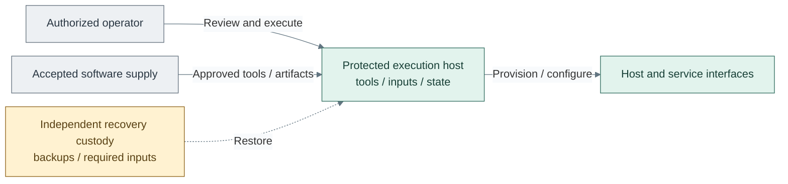

# Bootstrap and recovery execution

Bootstrap provides an independently accessible execution context for the first
infrastructure changes and later recovery. It consumes prepared host capacity,
network access and approved software; it does not depend on the platform's hosted
source control, identity or cluster services to restore those same services.

*Figure: An operator uses protected execution and accepted software to configure the platform; independent
custody supports recovery.*

The dashed recovery link is a custody and restoration relationship, not an
always-connected network route. A protected existing host can serve this role; the
reference path uses a manually created VM. Later automation can use a separately
protected runner, while original state and independent recovery inputs remain required.

| Need | Guide |
| --- | --- |
| Prepare the initial host | [Bootstrap deployment](../../03-deployment/foundation/bootstrap/README.md) |
| Review privileged execution boundaries | [Infrastructure control](03-provisioning.md#execution-contexts) |
| Restore hosts and infrastructure | [Recovery operations](../../05-operations/README.md) |
